# ticai · 体彩助手 架构说明

> 竞彩足球赔率投注 + 中国体彩开奖历史（排列5 / 七星彩 / 超级大乐透）+ 两种号码预测分析，
> 附带星座运势 / 天气，以及可选的账号、投注记录与中奖结算。
>
> **架构形态**：Next.js 16 App Router（公开页按请求 SSR + 客户端 Keep-Alive） + 独立 Node API（`apps/api`，只读库） + 本地爬虫（`apps/crawler`，写库）。
> 浏览器只与自有 API 通信（生产走同源 `/api` rewrite）；第三方密钥、提示词、上游访问全部留在服务端。
>
> 2026-10-23 起 `server/` 与 `api/` 两个旧 BFF 目录已删除，`apps/api` 是唯一服务端实现；
> 接口契约以 [docs/api.md](api.md) 为准。

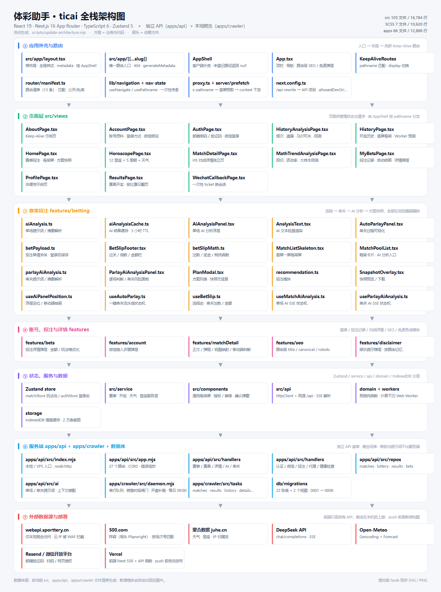

> 矢量源文件：[architecture.svg](./architecture.svg)（可直接在浏览器打开，或嵌入 PPT / 设计稿）
>
> 架构图由 [`scripts/update-architecture.mjs`](../scripts/update-architecture.mjs) 根据当前仓库文件清单自动生成；
> `pre-commit` hook 会在提交前同步 SVG / PNG，新增模块会自动出现在图中。

---

## 1. 项目速览

| 项目 | 内容 |
| --- | --- |
| 名称 / 版本 | `ticai` 0.0.0（私有） |
| 形态 | Next.js（Vercel `ticai` 项目，静态 + Serverless 函数）+ 独立 API（Vercel `ticai-service`）；生产用同源 `/api` rewrite 代理 |
| 前端规模 | 13 个页面（`src/views`）；`src` 下 97 个 TS/TSX 文件；`global.scss` + 6 个按域拆分样式 |
| 服务端规模 | `apps/api`：12 个 handler 模块、28 个接口路径（30 个处理方法）；`apps/crawler`：赛程/赛果/开奖/伤停/阵容/停售六条链路 |
| 数据层 | PostgreSQL 24 张表 + 3 个视图：API 只读，爬虫只写（`db/README.md`） |
| 构建产物 | `.next`：客户端 JS ≈ 670 KB + 143 KB CSS（gzip 后约 185 + 24 KB）+ 一个 SSR Serverless 函数 |
| 运行时 | 浏览器（ES2022+）+ Node ≥ 20（Next 服务端 / API 函数，内置 `fetch` / `AbortSignal.timeout`） |
| 依赖 | 前端：React 19、Next.js 16、Zustand 5、html2canvas、Sass；服务端仅 `pg`；爬虫可选 `playwright`（阵容） |
| 工程设施 | Git hooks（架构图、算法生成物、密钥扫描、自动部署）+ `node:test` 单测 107 个（API 64 + 爬虫 43） |
| tsconfig | `strict` **未开启**；开启 `noUnusedLocals`、`noUnusedParameters`、`erasableSyntaxOnly`、`verbatimModuleSyntax` |

### 功能地图

| 路由 | 页面 | 核心能力 | 数据来源 |
| --- | --- | --- | --- |
| `/` | 赛事投注 | 5 种玩法池、赔率勾选、串关注数/金额/最高奖金（按体彩单注限额封顶）/税、首屏骨架屏、单场与方案级 AI 分析、高清快照、保存投注 | `GET /api/matches`、`POST /api/bets` |
| `/match/:matchId` | 对战详情 | 交锋 / 伤停 / 近况 / 积分 / 阵容 / 射手 / 未来赛程 / 比赛地天气，PC 弹框与 H5 页面共用正文 | `GET /api/match-detail`、`GET /api/venue-weather` |
| `/history` | 开奖历史 | 排列五 / 七星彩 / 大乐透走势；大乐透前后区号码矩阵 + 右侧前区逐期指标（和值 / 跨度 / 奇偶比 / 大小比 / 三区比），并按近期频次与遗漏给出下期 5+2 号码参考和理由、首屏骨架屏、预测摘要 | `GET /api/history` + IndexedDB（分析结果已有服务端快照：`GET /api/analysis/lottery`） |
| `/history-analysis` | 分析页面 | 频次/遗漏/马尔可夫/滚动回测/组合推荐/冷热统计，首屏骨架屏；阶数 1–5 直接切快照，拖权重滑块时把权重作为 `w=` 参数发给服务端现算 | `GET /api/analysis/lottery?kind=prediction&order=N&w=34-20-22-14-10` |
| `/math-trend-analysis` | 数学走势 | 线性回归趋势、预测中心、波动率、大样本回测，首屏骨架屏 | `GET /api/analysis/lottery?kind=math_trend` |
| `/horoscope` | 星座运势 | 12 星座 × 5 种时间维度 + 基于 IP 的天气 | `/api/horoscope`、`/api/weather`、`/api/ip` |
| `/results` | 赛果开奖 | 按比赛日翻看比分与五个玩法的开奖结果，未开奖场次明确标注 | `GET /api/results` |
| `/login` | 登录 / 注册 | 邮箱 + 密码，或邮箱验证码（Resend；未注册邮箱直接建号，登录后引导设置密码）；可接微信扫码；登录态存 localStorage，请求带 Bearer | `/api/auth/*` |
| `/auth/wechat` | 微信回调 | 用一次性 ticket 换正式会话，失败时展示原因 | `POST /api/auth/wechat/session` |
| `/account` | 账号 | 账号资料与登录方式；「邮箱与密码」卡片（绑定邮箱 / 设置密码 / 修改密码）、绑定 / 解绑微信 | `/api/auth/identities`、`/api/auth/password`、`/api/auth/email`、`/api/auth/wechat/*` |
| `/my-bets` | 我的投注 | 保存的投注方案，按玩法分类、按赛果自动判中奖与奖金；首帧骨架屏、单注详情弹层（截图 / 回填到投注页） | `/api/bets`、`/api/bets/stats` + `/api/results` |
| `/about` | 关于页 | Keep-Alive 演示（输入框保留） | 无 |
| `/profile` | 个人页 | 不缓存演示，**不在导航中** | 无 |

---

## 2. 技术栈与运行方式

| 关注点 | 选型 |
| --- | --- |
| 视图 | React 19.2 函数组件 + Hooks，无 UI 组件库，手写语义化 class |
| 类型 | TypeScript 6.0，`import type` 风格，无 `enum` |
| 构建 | Next.js 16（Turbopack），`next build`；不再有构建时预渲染 |
| 路由 | Next App Router：`src/app/[[...slug]]/page.tsx` 是唯一入口，页面分发由 `src/router/manifest.ts` + `AppShell` 在客户端完成（Keep-Alive 需要） |
| 状态 | Zustand 5（`matchStore` / `authStore`）+ 自定义 hook（`useBetSlip`） |
| 样式 | `src/styles/global.scss`（BEM，5 552 行）+ `authBets / results / account / confirmDialog`、`features/matchDetail`、`features/betting/autoParlay` 按域拆分 |
| 计算 | 全部在 Python 分析服务（`apps/analysis`）：开奖分析 / 走势 / 大乐透推演 / 投注推荐 / 场馆天气 / AI；前端只渲染快照，权重滑块也走服务端（`w=` 参数） |
| 持久化 | IndexedDB（开奖历史）；localStorage（登录 token、AI 结果缓存、免责弹层偏好） |
| 传输 | 浏览器 `fetch('/api/*')`（默认同源，Vercel rewrite 转发到 API 项目）；API 只读库，不直连上游 |
| 截图 | html2canvas → `canvas.toDataURL('image/png')` |

### 运行方式

```bash
npm install
cp .env.example .env        # DATABASE_URL + 聚合数据 / DeepSeek 密钥

npm run dev                 # API :3001 + Next :3000（/api 走 rewrite 代理）
npm run dev:api             # 只起 API
npm run dev:web             # 只起 Next
npm run crawl:daemon        # 本地爬虫（抓上游、写云端库）

npm run build               # next build → .next（静态 + SSR 函数）
npm run web:start           # 本地跑生产产物（:3000）
```

| 环境变量 | 默认值 | 说明 |
| --- | --- | --- |
| `API_HOST` / `API_PORT` | `127.0.0.1` / `3001` | API 监听地址；默认只绑本机 |
| `DATABASE_URL` | — | PostgreSQL 连接串（API 与爬虫共用） |
| `DATABASE_SSL` | — | 云端库（Prisma Postgres 等）需设 `1` |
| `DATABASE_POOL_MAX` | `3` | API 连接池上限；serverless 环境别开大 |
| `CORS_ORIGINS` | 空 | 允许的前端来源，逗号分隔；留空 = 只允许同源 |
| `NEXT_PUBLIC_API_BASE` | 空（同源） | 构建时写进浏览器 bundle 的 API 地址；留空时走同源 `/api` rewrite |
| `API_PROXY_TARGET` | 本地 `127.0.0.1:3001` / 线上 `ticai-service` | `next.config.ts` 的 rewrite 目标 |
| `SSR_API_ORIGIN` | 空 | 服务端（Server Component / SSR）取数用的绝对地址 |
| `UPSTREAM_TIMEOUT_MS` | `8000` | 上游请求超时 |
| `JUHE_WEATHER_KEY` | — | 缺失时 `/api/weather` 返回 503 |
| `JUHE_HOROSCOPE_KEY` | — | 缺失时 `/api/horoscope` 返回 503 |
| `JUHE_IP_KEY` | — | 缺失时 `/api/ip` 返回空归属地（前端回退默认城市） |
| `DEEPSEEK_API_KEY` | — | AI 分析、串关与比赛地城市解析；缺失时 503 / 天气降级 |
| `DEEPSEEK_MODEL` | `deepseek-flash` | 也可用 `deepseek-v4-pro` |
| `DEEPSEEK_BASE_URL` | `https://api.deepseek.com` | OpenAI 兼容接口地址 |
| `DEEPSEEK_TIMEOUT_MS` | `60000` | 大模型上游超时 |
| `AI_RATE_LIMIT_PER_MIN` | `10` | AI 接口单实例限流 |
| `VENUE_RATE_LIMIT_PER_MIN` | `20` | `/api/venue-weather` 单实例限流 |
| `RESEND_API_KEY` / `MAIL_FROM` | — | 邮箱验证码；未配置时验证码只写服务端日志 |
| `AUTH_SESSION_DAYS` / `AUTH_CODE_MINUTES` | `30` / `10` | 会话有效期 / 验证码有效期 |
| `AUTH_ALLOW_INSECURE` | `0` | 认证接口默认只接受 HTTPS；本机/内网自动放行 |
| `WECHAT_APP_ID` / `WECHAT_APP_SECRET` / `WECHAT_REDIRECT_URI` | — | 微信开放平台扫码登录；缺失时前端展示接入步骤 |
| `APP_WEB_BASE` | `http://127.0.0.1:5199` | 微信回调结束后跳回的前端地址 |
| `ANALYSIS_API_BASE` | — | Python 分析服务地址；配置后分析接口走反向代理，留空 = Node 内联实现 |
| `SPORTTERY_BASE` / `JUHE_*_BASE` | 官方地址 | 指向 mock 服务即可离线联调 |

### 分层与依赖规则

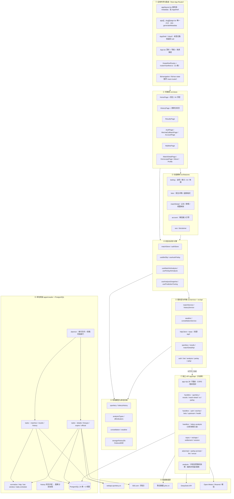

**依赖规则（实际执行情况）**

- `views → features/*`：投注页拆得最细（`betting`），登录/账号、投注记录、对战详情、SEO、免责弹层各自成模块；两个分析页仍自包含。
- `views → service → api/httpClient → /api/*`：统一传输层，**前端不出现任何上游域名或密钥**（`NEXT_PUBLIC_API_BASE` 只允许放 API 域名）。
- `views → domain`：分析页直接调用纯函数算法（通过 Worker）；`domain` 不依赖 React/DOM，可被 Worker 直接复用。
- `app/* → app-shell/AppShell → views`：页面组件只能经由外壳渲染，外壳按 `router/manifest.ts` 的 pathname 分发；`page.tsx` 不渲染页面内容（见 §4）。
- `apps/api` 只读库，`apps/crawler` 只写库；两者不依赖前端代码，只通过 HTTP 契约与数据库耦合。
- 外部上游只被「API（聚合数据 / DeepSeek / Open-Meteo / Resend / 微信）」或「本地爬虫（体彩 / 500.com）」访问，浏览器不直连。

---

## 3. 目录结构

```text
D:\ticai
├─ next.config.ts              # framework / rewrite(/api → API 项目) / allowedDevOrigins
├─ tsconfig.json               # bundler 模式、noEmit、strict 未开启
├─ vercel.json                 # framework: nextjs（发布由 Vercel 侧构建）
├─ package.json                # dev / build / web:start / crawl:* / db:* / deploy:*
├─ .env / .env.example         # 数据库、AI、聚合数据、Resend、微信（.env 已被 gitignore）
├─ public/                     # favicon / apple-touch / PWA 图标、robots.txt、sitemap.xml、og-cover.png
├─ apps/
│  ├─ api/                     # ★ 独立服务端：只读库，27 个接口路径
│  │  ├─ api/index.js          # Vercel 函数入口（全路径 rewrite 到这里）
│  │  ├─ src/app.mjs           # 路由表、CORS、错误信封、/healthz
│  │  ├─ src/index.mjs         # 本地 / VPS node:http 入口
│  │  ├─ src/config.mjs        # 环境变量 → 配置对象（.env 查找顺序）
│  │  ├─ src/db.mjs            # pg 连接池（懒加载 / 保活）
│  │  ├─ src/handlers/         # sporttery | results | match-detail | ai | parlay | auth | wechat | bets | upstream | health | lottery-analysis
│  │  ├─ src/repos/            # matches | lottery | results | bets 读库 SQL
│  │  ├─ src/analysis/         # ★ 开奖分析快照：configs（参数指纹/预设）+ compute（读库/算/落库）+ tsc 生成的算法
│  │  ├─ src/ai/               # prompt / parlay-prompt / context / parlay-context
│  │  ├─ src/auth.mjs / session.mjs / mail.mjs / wechat.mjs
│  │  ├─ src/settlement.mjs    # 逐腿判定、复式注数、单注限额、奖金连乘
│  │  └─ src/llm.mjs / venue.mjs / reshape.mjs
│  └─ crawler/                 # ★ 本地爬虫：只写库
│     ├─ src/tasks/matches.mjs # 赛程 + 赔率快照 + 自动下架
│     ├─ src/tasks/results.mjs # 赛果开奖：比分 + 五个玩法结果
│     ├─ src/tasks/history.mjs # 四彩种开奖（含奖级）→ 写完后触发分析快照重算
│     ├─ src/tasks/details.mjs # 伤停（--full 时 7 个官方接口）
│     ├─ src/tasks/lineups*.mjs# 阵容（500.com + Playwright）
│     ├─ src/tasks/expire.mjs  # 已开赛 → 停售（纯本地）
│     ├─ src/tasks/official.mjs# 每日 09:00 官方数据预热
│     ├─ src/normalize.mjs     # 上游 → 库字段，赛果 key 推导
│     ├─ src/bet-window.mjs    # 竞彩销售时段闸门
│     └─ src/daemon.mjs        # 常驻调度器：串行队列 + 开盘补跑
├─ db/
│  ├─ migrations/              # 0001_init → 0007_analysis_snapshot
│  ├─ seed/                    # 四彩种字典
│  └─ maintenance.sql          # 阵容/赔率/抓取记录保留策略
├─ scripts/
│  ├─ dev.mjs                  # 并行拉起 API + Next dev，任一退出则联动关闭
│  ├─ db-migrate.mjs           # 迁移执行器（up|seed|status|verify）
│  ├─ analyze-snapshot.mjs     # 分析快照回填 / --force 重算 / --status 巡检
│  ├─ analysis-dev.mjs         # 本地起 Python 分析服务（uvicorn，默认 3012）
│  ├─ analysis-test.mjs        # 跑 Python 单测 + 与 Node 的对拍（npm run analysis:test）
│  ├─ export-*-fixtures.mjs    # 三家对拍夹具：推荐 / 开奖分析 / AI 提示词
│  ├─ deploy-analysis.mjs      # 发布 Python 分析服务（Vercel 项目 ticai-analysis）
│  ├─ ai-smoke.mjs             # npm run ai:check 密钥连通性自检
│  ├─ check-secrets.mjs        # 暂存区密钥扫描
│  ├─ update-architecture.mjs  # 按文件清单生成 architecture.svg/.png
│  ├─ install-git-hooks.mjs    # 安装 pre-commit / pre-push hooks
│  ├─ git-hooks/               # 进仓库的 hook 源文件
│  ├─ deploy-local.mjs         # 本地 next build 自检 → 上传源码 → Vercel 远端构建（前端）
│  └─ deploy-api.mjs           # 临时目录上传源码 + Vercel 构建（API）
└─ src
   ├─ app                      # Next App Router（layout / [[...slug]] / not-found）
   ├─ app-shell/AppShell.tsx   # 客户端外壳：路径校验 + 挂 App
   ├─ App.tsx                  # 顶栏 + 导航 + 免责弹层 + 路由级 SEO
   ├─ router
   │  ├─ manifest.ts           # 路由清单（13 条）+ matchAppRoute + 公开/私有
   │  ├─ KeepAliveRoutes.tsx   # pathname 匹配 + display 切换的缓存路由
   │  └─ routes.tsx / match.ts / types.ts
   ├─ lib                      # navigation · nav-state · initial-data（首屏数据类型）
   ├─ server/prefetch.ts       # ★ 首屏取数（只在根 layout 调用，失败即降级）
   ├─ ssr                      # seed（首屏灌 store）· initial-context（context 通道）
   ├─ proxy.ts                 # 写 x-pathname 请求头，layout 靠它知道当前页面
   ├─ views                    # 13 个页面（见 §4 路由表）
   │  ├─ HomePage.tsx          # 803 行：状态编排 + 组合子组件 + 方案弹层
   │  ├─ HistoryPage.tsx       # 920 行：走势矩阵 + 大乐透号码推演 + 右栏指标
   │  ├─ HistoryAnalysisPage   # 723 行（仍未拆分）
   │  ├─ MathTrendAnalysisPage # 444 行（仍未拆分）
   │  ├─ ResultsPage.tsx       # 258 行：比赛日翻页 + 五个玩法结果
   │  ├─ AuthPage / WechatCallbackPage / AccountPage
   │  ├─ MyBetsPage.tsx        # 492 行：骨架屏 + 统计 + 筛选 + 详情弹层
   │  └─ MatchDetailPage / HoroscopePage / AboutPage / ProfilePage
   ├─ features
   │  ├─ betting               # 21 个文件：选号、串关、两级 AI、方案快照
   │  │  ├─ MatchListSkeleton.tsx # 首屏一屏骨架屏（按内容区高度补卡片）
   │  │  ├─ AiAnalysisPanel.tsx / useMatchAiAnalysis.ts # 单场 SSE + 天气
   │  │  ├─ ParlayAiAnalysisPanel.tsx / useParlayAiAnalysis.ts # 方案级判断
   │  │  ├─ aiAnalysisCache.ts # AI 结果 localStorage 缓存（3 小时 TTL）
   │  │  ├─ useBetSlip.ts / betSlipMath.ts # 选择态与纯函数投注计算
   │  │  ├─ recommendation.ts / useAutoParlay.ts / AutoParlayPanel.tsx # 一键推荐（概率在服务端算）
   │  │  ├─ MatchPoolList.tsx / BetSlipFooter.tsx / PlanModal.tsx / SnapshotOverlay.tsx
   │  │  └─ betPayload.ts      # 投注单请求体（登录后保存）
   │  ├─ bets                  # 投注详情弹层 + 金额格式
   │  ├─ account               # 微信接入步骤弹层
   │  ├─ matchDetail           # 正文 / 弹框 / 视图映射 / 移动端判断
   │  ├─ seo                   # 路由级 title / description / canonical / robots
   │  └─ disclaimer            # 娱乐提示弹层与按路由记忆
   ├─ storage
   │  └─ historyDb.ts          # ★ IndexedDB 仓储：读写、裁剪、清空
   ├─ service
   │  ├─ historyService.ts     # 547 行：内存 + IDB + 增量同步
   │  ├─ matchService.ts       # 赔率 → MatchCard 视图模型
   │  ├─ weatherService.ts / constellationService.ts
   │  └─ counterService.ts     # 死代码（无消费方）
   ├─ store                    # matchStore / authStore（zustand persist）/ counterStore
   ├─ domain
   │  ├─ analysisTypes.ts      # 分析结果的类型与空态占位（算法在 Python，前端不再计算）
   │  ├─ lotteryHistory.ts     # ★ 开奖记录 / 缓存元数据类型
   │  ├─ dltIndicators.ts      # 大乐透前区/后区逐期指标的展示用计算（走势图右栏）
   │  └─ sporttery.ts / constellation.ts / weather.ts / counter.ts
   ├─ api
   │  ├─ httpClient.ts / base.ts # 超时 + AbortSignal + 统一 ApiError；同源 /api
   │  ├─ sportteryApi.ts / resultsApi.ts / matchDetailApi.ts
   │  ├─ analysisApi.ts / parlayApi.ts / aiApi.ts / venueWeatherApi.ts
   │  ├─ authApi.ts / betApi.ts
   │  ├─ index.ts              # 统一导出
   │  └─ types.ts              # BffEnvelope<T>
   ├─ styles                   # global.scss + authBets / results / account / confirmDialog
   ├─ components               # 骨架屏 / 大乐透指标与推荐 / ConfirmDialog
   └─ assets                   # 未被引用的图片（可删）
```

---

## 4. 路由与 Keep-Alive

Next App Router 的导航会替换 `children`，页面状态天然不保留。为了保住 Keep-Alive，路由做了两件事：

1. **全站只有一个路由文件** `src/app/[[...slug]]/page.tsx`（可选 catch-all）：它只做路径校验、404 与 metadata，**不渲染页面内容**；
2. **外壳挂在根布局** `src/app/layout.tsx`：`<AppShell />` 跨路由不卸载，内部按 `usePathname()` 分发。

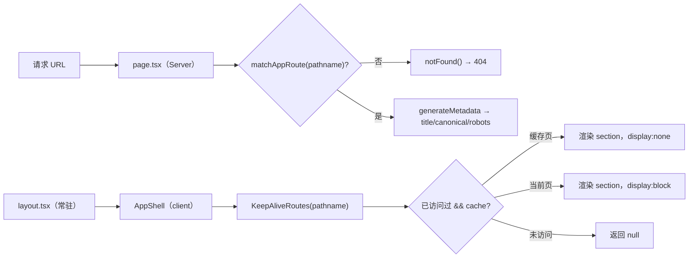

> 为什么不能按路由拆多个 `page.tsx`：Next 每次导航都会换页面组件实例，Keep-Alive 缓存和页面输入状态会全部丢失。实测把 `<AppShell />` 从 page 挪到 layout 后，`/about` → `/results` → 返回，输入内容才得以保留。

### 路由清单（`appRouteManifest` 13 条 / `navLinks` 7 项）

| 路径 | 页面 | 缓存 | 说明 |
| --- | --- | --- | --- |
| `/` | HomePage | ✅ | 投注主流程 |
| `/history` | HistoryPage | ✅ | 开奖历史 |
| `/results` | ResultsPage | ❌ | 按天翻页，回来时重新拉最新开奖 |
| `/history-analysis` | HistoryAnalysisPage | ✅ | 本地分析 |
| `/math-trend-analysis` | MathTrendAnalysisPage | ✅ | 本地分析 |
| `/match/:matchId` | MatchDetailPage | ❌ | 唯一动态路由，H5 详情 |
| `/horoscope` | HoroscopePage | ✅ | 星座 + 天气 |
| `/about` | AboutPage | ✅ | Keep-Alive 演示 |
| `/login` | AuthPage | ❌ | 每次进入重新挂载，避免残留错误提示 |
| `/auth/wechat` | WechatCallbackPage | ❌ | 一次性 ticket 换会话 |
| `/account` | AccountPage | ❌ | 登录方式与绑定 |
| `/my-bets` | MyBetsPage | ❌ | 回来时重新拉最新结算 |
| `/profile` | ProfilePage | ❌ | 不在导航中 |

> 导航（`navLinks`）：赛事投注 / 赛果开奖 / 开奖历史 / 分析页面 / 数学走势 / 星座运势 / 我的投注。
> 未登记路径由 `page.tsx` 直接 `notFound()`，是**真 404**（不再有「渲染首页 + 200」的软 404）。

要点：

1. 访问过的页面常驻 React 树，切换只改 `display`，`useState`/滚动位置保留。
2. **无缓存淘汰**：`cachedPathsRef` 只增不减；`cache: false` 的页面切走即卸载。
3. **移动端（≤640px）主导航折叠**：页头只留标题 + 登录/账号 + 汉堡按钮，导航收进两列菜单；
   路由切换时自动收起。桌面端保持平铺。
4. **吸顶不要叠两层**：站点头部吸顶，页面自己的工具条（如首页玩法切换）不再吸顶，
   否则整页可滚动时会互相遮挡；`.app-shell` 用 `100dvh` 跟随移动端可视高度。
5. **路由级 SEO**：服务端 `generateMetadata` 产出 title / description / canonical / robots / OG；
   客户端导航后由 `App` 调 `applyPageMeta` 补齐，两者共用 `resolvePageMeta()` 同一份规则。
   登录后才可见的页面标记 `noindex`。站点级 OG / JSON-LD 在 `src/app/layout.tsx`，
   `public/robots.txt` 与 `public/sitemap.xml` 仍作为静态文件返回。
6. **SSR 与首屏预取**：页面外壳由服务端渲染（`force-dynamic`，每次请求渲染，不做构建期静态化）；
   **首页与赛果开奖页已在服务端预取**（`src/proxy.ts` 写 `x-pathname` → 根 layout 取数 → context 下发），
   其余页面（history / 两个分析页）仍是客户端拉取，见 §13.6。
7. 精确匹配为主；`/match/:matchId` 是唯一的动态路由（`cache: false`），切换不同 `matchId` 时组件不卸载，但 `useMatchDetail` 会按 id 重新拉取。
8. 副作用常驻：页面的定时器与后台请求在切走后仍运行（`historyService` 的后台补页就是全局单例，不受影响）。
9. **导航与传参**：`react-router` 已移除。`src/lib/navigation.ts` 提供 `useNavigate` / `usePathname`，
   `src/lib/nav-state.ts` 用一次性内存槽替代 `location.state`（「我的投注 → 带方案去投注」「列表 → 详情占位队名」「登录后回哪」三处）。

对战详情有两条入口，同一份正文组件（`MatchDetailContent`）：

| 端 | 形态 | 实现 |
| --- | --- | --- |
| PC（≥768px） | 弹框 | `MatchDetailDialog`，portal 到 body，Esc / 遮罩 / × 关闭 |
| H5（<768px） | 独立页面 `/match/:matchId` | `MatchDetailPage`，带返回按钮 |

---

## 5. 核心数据流

### 5.1 赛事投注（`/`）

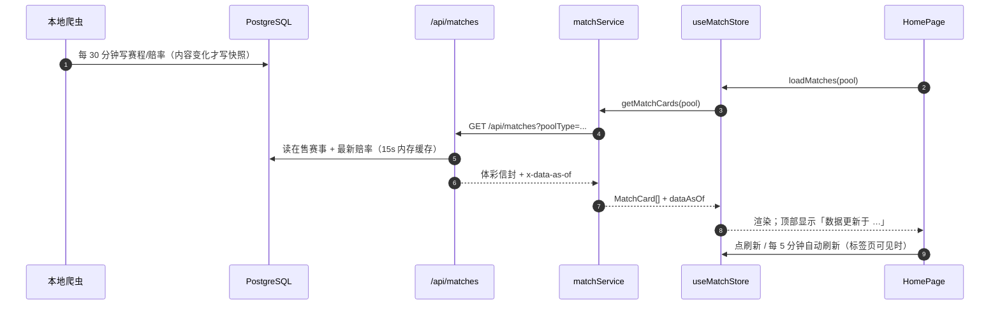

数据新鲜度直接来自响应头 `x-data-as-of`（库里 `max(last_seen_at)`），页头把它显示成「刚刚 / N 分钟前」，
超过 45 分钟标黄——这样「是页面没刷新」还是「爬虫真的没跑」一眼能分清，不用再去翻日志。

**首屏与方案快照细节**

1. 首屏加载时 `MatchListSkeleton` 读取 `.home-page__content` 的可视高度、单卡高度和 gap，按 `ceil((可视高度 + gap) / (卡片高度 + gap))` 动态补足骨架卡，覆盖一整屏。
2. 方案快照只截 `.plan-modal__card`，不带遮罩和背后的赛事列表；截图倍率按 DPR 取 3～4 倍。
3. 截图副本中隐藏「AI分析 / 截图 / 关闭」操作，并显示仅截图可见的当前玩法、倍数、投注金额与最高奖金；正常弹层不展示这些附加信息。
4. 截图副本会临时解除弹层最大高度和列表滚动限制，保证所有场次与底部摘要都被完整截入，不会挡住最后一行。

**投注计算规则（`features/betting/betSlipMath.ts`，纯函数）**

| 概念 | 规则 |
| --- | --- |
| 过关上限 | 胜平负 8 串 1、进球数 6 串 1、比分/半全场 4 串 1、混合 5 串 1 |
| 注数 | 每种串法求「所选选项数的组合乘积」，再跨串法求和（`sumCombinationProducts`） |
| 投注金额 | `注数 × 2 元 × 倍数`，倍数上限 50 |
| 最高奖金 | `Σ 各串法 max(赔率) 乘积 × 2 × 倍数`，再按单注限额封顶 |
| 单注限额 | 单场 10 万、2/3 串 20 万、4/5 串 50 万、6 串以上 100 万；倍数按多注分别封顶后相加 |
| 彩票税 | 奖金 > 10 000 元按 20% 计税 |
| 截图 | `PlanModal` 根节点 → html2canvas → `toDataURL` → 预览/下载 |

**保存投注**：`PlanModal` 里登录用户点「保存方案」→ `betPayload.ts` 组装 legs（场次号、玩法、选项、赔率、让球）→ `POST /api/bets`。注数、金额、最高奖金由服务端 `settlement.mjs` 重新计算，不信任客户端传值；保存成功后「我的投注」按赛果实时结算。

### 5.2 开奖历史：IndexedDB 缓存 + 增量同步

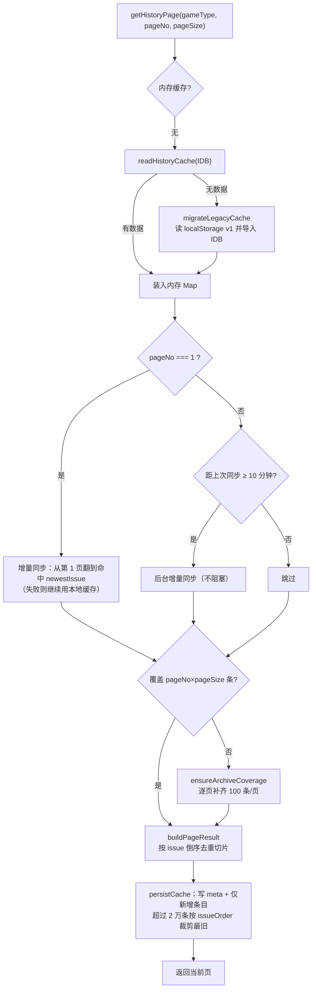

> 2026-10-27 起去掉了「每 1.8s 后台补一页直到全量」：分析改由服务端快照提供后，
> 前端不再需要先把 78 页开奖翻完（1805 KB / 约 140s），只按用户实际翻到的页增量补齐。

开奖历史页的首屏与预测：

- 首次加载时 `HistoryPageSkeleton` 覆盖预测摘要 / 号码推演卡和走势表的占位，不再先渲染空表格；
- 预测与 5+2 推演直接读服务端快照（`GET /api/analysis/lottery`），页面不再下载全量开奖、也不再跑 Worker；
- 走势表格的 `TrendGrid` 用 `memo` 隔离，快照到达时只更新表头预测/回测摘要，不重建 5×30×10 个单元格。
- 大乐透前区逐期指标由 `domain/dltIndicators.ts` 纯函数计算（和值、跨度、奇偶比、大小比、三区比），`DltIndicatorRail` 渲染为桌面右栏，移动端卡片复用同一套口径；
- 桌面四列（期号轴 / 前区 / 后区 / 指标栏）共用行高（表头 2.125rem、统计区 2.7rem、每期 1.875rem）逐行对齐，期号轴左侧标注「出现次数 / 当前遗漏」；64–75rem 收窄号码字号，避免 35 列两位数挤压。
- 大乐透 5+2 号码推演用服务端快照（kind=dlt，最近 300 期），`DltRecommendationPanel` 展示主推号码、备选与逐条理由；移动端与桌面共用同一份 DOM，窄屏上下堆叠；
- 推演口径：近 10 / 30 / 300 期频次按期望次数归一，遗漏按平均间隔归一（封顶 3 倍）；前区每区取评分前 4 共 12 码，枚举 5 码组合，再用近 30 期和值 / 跨度 / 奇偶 / 大小 / 三区均值打分；后区取 5 码候选池枚举 2 码；理由引用实际频次、遗漏与结构数据。

存储设计（`src/storage/historyDb.ts`）：

| 项 | 值 |
| --- | --- |
| 数据库 | `ticai`，version 1 |
| `history_meta` | keyPath `gameType`；同步元数据（页数、已加载页、newestIssue、时间戳） |
| `history_draws` | keyPath `key = ${gameType}:${issue}`；索引 `byGame`、`byGameOrder = [gameType, issueOrder]` |
| 写入策略 | 只写新增条目（按 issue 差集），元数据同事务更新 |
| 容量治理 | 上限 20 000 条，`byGameOrder` 游标删除最旧记录，内存同步裁剪 |
| 旧数据迁移 | 首次读不到 IDB 时导入 `ticai:history-cache:v1`，成功后删除该 key |
| 降级 | 隐私模式等 IDB 不可用 → 纯内存运行（不持久化），页面仍可用 |

### 5.3 分析计算：服务端快照为主，Worker 只留给调参

```mermaid
sequenceDiagram
  autonumber
  participant P as 分析页 / 开奖页
  participant N as apps/api（Node）
  participant A as apps/analysis（Python）
  participant S as lottery_analysis_snapshot

  P->>N: GET /api/analysis/lottery?game=pl5&kind=prediction&order=2
  N->>A: 反向代理（ANALYSIS_API_BASE）
  A->>S: 读最新快照（1 次往返）
  S-->>A: payload + 溯源（期号 / 开奖日 / 样本期数）
  A-->>N: analysis + sample + stale
  N-->>P: 原样返回（x-analysis-via: python）
  P->>P: 直接渲染（约 2 KB gzip）

  Note over P,A: 拖权重滑块：权重作为 w= 参数发给服务端现算，同参数命中同一条快照
  P->>N: GET /api/analysis/lottery?...&w=34-20-22-14-10（400ms 防抖）
  N->>A: 反向代理
  A->>S: 查 config_key=markov=2;w=34-20-22-14-10
  alt 快照不存在
    A->>A: 全量重算（7762 期约 1.6s）并写回快照
  end
  A-->>P: analysis（前端按 analysisTypes 渲染）
```

算法要点：近期/长期频次 + 遗漏补偿 + 一阶/二阶转移加权打分；滚动回测 top1/top3；马尔可夫模式后继分布；组合推荐与冷热/和值/跨度统计；数学趋势页额外做线性回归斜率、预测中心、标准差波动率（240 期窗口、120 期起验证）。

两个分析页在等待快照时渲染 `AnalysisPageSkeleton`：预测 hero、权重/模型面板、概览和走势卡都有占位块，顶部统计 chips 也换为骨架，避免先闪出一屏 `0 / --` 再跳变。

> ✅ 2026-10-29：三个页面（`/history`、`/history-analysis`、`/math-trend-analysis`）只读服务端快照；
> 权重滑块也改成 `w=` 参数（400ms 防抖）由 Python 现算并落库。
> 前端 `domain/historyPrediction.ts`、`domain/dltRecommendation.ts`、`workers/historyAnalysisWorker.ts`
> 与 `scripts/sync-analysis.mjs` 已删除——前端不再保留任何分析算法副本。

### 5.3.1 开奖分析快照：开奖后算一次，接口直读

**问题**：分析必须用**全量**样本（排列五 7760 期）。放在浏览器里算有三重代价：

| 现状（浏览器） | 实测 |
| --- | --- |
| 首屏要翻完 78 页开奖（100 期/页、1.8s 节流） | 1805 KB 明文 / 184 KB gzip、约 140s 才凑齐全量 |
| 样本数取决于「进场时本地缓存里有多少」 | 旧版构建时预渲染的静态页里写死「本地样本 100 期」，与回访用户看到的 7760 期不一致 |
| 每翻一页在 Worker 里全量重算 | 7760 期一次约 1.4–1.9s（桌面），手机数秒 |

**做法**：开奖入库后立刻算一次，结果连同「基于哪一期 / 哪一天 / 多少期样本」一起存进
`lottery_analysis_snapshot`，接口只读一行 JSONB。

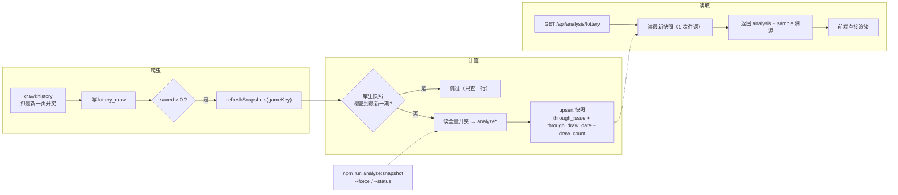

**表结构要点**（迁移 `0007_analysis_snapshot.sql`）：

| 列 | 含义 |
| --- | --- |
| `game_no` / `kind` / `config_key` | 彩种 × 分析种类（prediction / math_trend / dlt）× 参数指纹（如 `markov=2`） |
| `through_issue` / `through_issue_seq` / `through_draw_date` | **基于哪一期、哪一天**（最新一期开奖） |
| `from_issue` / `from_draw_date` / `draw_count` | 样本起点与真正吃进去的期数（数学走势 240、大乐透 300） |
| `payload` | 与前端渲染同构（类型见 `src/domain/analysisTypes.ts`），前端可直接渲染 |
| `meta` | 引擎版本 + 指纹（Python 版写 `python <版本>` / `python-port-1`）+ 选项 |
| `source` / `crawl_run_id` / `duration_ms` / `computed_at` | 谁触发的（crawler / cli / api）、哪一轮抓取、算了多久 |

唯一键 `(game_no, kind, config_key, through_issue)`：同一期重复触发是 upsert，不会堆垃圾；
新一期只补一条。视图 `lottery_analysis_latest` 把每种分析的最新快照和**库里最后一期开奖**放在一起，
可以直接看出「分析是否落后于开奖」（`/api/health`、`db:status`、`analyze:snapshot --status` 都在用）。

**预设组合**：开奖后一次算 5 个马尔可夫阶数 + 数学走势（位置型彩种）或 5+2 推演（大乐透），
前端切阶数只是换 `order` 参数，不再等计算。权重滑块是连续值，不进预设；需要时按参数现算一条并落库。

**接口**：

```text
GET /api/analysis/lottery?game=pl5&kind=prediction&order=2
GET /api/analysis/lottery?game=pl5&kind=prediction&order=3&w=34-20-22-14-10   # 自定义权重
→ { game, kind, configKey, sample{throughIssue,throughDrawDate,fromIssue,drawCount},
    engine{version,digest,runtime}, analysis{…与前端渲染同构…}, stale, latestDraw }
响应头：x-analysis-through-issue / -through-date / -draw-count / -computed-at / -stale
缓存：同一期快照不变 → public, s-maxage=900；落后开奖时降到 60s
```

快照缺失时（新库 / 新彩种 / 爬虫没跑）接口会现算一次并落库，保证可用；
正常路径是开奖时已经算好，读取只花一次数据库往返（跨境库实测 1–2s，Vercel 上由边缘缓存兜住）。

**为什么不「请求时现算」**：7760 期全量回测 1.4–1.9s，加上冷启动与远端库往返就是 3–6s，
而结果只在「多了一期开奖」时才变——现算等于把同一份结果重复算给每个访客。

**算法源只有一份**：Python 分析服务 `apps/analysis/app/analysis/`（`prediction.py` / `dlt.py` / `dlt_indicators.py`）。
前端只保留 `domain/analysisTypes.ts`（类型与空态）与 `domain/dltIndicators.ts`（走势图右栏的展示计算）；
`apps/api/src/analysis/*.mjs` 是冻结的 Node 内联回退实现，不再从任何 TS 生成。

### 5.4 比赛 AI 分析（SSE）

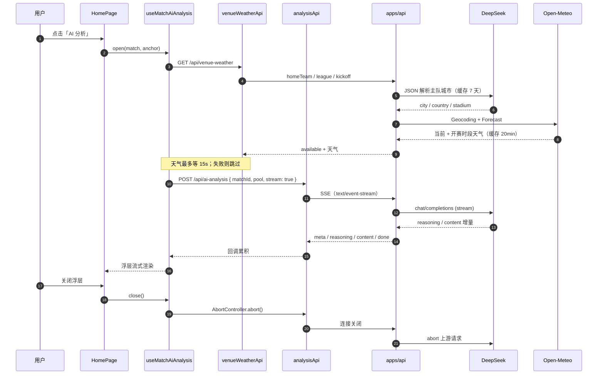

要点：

1. 前端只发 `matchId + pool`：比赛信息、最新赔率、伤停、交锋、近况、阵容、天气与系统提示词全部由 `apps/api` 装配。
2. 城市解析依赖 DeepSeek，天气来自 Open-Meteo；两者都有缓存，失败时不阻塞分析，只在提示词里标注「天气缺失」。
3. `analysisApi` 解析 SSE 的 `meta` / `reasoning` / `content` / `done` / `error`，前端只拼接文本；流式请求有 120s 总超时。
4. 关闭浮层会 abort 客户端请求，API 监听 `res` 的 `close` 事件后同步 abort DeepSeek，避免继续生成。

### 5.5 方案级 AI 串关分析（SSE）

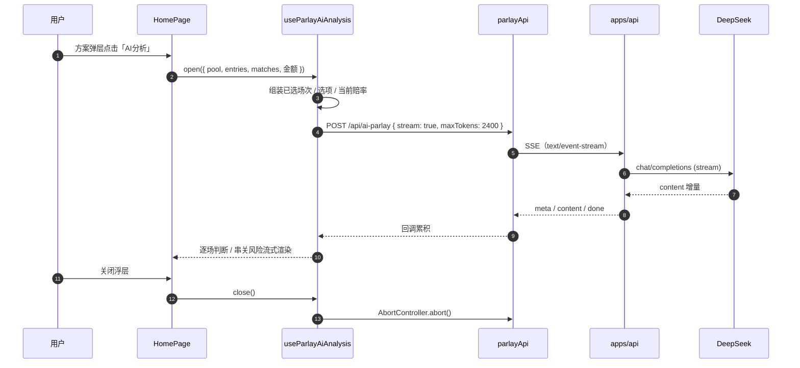

要点：

1. 只分析当前方案已选场次，不额外拉取未选比赛；提示词要求逐场覆盖、不新增比赛。
2. 输出固定包含「总评 / 逐场分析 / 串关建议 / 结论」，解析「整体风险、综合信心、一句话总结」做摘要。
3. 缓存键为「玩法 + 过关方式 + 场次 + 选项」，同一方案重复打开不重复扣费；关闭浮层会 abort SSE。
4. 单场与方案结果写入 `localStorage`，TTL 3 小时；方案未命中时仍只发一次请求，但会把已缓存单场分析带入提示词复用。
5. 与单场分析不同，方案级分析不逐场请求比赛地天气，避免 N 场串关产生 N 次城市解析与天气请求。

### 5.6 星座与天气

1. `weatherService.getWeatherByLocation()`：`GET /api/ip` 拿城市 → `GET /api/weather?cityname=`；定位失败回退默认城市 `宝山`。
2. `constellationService.getHoroscope()`：`GET /api/horoscope?consName=&type=`。
3. 两个请求各自 `AbortController`，同一 `reloadSeed` 触发刷新。

---

### 5.7 赛果开奖 → 投注结算

过去「赛果」是逐场从 `getMatchResultV1`（球队视角的近期赛果）里捞，一场一个请求。
2026-10 起改用官网赛果开奖接口，一次一批：

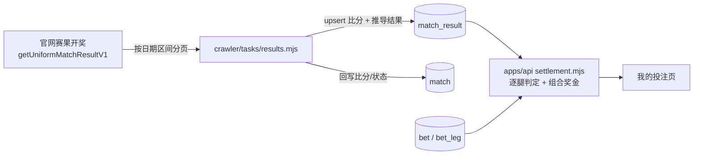

- **推导集中在爬虫**（`normalize.mjs`）：上游只给比分和胜平负，`hhad/ttg/crs/hafu`
  由 `crsKey` / `hafuKey` 等纯函数算出，key 与前端玩法选项一致；
  单测覆盖「胜其它 / 平其它 / 负其它」等边界。
- **关联**：`match_result.match_id` 回填到当时在售的 `match` 行（按 `sporttery_match_id`），
  老的赛程/详情接口不需要改就能看到比分。
- **少爬**：`details` 默认不再抓赛果 feed，每场请求数 2 → 1；没有待开奖比赛时
  `results` 连请求都不发（`hasPendingResults` 先查库）。
- **结算实时算**：`bet` 只存下注时的赔率/让球/过关方式快照，中奖与奖金每次读取时
  用 `match_result` 重算，所以开奖数据更新后「我的投注」刷新即变，不需要后台结算任务。
- **单注奖金限额**：按体彩规则对每一注封顶——单场 10 万、2/3 串 20 万、4/5 串 50 万、
  6 串及以上 100 万；倍数按多注处理，每注各自封顶后相加。前端「理论最高奖金」与
  服务端结算奖金都走同一条规则，超过时在投注栏打「封顶」角标。
  （`getPayoutLimit()` / `computePlanMetrics()` / `settleBet()`）

---

### 5.8 账号、登录方式与密码（微信 / 邮箱 / 验证码）

账号（`app_user`）与登录方式（`user_identity`）是两层：

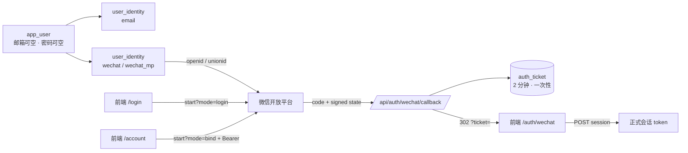

密码是「可选升级项」，不是注册门槛——验证码登录即注册，之后再设置密码：

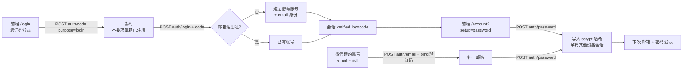

设计要点：

- **一个账号多条身份**：邮箱注册的用户再绑微信，是给已有账号加一条 `wechat` 身份，投注记录不动；
  反过来微信首次登录没有邮箱，就直接建一个 `email = null` 的账号。
- **验证码登录即注册**：`purpose=login` 不要求邮箱已注册——验证码通过就证明邮箱归属，未注册时当场建号（`password_hash = null`）。
  前端拿到 `user.hasPassword === false` 就跳到 `/account?setup=password` 引导设置密码。
- **密码的三条授权规则**（`apps/api/src/handlers/auth.mjs` 的 `setPassword`）：
  1. 账号还没有密码 → 任意有效会话都能设置；
  2. 已有密码 + 会话是验证码登录建立的（`user_session.verified_by='code'`）→ 可以直接覆盖，这就是「忘记密码」的自助路径；
  3. 已有密码 + 其他会话（密码 / 微信登录）→ 必须验当前密码，或再收一条验证码。
  改完密码吊销该账号其他设备的会话，只留当前这枚（密码是长期凭据）。
- **微信账号要先绑邮箱**：密码登录的唯一标识是邮箱，所以 `email = null` 的账号调 `setPassword` 会得到 `400`；
  账号页让用户先走 `purpose=bind` 的验证码绑定邮箱，再设置密码。
- **state 自签名**：HMAC 里带 mode、渠道、绑定用户 id 与 10 分钟过期，不依赖服务端 session 存储，多实例也成立。
- **回调不直发 token**：URL 会进历史记录/日志，所以只放 2 分钟、一次性的 `auth_ticket`，前端换取正式会话后立即作废。
- **渠道可扩展**：`wechat_web`（开放平台扫码）与 `wechat_mp`（公众号网页授权）共用同一条回调与建号逻辑；
  以后接小程序/Apple 只是新增 `channel` 与一个 adapter（`apps/api/src/wechat.mjs`）。
- **未接入时给指引**：没配 `WECHAT_*` 时 `config` 返回 `enabled: false` 与 `missing`，登录页/账号页把按钮变成「接入步骤」弹层，不影响邮箱登录与投注。

### 5.9 投注推荐（服务端，`/api/recommendations`）

推荐算法从浏览器搬到了服务端（`apps/api/src/recommend/`）。旧实现是在浏览器里用同一份赔率反推 λ、
再拿模型概率去和市场概率比大小，专挑差值最大的选项——等于用同一份赔率跟自己打，必然在拟合噪声处
「发现优势」，于是把 22.00 这种冷门串进 8 串 1（历史投注单全是未中）。

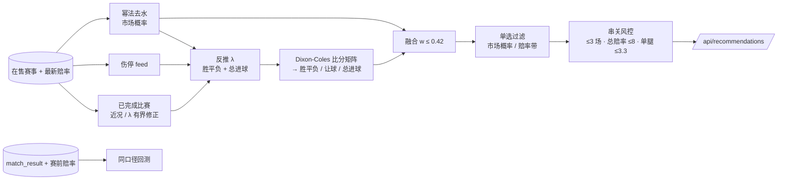

要点：

- **市场是基准**：幂法去水（`p_i = (1/o_i)^k`，二分求 k）而不是比例归一。比例归一会把抽水按比例摊，
  系统性高估长赔——那正是旧推荐偏爱冷门的原因之一。
- **数据只做有界修正**：近况最多挪动 λ ±12%，伤停每缺 1 人 −3%（最多 −12%）；
  融合权重 `w = 0.06×样本数 + 伤停 0.04`，上限 0.42。没有近况的场次 `w≈0.02`，基本按市场走，不凭空造优势。
- **风控硬约束**：只有单关 / 2串1 / 3串1；单腿赔率 ≤ 3.3（低概率玩法单关档 ≤ 4.5）、
  2串1 融合命中率 ≥ 26%、3串1 ≥ 15%、总赔率 ≤ 8；同联赛成串会被轻微降权。
- **宁可空着**：达不到门槛就返回空方案 + 每条被过滤的原因；比分 / 半全场直接不参与（方差太大）。
- **自曝回测**：`match_result` × 开赛前最后一次赔率快照跑同口径回测（单场首选 / 2串1 模拟 / 长赔 / 赔率区间），
  把「高赔到底是什么水平」摆给用户看，而不是只给结论。
- **诚实标注**：方案同时给融合命中率与期望回报（`<1` 是常态，庄家抽水仍在），不宣称稳赚。

数据现状（2026-10 实测）：在售约 19 场都有五个玩法赔率；伤停 feed 覆盖当天 7 场；
官方近况 / 交锋 / 积分 feed 默认不抓（`crawl:details` 只取伤停，`--full` 才补齐），
所以「近况」多数时候来自本库已结束比赛（近两周 111 场，样本很薄），引擎按样本数量自动降低权重。

#### 5.9.1 分析服务（Python）与反向代理

推荐引擎先迁到了 `apps/analysis`（Python + FastAPI），后续所有分析接口都往这里搬：

```
浏览器 ──同源 /api/**──▶ Next rewrite ──▶ apps/api (Node)
                                           ├── 非分析接口：自己处理（赛事/账号/投注/…）
                                           └── 分析接口：ANALYSIS_API_BASE ? 反向代理 → apps/analysis（Python）
                                                                        : 内联实现（迁移期回退）
```

- **接口形状完全一致**：两边都是 `{success, data}` / `{success:false, errorMessage}`，
  字段名、选腿、缓存放同一个位置；前端零改动。
- **回滚靠环境变量**：删掉 `ANALYSIS_API_BASE` 就回到 Node 内联实现，不用回滚代码；
  Python 侧故障时代理失败，Node 自动回退（响应头 `x-analysis-via: python` 表示这一跳走了 Python；
  `x-analysis-source` 仍表示快照来源，两者不要混用）。
- **已迁移的分析路径**：`/api/recommendations`、`/api/analysis/lottery`（`prediction` / `math_trend` / `dlt`）、
  `/api/venue-weather`、`/api/ai-analysis` 与 `/api/ai-parlay`（SSE 原样流式转发）都走 Python；
  代理只认路径，后续新增分析接口只需往 `ANALYSIS_PATHS` 里加一条。
- **对拍**：`npm run analysis:fixtures` 用 Node 引擎导出一批真实盘口的期望结果（提交在仓库里），
  `npm run analysis:test` 里 Python 必须给出同样的方案与选腿，概率差 < 5e-3（实测最大 5e-4，
  来自 λ 粗网格的浮点求和顺序）。
- **部署**：Vercel 项目 `ticai-analysis`（Python 运行时，`api/index.py` 暴露 ASGI app），
  `npm run deploy:analysis` 发布；Node 项目设 `ANALYSIS_API_BASE` 指向它。
- **Vercel rewrite 会丢路径**：函数里看到的 `path` 恒为 `/api/index`（`destination` 写 `/api` 也一样）。
  因此 `vercel.json` 用 `destination: "/api/index?__path=/$1"` 带上原路径，`app/main.py` 的
  `RewritePathMiddleware` 在 ASGI 层还原并摘掉 `__path`；回归测试在 `tests/test_middleware.py`。
- **Deployment Protection 必须关**：否则 Node 代理被 Vercel Authentication 挡住（401），只能回退内联。
- **线上验证**：`x-analysis-via: python` 是「这一跳真的走了 Python」的唯一判据；
  2026-10-29 实测生产链路（`https://yujun426.online/api/...`）：开奖分析 300ms、推荐 877ms、
  天气 2.1s（Manchester）、大乐透 377ms、自定义权重 `markov=3;w=60-20-22-14-10`、AI SSE 42 个事件。
- **测试命令**：`npm run analysis:test`（Python unittest：数学、风控边界、AI 提示词、rewrite 中间件、与 Node 对拍）。

---

## 6. 接口契约（`apps/api`）

> 2026-10-23 起接口实现位于 `apps/api`，`server/` 与 `api/` 已删除。
> **完整契约（参数、响应示例、SSE 协议、错误码、字段双写）以 [docs/api.md](api.md) 为准**。
> 本章只做分组速查。

| 分组 | 路径 | 数据来源 | 缓存 |
| --- | --- | --- | --- |
| 赛事 | `GET /api/matches` | 数据库（爬虫写） | 15 s |
| 开奖 | `GET /api/history` | 数据库 | 60 s |
| 开奖分析 | `GET /api/analysis/lottery`、`GET /api/analysis/lottery/snapshots` | 数据库（爬虫开奖后预算的快照） | 同一期不变：`s-maxage=900`；落后开奖时 60 s |
| 赛果 | `GET /api/results` | 数据库 | 30 s |
| 对战详情 | `GET /api/match-detail` | 数据库 | 无（按场次） |
| AI | `POST /api/ai-analysis`、`POST /api/ai-parlay`、`POST /api/ai-chat` | 数据库 + DeepSeek | 无（SSE） |
| 认证 | `POST /api/auth/code` `/register` `/login` `/logout`、`GET /api/auth/me` | 数据库 + Resend | 无 |
| 账号安全 | `POST /api/auth/password`（设置 / 修改密码）、`POST /api/auth/email`（绑定邮箱） | 数据库 + Resend | 无 |
| 投注推荐 | `GET /api/recommendations`（`pool=had\|hhad\|ttg\|mixed`、`scope=today\|all`） | 数据库（赔率 + 伤停 + 历史战绩） | 60 s（回测 10 min） |
| 身份 | `GET /api/auth/identities`、`DELETE /api/auth/identities/:provider` | 数据库 | 无 |
| 微信 | `GET /api/auth/wechat/config` `/start` `/callback`、`POST /api/auth/wechat/session` | 微信开放平台 | 无 |
| 投注 | `GET/POST /api/bets`、`GET /api/bets/stats`、`GET/DELETE /api/bets/:id` | 数据库 | 无（实时结算） |
| 代理 | `GET /api/horoscope` `/api/weather` `/api/ip` `/api/venue-weather` | 聚合数据 / DeepSeek + Open-Meteo | 10 min / 10 min / 30 min / 城市 7 天 · 天气 20 min |
| 运维 | `GET /api/health`、`GET /healthz` | 数据库 / — | 无 |

> `/api/history` 的库在远端 Prisma Postgres。`apps/api` 已把开奖与奖级合并为一次查询、彩种元数据做进程内缓存，连接池空闲保留 30 分钟（`DATABASE_IDLE_TIMEOUT_MS` 可调），本地/VPS 入口启动时预热并每 4 分钟 `select 1` 保活（`DATABASE_KEEPALIVE_MS` 可调，0 = 关闭）。响应头 `Server-Timing` 会给出 `db / resolve / reshape / app` 分段耗时。实测 SQL 执行仅 8–11ms，请求慢主要在跨境建连（5–7s）与每次 DB 往返（0.4–1s）；本地/自建服务可靠连接复用规避，Vercel 冷启动仍建议换池化或就近的数据库入口。

响应形态三类：

- **体彩信封原样透传**：`{ success, errorCode, errorMessage, value }`（`/api/matches`、`/api/history`，前端 `sportteryApi` 逻辑不变）。
- **统一信封**：`{ success, data }` 或 `{ success:false, errorMessage }`（赛果/详情/认证/投注/天气/AI 非流式）。
- **SSE**：`/api/ai-analysis` 与 `/api/ai-parlay` 传 `stream: true` 时返回 `text/event-stream`，事件为 `meta` / `reasoning` / `content` / `done` / `error`。

比赛 AI 分析链路：`MatchPoolList` → `useMatchAiAnalysis` → `GET /api/venue-weather`（DeepSeek 解析主队城市 + Open-Meteo 天气）
→ `analysisApi` → `POST /api/ai-analysis`（SSE）→ DeepSeek。城市解析失败时返回 `available:false`，分析继续但注明天气缺失。
方案 AI 链路：`PlanModal` → `useParlayAiAnalysis` → `parlayApi`（只包含已选场次）→ `POST /api/ai-parlay`（SSE）→ DeepSeek；
按「玩法 + 过关方式 + 场次 + 选项」缓存，关闭时 abort。
服务端在首个增量前不写响应头，因此参数/鉴权/限流错误仍按普通 JSON 错误返回；结果按 `pool:matchId` 缓存在页面内存。
关闭浮层时前端 `AbortController` 取消请求，API 在 `res` 的 `close` 事件里同步中止 DeepSeek 上游；天气查询最多等 15s，超时按缺失处理。

错误约定：参数非法 `400`、未登录 / token 失效 `401`、明文 HTTP 认证请求 `403`、请求体过大 `413`、方法不允许 `405`、未知接口 `404`、上游失败 `502`、上游超时 `504`、缺密钥 / 库不可用 `503`、限流 `429`。

安全姿态：

- 密钥仅存在于服务端 `.env`；构建产物中**已确认不含任何密钥**（`npm run check:secrets` 在 pre-commit 再扫一遍）。
- 默认只监听 `127.0.0.1`；CORS 白名单支持 `GET,POST,DELETE,OPTIONS`，留空 = 仅同源。
- 入参全部白名单/类型校验，不透传任意 query。
- 密码登录：认证接口在公网明文请求下返回 `403`；库里只存 scrypt 哈希；登录/注册/改密有 IP 与邮箱维度限流。
- 会话：30 天不透明 Bearer token，服务端只存 sha256；`/api/bets*` 一律要求登录，越权按 `404`。
- 密码变更：没有密码时任何有效会话都能设置；已有密码必须验当前密码，只有「验证码登录」建立的会话（`user_session.verified_by='code'`）可以免当前密码重设；改完吊销该账号其他会话。
- AI 接口有单实例内存限流（默认 10 次/分钟/IP），`/api/venue-weather` 另有 20 次/分钟/IP 限流；城市解析与天气都缓存。
- ⚠️ 赛事 / 开奖 / 赛果等只读接口仍**没有鉴权与限流**：对外暴露时配额可能被刷，建议前置网关或在 API 增加限流。

---

## 7. 持久化与缓存

| 存储 | key / store | 写入方 | 内容 | 生命周期 |
| --- | --- | --- | --- | --- |
| IndexedDB | `ticai` → `history_meta` / `history_draws` | `historyService` | 全量开奖条目 + 同步元数据（上限 2 万条） | 持久，按 issueOrder 裁剪 |
| localStorage | `ticai.auth` | `authStore`（zustand persist） | 登录 token + 用户资料 | 30 天会话，退出即清 |
| localStorage | `ticai:ai-analysis:*` | `aiAnalysisCache` | 单场 / 串关 AI 结果 | 3 小时 TTL |
| localStorage | `ticai.entertainment-disclaimer.hidden.v1:<path>` | `disclaimerPreferences` | 每个路由的免责弹层「不再提示」 | 永久 |
| localStorage | `ticai:history-cache:v1` | 旧版本 | 仅剩迁移来源，迁移成功后删除 | 一次性 |
| localStorage | `ticai_counter_value` | `counterService` | 单个数字（死代码） | 永久 |
| 内存 | `cacheByGame`（Map） | `historyService` | 会话内权威缓存 | 页面刷新即丢 |
| 内存 | `matchStore.poolCache` | `matchStore` | 5 个玩法池 `{loading,error,cards,fetched}` | 刷新即丢 |
| 内存 | 组件 state | `HomePage` | 选择态、弹层、截图 dataURL | 卸载即丢 |

### 7.1 服务端数据库（PostgreSQL）

体彩数据不再实时透传，改为"爬虫写库 → API 读库"。数据库是三件事的唯一交汇点：


| 域 | 表 | 写入方 | 保留策略 |
| --- | --- | --- | --- |
| 彩票 | `lottery_game` / `lottery_draw` / `lottery_prize_level` | 开奖爬虫（4 个彩种） | 永久 |
| 分析 | `lottery_analysis_snapshot` | 开奖后由爬虫算（API 缺失时兜底现算） | 永久（每期 × 每参数一条，单条 ~11 KB） |
| 足球 | `league` / `team` / `team_alias` / `match` / `match_odds_snapshot` | 赛程爬虫 + 赛果爬虫 | 赔率快照 120 天 |
| 赛果 | `match_result` | 赛果开奖爬虫 | 永久（按 sporttery_match_id 幂等覆盖） |
| 补充 | `player` / `injury` / `match_lineup` / `match_lineup_player` | 自建爬虫 | 阵容每队只留最近 1 场 |
| 映射 | `external_ref` | 人工确认后写入 | 永久 |
| 账户 | `app_user` / `email_code` / `user_session` | API（登录链路） | 会话 30 天，验证码 10 分钟（用途 `register` / `login` / `bind`）；会话记 `verified_by` |
| 身份 | `user_identity` / `auth_ticket` | API（登录/绑定链路） | 身份永久；票据 2 分钟一次性 |
| 投注 | `bet` / `bet_leg` | API（登录用户） | 永久（用户删除即级联删除） |
| 可观测 | `crawl_run` | 每条爬虫链路 | 30 天 |

共 24 张表 + 3 个视图（`match_side` / `match_odds_latest` / `lottery_analysis_latest`）。

关键设计：

1. **只入库竞彩赛事**：`match.sporttery_match_id` 必填且唯一，第三方数据只 UPDATE 字段、不 INSERT 行，避开跨源实体消解。
2. **比分与半场比分单列**，`htft` 是存储生成列（`h/d/a × h/d/a`），半全场分布可直接分组统计；`match_side` 视图把主客方向拉平，并用 `translate(htft,'ha','ah')` 翻转客队视角。
3. **赔率快照按 `content_hash` 去重**，内容不变不写行，是唯一需要保留策略的表。
4. **`crawl_run` 是数据新鲜度的唯一来源**，API 用它回答"当前数据是多少分钟前的"，而不是猜上游。

实现与运维细节见 [db/README.md](../db/README.md)。

### 7.2 独立 API 服务（`apps/api`）

全部接口收敛到 `apps/api`：零框架、零构建，只依赖 `pg`。同一份 `createApp()` 同时给本地/VPS 的 `node:http` 和 Vercel 函数使用，不存在两套实现。

| 接口 | 数据来源 | 说明 |
| --- | --- | --- |
| `/api/matches` | 数据库 | 库 → 体彩 `matchInfoList` 信封；忽略 `poolType`，一次返回全部玩法 |
| `/api/results` | 数据库 | 赛果开奖：比分 + 五个玩法结果（`had/hhad/ttg/crs/hafu`），按**真实开赛时间**筛选与升序 |
| `/api/history` | 数据库 | 库 → `{list,pageNo,pageSize,pages,total}`；金额字段同时输出上游真名与历史误用名 |
| `/api/match-detail` | 数据库 | 对战详情 7 个板块（交锋/伤停/近况/未来/特征/积分/射手），**缺失返回 null、空分组保留空数组，并列出 `missing`** |
| `/api/auth/code` `/register` `/login` `/logout` `/me` | 数据库 + Resend | 邮箱验证码 / 密码登录，Bearer 不透明 token，服务端只存 sha256 |
| `/api/auth/identities`、`/api/auth/wechat/*` | 数据库 + 微信开放平台 | 微信扫码/网页授权；回调只发一次性 ticket，前端换会话；未配置时前端展示接入步骤 |
| `/api/bets`、`/api/bets/stats`、`/api/bets/:id` | 数据库 | 保存投注快照、按玩法筛选、实时结算（读 `match_result`） |
| `/api/ai-analysis` | 数据库 + DeepSeek | **只收 `matchId` + `pool`**：服务端装配提示词（`apps/api/src/ai/prompt.mjs`）、官方数据、天气，SSE 先发 `meta` 再流式输出 |
| `/api/ai-parlay` | 数据库 + DeepSeek | 只收选中的场次与选项，服务端补赔率/伤停并复用单场缓存 |
| `/api/horoscope` `/api/weather` `/api/ip` | 聚合数据 | 代理 + TTL 缓存 |
| `/api/venue-weather` | DeepSeek + Open-Meteo | 城市解析 + 天气 |
| `/api/ai-chat` | DeepSeek | `stream:true` → SSE |
| `/api/health` `/healthz` | 数据库 / — | readiness（库不通 503）与 liveness 分离 |

关键约定：**响应形状保持与旧实现一致**，前端 `matchService` / `historyService` 无需感知库结构；生产环境前端走同源 `/api`，由 `next.config.ts` 的 rewrite 转到 `ticai-service`，需要直连时才设置 `NEXT_PUBLIC_API_BASE`。

前端 AI 分析在打开面板时由服务端并行装配 `/api/match-detail` 的伤停、历史交锋、近期战绩、联赛排名与射手（[apps/api/src/ai/context.mjs](../apps/api/src/ai/context.mjs)），接口不可用时静默降级，**不改变原有行为**；数据缺失时提示词明确写「缺失，不要编造」，而不是交给模型猜。

### 7.3 独立爬虫（`apps/crawler`）

与主应用、API 都隔离：自己的 `package.json`、自己的进程，不 import 任何应用代码，只写数据库。

```
体彩 webapi ──▶ apps/crawler ──写──▶ PostgreSQL ──读──▶ apps/api ──▶ 前端
```

| 任务 | 数据源 | 写入 | 频率 |
| --- | --- | --- | --- |
| `matches` | 体彩 | `league` / `team` / `match` / `match_odds_snapshot` | 每 30 分钟（销售时段内） |
| `results` | 体彩赛果开奖 | `match_result` + 回写 `match` 比分 | 每 30 分钟；没有待开奖比赛时自动跳过 |
| `history` | 体彩 | `lottery_draw` / `lottery_prize_level` | 每 3 小时 |
| `details` | 体彩 | `injury` / `player` / `match_feed` | 每 3 小时（默认只抓伤停） |
| `lineups` | 500.com | `match_lineup` / `match_lineup_player` / `player` | 每 60 分钟，仅赛前 6 小时窗口 |
| `expire` | —（纯本地） | `match.sell_status` | 每 30 分钟 |
| `official` | 体彩 | 上面几类官方数据 | **每天 09:00**（开盘前预热） |

调度规则（`daemon.mjs`）：

- **销售时段闸门**：平日 11:00–22:00、周末 11:00–23:00（北京时间）。非销售时段盘口不变，`matches` / `details` / `lineups` 直接跳过；`history`、`results` 与 `expire` 不受限。
- **开盘补跑**：被闸门跳过时按开盘时刻排一次性定时器，11:00 立刻抓一轮，不用等下一个 30 分钟周期。
- **串行队列**：跨境写库延迟高，几条链路排队执行；上一轮没跑完时同一任务不会重复入队。
- **已开赛兜底**：体彩在结算前仍会返回已开赛的比赛，`matches` 写库时按 `kickoff_at <= now()` 一律记 `closed`，否则会把 `expire` 的结果改回在售。
- **跨零点日期**：`businessDate` 是销售日，凌晨场次的真实比赛日在元素 `matchDate` 上；`kickoff_at` 用 `resolveMatchDate` 拼日期。只按销售日拼会把凌晨场次提前 24 小时，上面那条兜底会连带把在售状态和阵容一起藏掉。

单测覆盖：`normalize`（赛程/开奖/伤停）、`results`（赛果推导：比分 key、半全场、让球、总进球封顶、日期切块）、`daily-schedule`（09:00 倒计时）、`bet-window`（开盘边界与补跑倒计时），共 40 个；API 侧 52 个，覆盖 `reshape`、`prompt`、`parlay-prompt`、`match-detail`、`settlement`、`request-security`、`wechat`。

四个关键事实（实测）：

1. **体彩不需要浏览器**。不带 `Referer` 时体彩 WAF 返回 `HTTP 567`，补齐 `referer`/`origin`/浏览器 UA/`accept-language` 后即 200。爬虫把这套头写死在 `http.mjs`。
2. **对战数据有 7 个接口**（`getInjurySuspensionV1` / `getMatchResultV1` / `getResultHistoryV1` / `getFutureMatchesV1` / `getMatchFeatureV1` / `getMatchTablesV1` / `getMatchPlayerV1`），都挂在 `webapi.sporttery.cn/gateway/uniform/football`，参数是 **`sportteryMatchId`**（不是 `matchId`，用错会静默返回空 `value`）。
3. **比分与半场比分来自 `getMatchResultV1`** 的 `fullCourtGoal` / `halfTimeGoal`；`match.htft` 生成列据此自动产出，半全场分布可直接统计。
4. **阵容必须用浏览器**：体彩没有阵容接口（7 个候选路径全 `E0001`），改用 500.com；它的阵容是 JS 渲染且拦截 headless，所以 `lineups` 用 Playwright + 有头 Chrome，按「场次号」匹配（体彩与 500.com 共用同一套编号）。

每轮写一条 `crawl_run`，`/api/health` 的 `dataSources[].ageSeconds` 直接由它计算。

---

## 8. 关键设计取舍

1. **独立 API 而非浏览器直连**：密钥、提示词与上游访问都留在服务端；代价是多一个需要部署的项目（`ticai-service`）。
2. **零框架 Node API**：不引入 Express/Fastify，用 `node:http`（本地）与单函数（Vercel）共用一套 `createApp()`，避免供应链与安装成本；服务端唯一运行时依赖是 `pg`。
3. **IndexedDB 而非 localStorage**：开奖数据是只追加序列，5 MB 配额与"整份重写"都不合适；改为 meta + 单条记录两 store，只写增量、按序裁剪。
4. **内存 Map 为权威、IDB 为持久化**：读路径零 await 抖动，写入异步且失败静默降级，保证弱网/隐私模式仍可用。
5. **自研 Keep-Alive**：Next 无内置方案，`display:none` + 常驻挂载成本最低；代价是无淘汰、无懒加载，且**迫使外壳挂在根布局、全站只用一个 catch-all 路由**。
6. **视图模型下沉到 service**：`MatchCard` 让页面不感知 `ttg/crs/had/hafu` 原始字段。
7. **投注逻辑抽成纯函数 + hook**：`betSlipMath.ts` 可独立测试，`useBetSlip` 让页面只做编排；保存投注时服务端再算一遍，客户端数字只用于展示。
8. **同源 `/api` 而非写死 API 域名**：前端 bundle 不含 `*.vercel.app`，换域名、加自定义域或前后端合并部署都不需要重新构建前端；代价是 `next.config.ts` 多一条 rewrite。
9. **登录可选、身份分层**：`app_user` 与 `user_identity` 分开，邮箱/微信只是不同身份；不登录也能用全部只读功能，登录只解锁保存投注与结算。
10. **Next.js 承载 SSR 而非自建 Vite SSR**：公开页按请求渲染，meta / canonical / 404 由服务端产出，不再有构建时快照；代价是路由模型要迁就框架（只保留一个 catch-all + 全客户端 Keep-Alive）。

---

## 9. 风险与技术债

### 高

| # | 问题 | 位置 | 影响 |
| --- | --- | --- | --- |
| 1 | 只读接口无鉴权 | `apps/api/src/app.mjs` | 赛事 / 开奖 / 赛果可被任意调用；AI 接口有 IP 限流，其余没有 |
| 2 | 跨境数据库往返 | `apps/api/src/db.mjs` | 单次写 100–300ms，批量抓取变慢；连接数受 Prisma Postgres 限制（`max_connections=50`） |
| 3 | 爬虫依赖本机长驻 | `apps/crawler/src/daemon.mjs` | 机器关机/休眠就没有新数据；可用系统计划任务兜底跑 `official` |

### 中

| # | 问题 | 位置 | 影响 |
| --- | --- | --- | --- |
| 4 | 分析页仍巨型 | `HistoryAnalysisPage` 723 行、`MathTrendAnalysisPage` 444 行 | 与已拆分的 `HomePage` 风格不一致，复用困难 |
| 5 | 全局样式仍集中 | `global.scss` 6 423 行（另有 6 个按域拆分的 SCSS） | 无作用域隔离，删除困难 |
| 6 | 单 chunk 668 KB，无路由懒加载 | 构建产物 | 首屏体积偏大（gzip 后 185 KB）；Next 侧也只有一个 catch-all，代码分割收益有限 |
| 7 | 类型宽松 | 领域类型含 `[key: string]: unknown`；`strict` 未开 | 接口字段漂移无法在编译期发现 |
| 8 | 截图以 base64 常驻 state | `HomePage.tsx` | 多次截图累积数 MB 内存 |
| 9 | 缓存无 TTL 过期 | `historyService.ts` | 老数据长期保留（裁剪只按数量） |
| 10 | 无 ESLint / Prettier / CI | 全仓 | 已有 `node:test` 单测 92 个，但没有 lint 与流水线 |
| 11 | 只预取了两页 | `src/server/prefetch.ts` | `/` 与 `/results` 已 SSR；`/history` 与两个分析页仍靠客户端拉取，禁用 JS 看不到数据 |
| 12 | 同源 rewrite 依赖 `ticai-service` | `next.config.ts` | API 项目改名或迁移时前端要同步改 rewrite（不需重新打包） |

### 低

| # | 问题 | 说明 |
| --- | --- | --- |
| 13 | 死代码 | `useCounterStore` / `counterService` / `domain/counter.ts` / `matchStore.addMockCard` / `src/assets/*` |
| 14 | 移动端横向溢出 | 430 px 视口下玩法标签与底部栏仍有被裁切的风险；列表切换的横向滚动条已通过 `overflow-x: hidden` 消除 |
| 15 | 错误边界缺失 | 任一页面抛错仍会整页白屏；加载态已补一屏骨架屏 |
| 16 | 无 404 路由 | 未知路径统一重定向首页 |
| 17 | 微信登录需外部资质 | 企业主体 + 已备案域名 + 开放平台网站应用；未接入时只展示接入步骤 |

---

## 10. 演进建议

1. **API 加固**：给只读接口加 IP 维度限流或简单 token 鉴权，`/api/health` 接入编排；必要时换 Fastify 以获得成熟中间件。
2. **测试基线**：给 `betSlipMath.ts`、`historyPrediction.ts`、`historyDb.ts` 加 Vitest（纯函数/仓储，收益最高）；把 CDP 冒烟固化成 `scripts/smoke.mjs`。
3. **继续拆页面**：`HistoryAnalysisPage` 按「参数面板 / 每位明细 / 统计卡」拆分，复用 `useAnalysisWorker`。
4. **分包与懒加载**：`views` 按路由动态 import（Keep-Alive 的常驻挂载与懒加载天然冲突，需要先决定优先级）。
5. **样式模块化**：把剩余页面级样式继续拆成 `*.module.scss`，`global.scss` 只留 reset 与设计 token。
6. **缓存治理**：给 IndexedDB 加 TTL 与"最近访问"策略；超范围分页明确返回空态提示。
7. **继续扩服务端预取**：首页已经跑通（proxy 写 pathname → layout 取数 → context 下发），
   按同一模式补 `/results`、`/history` 与两个分析页（见 §13.6）。
8. **分析快照再压缩**：`payload` 目前每期 × 每参数存一条（约 11 KB），一年约 80 MB；
   如果以后参数变多，可以只存「最近 3 期」的完整 payload + 更早的摘要，或把 payload 挪到对象存储。
9. **推荐快照化**：一键推荐已经搬到服务端（`apps/api/src/recommend/`，见 §5.9），下一步可以让爬虫开奖/停售后
   定时算一份「当日推荐」写进表里，前端只读，顺便支持分享与历史回看。

---

## 11. 本次改造记录

> 以下是历史记录，描述的是各时间点的状态；前端已从 Vite SPA 迁到 Next.js（见 §13），
> 其中 `VITE_API_BASE` 现对应 `NEXT_PUBLIC_API_BASE`，`vercel.json` 的 rewrite 已移到 `next.config.ts`。

| 项 | 改造前 | 改造后 |
| --- | --- | --- |
| 第三方密钥 | 硬编码在 `weatherService` / `constellationService` | 仅在本地 `.env` 与 Vercel 环境变量，由 BFF 读取；bundle 已扫描确认无泄漏 |
| 生产请求地址 | `http://` 直连（HTTPS 站点必被拦截） | 同源 `/api/*`，由 BFF 转发 |
| IP 定位 | 依赖仓库外的 `localhost:3000/api/ip`（无实现） | BFF 实现 `/api/ip`，未配置密钥时优雅降级 |
| 上游治理 | 无缓存、无超时、错误靠文案 | 白名单校验 + TTL 缓存 + 8 s 超时 + 统一错误码 |
| 开奖缓存 | localStorage 单 key 全量，超 5 MB 静默失败 | IndexedDB 两 store，增量写入，2 万条上限裁剪，旧数据自动迁移 |
| 首页 | `HomePage.tsx` 916 行、12 个 `useState` | 511 行 + `features/betting`（hook + 组件 + AI + 快照） |
| 构建 | `npm run build` 失败（`main.tsx` 未使用 React 导入） | 通过，退出码 0 |

### 2026-10-21 增量

| 项 | 内容 |
| --- | --- |
| 首屏骨架屏 | 按内容区高度动态计算卡片数量，覆盖一整屏；切换玩法也复用同一套骨架 |
| 方案级 AI | 弹层内「AI分析」逐场判断已选比赛 + 串关风险；SSE 流式、方案维度缓存、关闭 abort |
| 方案快照 | 只截白色弹框、3～4 倍 DPR 输出、隐藏操作控件；截图副本显示玩法/倍数/金额/最高奖金 |
| 自动交付 | `pre-commit` 同步架构图 + 密钥扫描；`pre-push` 自动 Vercel 预构建部署；hook 源文件已进仓库 |
| 部署隔离 | 使用系统临时目录 + 项目 ID 构建，不依赖仓库根 `.vercel`，避免权限/密钥目录问题 |
| 线上体彩 | 发布构建强制 `VITE_SPORTTERY_DIRECT=1` 并校验 bundle 含体彩域名；Vercel 出口 IP 会被体彩 WAF 拦截 |
| 交互修复 | 玩法切换动画导致的短暂横向滚动条通过内容区 `overflow-x: hidden` 消除 |
| 开奖历史性能 | 7755 期预测在主线程 `useMemo` 中同步计算 | 迁移 `historyAnalysisWorker`，按样本签名去重；走势表格 memo，首屏增加骨架 |
| 分析页骨架 | 分析页 / 数学走势页加载态为文字 | 预测 hero、参数面板、概览和走势区均有一屏骨架 |

**验证证据（本次实跑）**

| 验证项 | 结果 |
| --- | --- |
| `tsc --noEmit` / `npm run build` | 通过，退出码 0 |
| 8 个接口实测（真实上游） | `matches/history/horoscope/weather/ip/ai-chat/venue-weather/health` 均正常；`400/404/405/429` 分支正确 |
| AI 分析链路（真实 DeepSeek） | SSE 增量、关闭 abort、比赛地天气、120s 流式超时均实测 |
| 本地预构建部署 | `vercel build --prebuilt` 上传，云端仅托管；函数产物已剔除 `.env` |
| 生产构建 5 个路由（CDP 驱动 Chrome） | 全部渲染出真实数据，**0 exception、0 console error** |
| 存储层集成测试 | localStorage 3 条 → IDB 迁移成功且旧 key 删除；裁剪 3→2 保留最新；新页面从 IDB 读回 2 条 |
| 真实应用写入 IDB | 访问 `/history` 后落库 100 条（期号 26177–26276），新页面读回一致 |
| 投注计算 | 2 场各选 1 项 → 2串1 = 1 注 = 2 元；2 倍 → 4 元；最高奖金 280 元；方案弹层 2 条 |
| 截图链路 | 弹层截图生成 `data:image/png` 并出现缩略图 |
| 布局回归 | 拆分前后 430×932 截图一致（含既有的横向溢出问题） |

### 2026-10-23 重构：数据层与 AI 全链路

| 项 | 改造前 | 改造后 |
| --- | --- | --- |
| 接口来源 | BFF 实时透传体彩 | 爬虫写库，API 只读库（`apps/api`） |
| 数据存储 | 无 | PostgreSQL 16 张表 + 2 个视图（当时；现为 23 张表）：彩票域、足球域、对战源、可观测性 |
| 爬虫 | 无 | `apps/crawler`：赛程/赔率、四彩种开奖、伤停、赛果、阵容 |
| 阵容 | 无来源 | 500.com + Playwright（有头），按场次号匹配，11 首发 + 替补 |
| AI 分析 | 前端拼 messages 发 `/api/ai-chat` | `POST /api/ai-analysis` 只收 `matchId + pool`，提示词与官方数据下沉服务端 |
| 前端请求 | 天气 + 详情 + 对话 = 3 次 | 1 次；`meta` 事件先返回天气 |
| 部署 | Vercel 单项目 | 前端 `ticai` + 后端 `ticai-service` 两个项目，`VITE_API_BASE` 连接 |
| 投注时段 | 无限制 | matches/details/lineups 过销售时段闸门（平日 11–22、周末 11–23），开盘瞬间补跑一次 |
| 每日预热 | 无 | 每天 09:00 跑一轮「仅体彩官网数据」：停售收敛 + 赛程赔率 + 开奖 + 伤停赛果 |

接口清单与契约见 [docs/api.md](api.md)；数据库与上游字段实况见 [db/README.md](../db/README.md)；爬虫调度与阵容抓取见 [apps/crawler/README.md](../apps/crawler/README.md)。

### 2026-10-26 增量：账号 / 投注闭环 + SEO + 构建时预渲染

| 项 | 改造前 | 改造后 |
| --- | --- | --- |
| 账号体系 | 无登录，投注方案只存在浏览器 | 可选邮箱 / 微信登录；`app_user` + `user_identity` 两层；投注单落库并实时结算 |
| 我的投注 | 无 | 保存方案、按玩法筛选、按 `match_result` 自动判中奖；首帧骨架屏 + 详情弹层 |
| 单注限额 | 只有赔率连乘 | 前端「理论最高奖金」与服务端结算都按体彩限额逐注封顶 |
| SEO | 纯 SPA，无 meta / robots / sitemap | 路由级 meta + `robots.txt` / `sitemap.xml` / OG 图 + 公开页预渲染 |
| 域名 | `*.vercel.app` | 自定义域名 `yujun426.online`，canonical / OG / sitemap 全部切换 |
| 预渲染布局 | 首页与动态路由共用一个 HTML | `/` 写回 `dist/index.html`，公开路由落 `dist/prerender/*.html`，动态路由回落 `dist/spa.html` |
| 微信 | 无 | 开放平台扫码 / 公众号网页授权两条通道；回调只发一次性 ticket；未配置时展示接入步骤 |

### 2026-10-27 增量：同源 API + 品牌图标

| 项 | 改造前 | 改造后 |
| --- | --- | --- |
| 前端请求地址 | bundle 里写死 `https://ticai-service.vercel.app` | 默认同源 `/api`，由前端 `vercel.json` rewrite 到 API 项目；`VITE_API_BASE` 仅用于直连覆盖 |
| 图标 | 旧 favicon | 机器人图标重做 favicon.ico / 32 / apple-touch / 192 / 512 全尺寸，并同步 JSON-LD `logo` |

### 2026-10-27 增量：自定义确认弹窗

| 项 | 改造前 | 改造后 |
| --- | --- | --- |
| 危险操作确认 | `window.confirm` 原生弹框，样式不可控、没有 loading | 全局 `ConfirmDialogProvider` + `useConfirm()`，与方案弹层共用圆角 / 缓动 |
| 删除投注 / 解绑微信 | 确认后请求出错只能落到页面顶部提示 | `onConfirm` 异步执行，按钮显示「删除中… / 解绑中…」spinner，失败信息留在弹窗内可重试 |
| 可访问性 | 依赖浏览器原生对话框 | `role="alertdialog"`、Esc / 点遮罩取消、Tab 焦点锁定、打开时锁定页面滚动 |

### 2026-10-27 增量：开奖分析快照（开奖后算一次）

| 项 | 改造前 | 改造后 |
| --- | --- | --- |
| 分析在哪算 | 浏览器：先翻 78 页开奖（约 140s）凑齐全量，再在 Worker 里全量回测 | 爬虫开奖入库后算一次，写 `lottery_analysis_snapshot`；接口只读一行 JSONB |
| 样本口径 | 取决于进场时 IndexedDB 里有多少（首访 100 期，补齐后 7760 期） | 恒定取库里全量（排列五 7760 / 七星彩 3406 期） |
| 溯源 | 无 | 每条快照记 `through_issue` / `through_draw_date` / `from_issue` / `draw_count` / `source` / `crawl_run_id` / 算法指纹 |
| 读取代价 | 184 KB gzip + 140s 同步 + 手机数秒 CPU | 12 KB（gzip 约 2 KB）+ 一次数据库往返；同一期可被 CDN 缓存 |
| 参数切换 | 滑块 / 阶数变化触发全量重算 | 阶数 1–5 在开奖时预算好，切档只换 `order` 参数 |
| 算法源 | 只有 TS（浏览器） | TS 仍是唯一真源，`npm run analysis:sync` 生成 API 侧 `.mjs`，`--check` 防漂移 |

### 2026-10-27 增量：分析与开奖页切到服务端快照

| 项 | 改造前 | 改造后 |
| --- | --- | --- |
| `/history-analysis`、`/math-trend-analysis` | 先翻页凑全量缓存，再 Worker 里全量回测 | 一次 `GET /api/analysis/lottery`，直接渲染；页脚标注基准期号与开奖日 |
| 马尔可夫阶数切换 | 触发一次全量重算（1.4–1.9s） | 服务端已预算 1–5 阶，切档只是换快照 |
| 权重滑块 | 本地缓存全量数据 + Worker 重算 | 拖回默认值走服务端快照；自定义权重时才取 `/api/history/bulk`（约 45 KB gzip）本地重算 |
| `/history` | 预测与 5+2 推演吃本地缓存（首访只有 100 期） | 预测走 `prediction` 快照、推演走 `dlt` 快照，样本恒定 |
| 预渲染 | 静态 HTML 里写死「本地样本 100 期」 | 静态 HTML 里是全量样本 + 基准期号（实测「样本 7761 期 · 基准 26286」） |
| 后台同步 | 每 1.8s 补一页直到 78 页全量 | 去掉；只按用户实际翻到的页增量补齐 |

### 2026-10-27 增量：「我的投注」首屏顺序

| 项 | 改造前 | 改造后 |
| --- | --- | --- |
| 加载顺序 | 先等 `validate()` 里 `/api/auth/me` 校验完登录态，期间页面只有一行「正在读取登录状态…」，之后才出现骨架屏（文字 → 骨架 → 列表三次跳变） | 首帧直接渲染页面骨架（标题 + 统计 + 筛选 + 列表卡片），登录态校验通过后再加载列表并无缝替换；`!ready` / 无 token 时同样走骨架，未登录由重定向送到登录页 |

### 2026-10-29 增量：验证码登录即注册 + 登录后设置密码

| 项 | 改造前 | 改造后 |
| --- | --- | --- |
| 验证码登录 | 邮箱没注册直接 `404`「请先注册」 | 验证码通过即证明邮箱归属，未注册邮箱当场建「无密码」账号；`purpose=login` 发码不再要求邮箱已注册 |
| 密码 | 只能在注册时设置；忘记密码没有自助路径 | 账号页「邮箱与密码」卡片：设置 / 修改密码；验证码登录建立的会话可免当前密码重设，忘记密码闭环 |
| 微信账号 | 没有邮箱，永远只能用微信登录 | 先用 `purpose=bind` 验证码绑定邮箱，再设置密码；`user_identity` 同步补一条 email 身份 |
| 会话 | 只记 `user_agent` | 记 `verified_by`（`password` / `code` / `wechat`），决定改密要不要当前密码；改密吊销该账号其他设备的会话 |
| 登录后路由 | 验证码登录一律回首页 | `user.hasPassword === false` 时跳 `/account?setup=password`，账号页高亮密码卡片 |
| 数据 | — | 迁移 [`0008_code_signup_password.sql`](../db/migrations/0008_code_signup_password.sql)：`app_user.password_updated_at`、`user_session.verified_by`、`email_code.purpose` 增加 `bind` |

### 2026-10-29 增量：投注推荐搬到服务端（去水 + 有界修正 + 串关风控）

| 项 | 改造前 | 改造后 |
| --- | --- | --- |
| 算在哪 | 浏览器里用当前赔率反推 λ，再拿模型概率和市场比，挑差值最大 | 服务端 `apps/api/src/recommend/` 统一算；前端只发 `GET /api/recommendations` |
| 去水 | 比例归一（系统性高估长赔） | 幂法去水（`p_i=(1/o_i)^k` 二分求 k），长赔不被高估 |
| 数据 | 只用赔率（自己跟自己打，必然「发现优势」） | 市场为基准 + 伤停 / 近况**有界**修正（λ ±12%、伤停每缺 1 人 −3%），样本少自动降权；融合权重 ≤ 0.42 |
| 串关 | 串到关卡上限（最高 8 串 1），长赔越挑越冷 | 风控硬约束：≤3 场、单腿 ≤3.3、总赔率 ≤8、2串1 命中率 ≥26%；达不到就返回空方案 |
| 玩法 | 比分 / 半全场也参与 | 只做胜平负 / 让球 / 总进球；比分与半全场不进推荐，总进球只给单关 |
| 可解释 | 只有「EV」一列 | 每条腿给出：市场概率 → 模型概率 → 融合概率、近况/伤停理由、被过滤原因 |
| 自证 | 无 | 同口径回测（`match_result` × 赛前赔率）：单场首选 / 2串1 模拟 / 长赔对照 / 赔率区间命中率 |

### 2026-10-29 增量：分析层迁 Python（推荐先行，Node 代理 + 对拍）

| 项 | 改造前 | 改造后 |
| --- | --- | --- |
| 分析实现 | 全在 Node（`apps/api/src/recommend/*.mjs`） | 新增 `apps/analysis`（Python + FastAPI），推荐引擎完整移植：泊松 / Dixon-Coles / 幂法去水 / λ 反推 / 风控 / 回测 |
| 前端调用 | 直连 Node `/api/recommendations` | 不变：Node 按 `ANALYSIS_API_BASE` 反向代理到 Python；未配置或不可达时回退内联实现 |
| 一致性 | 只有一套实现 | 对拍夹具（Node 导出）+ Python unittest：方案/选腿/概率一致，实测最大概率差 5e-4 |
| 依赖 | Node 只有 `pg` | Python 侧只加 `fastapi` / `uvicorn` / `psycopg`；数学层不用 numpy（CDF + 卷积替代矩阵，单场拟合毫秒级） |
| 部署 | 前端 + API 两个 Vercel 项目 | 新增 `ticai-analysis`（Python 运行时）+ `npm run deploy:analysis`；首次需建项目 |
| 回滚 | — | 删掉 `ANALYSIS_API_BASE` 即回到 Node 实现，不用回滚代码 |

后续回合（已全部完成，见本文档 2026-10-29 的三条增量）：开奖分析 / 走势 / 回测、场馆天气、
AI 单场与串关（SSE）迁 Python，以及删除前端 TS 分析实现、权重滑块改服务端。

### 2026-10-29 增量：开奖分析（预测 / 走势）迁 Python

| 项 | 改造前 | 改造后 |
| --- | --- | --- |
| 位置型预测 | `history-prediction.mjs`（由 TS 生成）在 Node 算 | `app/analysis/prediction.py`：频次 / 遗漏 / 一阶与二阶转移 / 马尔可夫 1–5 阶 / 滚动回测 / 组合 + 冷热·和值跨度·奇偶大小统计 |
| 数学走势 | 同上 | `analyze_math_trend_prediction`：线性趋势、预测中心、波动率、滚动验证 |
| 对拍 | 只有一套实现 | 320/260/200 期夹具 + **全量 7762 期**逐字段对比：prediction、math_trend 差异 **0** |
| 性能 | Node 全量 1.68s | 照搬的 O(n²) 要 64s → 改成增量流式（转移计数 / 出现次数 / 遗漏位置都增量维护）后 **1.59s**；数学走势 6.8s（Node 0.56s，快照预计算，不在请求路径上） |
| 代理分流 | 全走 Node | `prediction` / `math_trend` / `dlt` 全部走 Python，代理只按路径判断 |
| 响应头 | Node 自己产 | 代理透传全部 `x-analysis-*` 与 `server-timing`，另加 `x-analysis-via: python`；`x-analysis-source`（快照来源）语义不变 |

### 2026-10-29 增量：大乐透推演 + 场馆天气迁 Python

| 项 | 改造前 | 改造后 |
| --- | --- | --- |
| 大乐透 5+2 | `dlt-recommendation.mjs`（TS 生成）在 Node 算 | `app/analysis/dlt.py` + `dlt_indicators.py`：号码评分池、前区 12 码枚举 792 组合、后区 10 组合，和值/跨度/奇偶/大小/三区软约束，理由文案逐字一致 |
| 对拍 | 只有一套实现 | 320 期夹具逐字段 **0 差异**（窗口固定 300 期，覆盖完整行为） |
| 场馆天气 | `venue.mjs` + DeepSeek + Open-Meteo 全在 Node | `app/llm.py`（标准库 urllib 调 OpenAI 兼容接口）+ `app/venue.py`；城市解析 7 天、天气 20 分钟、失败 10 分钟短缓存；本地实跑两次同城同字段 |
| 限流 | Node 内存限流 | `app/ratelimit.py` 滑动窗口，`/api/venue-weather` 默认 20 次/分/IP |
| 代理 | 只拦推荐与两种 kind | 三条路径全部转发，AISSE 以后复用同一条通道 |
| 测试 | 20 个 Python 用例 | 31 个（新增大乐透对拍 + 天气纯函数：北京时间换算、预报对齐、国家名归一、地理编码挑选、TTL 缓存） |

### 2026-10-29 增量：AI 单场/串关 SSE 迁 Python

| 项 | 改造前 | 改造后 |
| --- | --- | --- |
| 提示词 | `ai/prompt.mjs`、`ai/parlay-prompt.mjs` 在 Node 拼接 | `app/ai/prompt.py`、`parlay_prompt.py` 逐字节移植（5 种玩法 + 天气 + 串关 + 缓存分析复用） |
| 数据装配 | `ai/context.mjs`、`ai/parlay-context.mjs` | `app/ai/context.py`（比赛/赔率/feed/阵容 + 天气 5s 上限）、`parlay_context.py`（3 条 SQL 取齐） |
| 流式 | Node `llm.mjs` 手写 SSE 解析 | `app/llm.py` 增加 `open_chat_stream`：先建连（失败回 JSON 错误），再按行解析 `data:`，产出 reasoning/content 增量 |
| 协议 | `meta → reasoning/content → done / error` | 完全一致；本地实测单场 80 个 content 增量、串关 meta `{legs:2,matched:2,promptChars:380}` 两侧相同 |
| 对拍 | 无 | 提示词夹具（5 池 + 天气 + 串关）逐字节 0 差异；LLM 正文不参与比较 |
| 代理 | 只到天气 | `/api/ai-analysis`、`/api/ai-parlay` 也走代理，`pipeline` 直接透传 `text/event-stream` |

### 2026-10-29 增量：删掉前端 TS 分析实现，权重滑块改服务端

| 项 | 改造前 | 改造后 |
| --- | --- | --- |
| 预测 / 推演算法 | `src/domain/historyPrediction.ts`（1069 行）+ `dltRecommendation.ts`（602 行）在浏览器算 | 全部删除；唯一实现在 `apps/analysis`（Python），前端只留类型 |
| Worker | `workers/historyAnalysisWorker.ts` + 主线程降级 | 删除；分析页不再持有任何算法 |
| 生成链 | `scripts/sync-analysis.mjs`（TS → `.mjs`）+ `analysis:sync` / `analysis:check` | 删除；`apps/api/src/analysis/*.mjs` 冻结为 Node 内联回退 |
| 权重滑块 | 下载全量开奖（约 45 KB gzip）→ Worker 重算 | `w=` 参数（400ms 防抖 + AbortController）→ Python 现算并落快照 |
| 空态 | 调 `analyzeHistoryPrediction([])` 现算一个空结果 | `domain/analysisTypes.ts` 的 `EMPTY_*` 静态占位 |
| 大乐透推演 | 面板优先快照、无快照时本地算 | 只读快照，无快照显示空态 |

### 2026-10-29 上线：分析服务部署到 Vercel（ticai-analysis）

| 项 | 内容 |
| --- | --- |
| 项目 | `ticai-analysis`（`prj_qFfNGED3ME8AfdYN25kMLbBKdqst`），Python 运行时，别名 `https://ticai-analysis.vercel.app` |
| 环境变量 | `DATABASE_URL`、`DATABASE_SSL=1`、`DEEPSEEK_API_KEY`（值从本地 `.env` 经 Vercel API 写入，未进仓库） |
| 首次发布 | `npm run deploy:analysis`（脚本自动读 `apps/analysis/.vercel/project.json`，找不到再回退 `vercel project ls`） |
| 路径还原 | Vercel rewrite 丢失原始路径（函数只看到 `/api/index`）→ `vercel.json` 带 `?__path=/$1`，`RewritePathMiddleware` 还原 |
| 安全 | 关闭 Deployment Protection（Vercel Authentication），否则 Node 代理 401 |
| 接通 | `ticai-service` 设 `ANALYSIS_API_BASE=https://ticai-analysis.vercel.app` 并重新发布 API（环境变量变更需重新部署） |
| 生产实测 | 开奖分析 300ms / 推荐 877ms / 天气 2082ms（Manchester）/ 大乐透 377ms / 权重 `markov=3;w=60-20-22-14-10` / AI SSE 42 事件，全部 `x-analysis-via: python` |
| 回滚 | 删掉 `ANALYSIS_API_BASE` 重新发布 API 即回 Node 内联实现 |

---

## 12. 关键文件索引

| 关注点 | 文件 |
| --- | --- |
| API 入口 / 路由 | [apps/api/src/index.mjs](../apps/api/src/index.mjs)、[apps/api/src/app.mjs](../apps/api/src/app.mjs) |
| API 配置 / 基础设施 | [apps/api/src/config.mjs](../apps/api/src/config.mjs)、[apps/api/src/lib.mjs](../apps/api/src/lib.mjs)、[apps/api/src/db.mjs](../apps/api/src/db.mjs) |
| API 认证 / 会话 | [apps/api/src/auth.mjs](../apps/api/src/auth.mjs)、[apps/api/src/session.mjs](../apps/api/src/session.mjs)、[apps/api/src/handlers/auth.mjs](../apps/api/src/handlers/auth.mjs) |
| API 微信身份 | [apps/api/src/wechat.mjs](../apps/api/src/wechat.mjs)、[apps/api/src/handlers/wechat.mjs](../apps/api/src/handlers/wechat.mjs) |
| API 投注 / 结算 | [apps/api/src/handlers/bets.mjs](../apps/api/src/handlers/bets.mjs)、[apps/api/src/repos/bets.mjs](../apps/api/src/repos/bets.mjs)、[apps/api/src/settlement.mjs](../apps/api/src/settlement.mjs) |
| API 赛果 | [apps/api/src/handlers/results.mjs](../apps/api/src/handlers/results.mjs)、[apps/api/src/repos/results.mjs](../apps/api/src/repos/results.mjs) |
| 开发双进程脚本 | [scripts/dev.mjs](../scripts/dev.mjs) |
| 环境变量样例 | [.env.example](../.env.example) |
| 构建 / 代理 / 部署 | [next.config.ts](../next.config.ts)、[vercel.json](../vercel.json)、[scripts/deploy-local.mjs](../scripts/deploy-local.mjs) |
| 应用入口 / 外壳 | [src/app/layout.tsx](../src/app/layout.tsx)、[src/app/[[...slug]]/page.tsx](../src/app/[[...slug]]/page.tsx)、[src/app-shell/AppShell.tsx](../src/app-shell/AppShell.tsx)、[src/App.tsx](../src/App.tsx) |
| 缓存路由 / 路由表 | [src/router/KeepAliveRoutes.tsx](../src/router/KeepAliveRoutes.tsx)、[src/router/manifest.ts](../src/router/manifest.ts)、[src/router/routes.tsx](../src/router/routes.tsx) |
| 导航适配 | [src/lib/navigation.ts](../src/lib/navigation.ts)、[src/lib/nav-state.ts](../src/lib/nav-state.ts) |
| 首屏预取 | [src/proxy.ts](../src/proxy.ts)、[src/server/prefetch.ts](../src/server/prefetch.ts)、[src/ssr/initial-context.tsx](../src/ssr/initial-context.tsx)、[src/ssr/seed.ts](../src/ssr/seed.ts) |
| 投注页 | [src/views/HomePage.tsx](../src/views/HomePage.tsx) |
| 投注逻辑 | [src/features/betting/useBetSlip.ts](../src/features/betting/useBetSlip.ts)、[betSlipMath.ts](../src/features/betting/betSlipMath.ts)、[recommendation.ts](../src/features/betting/recommendation.ts)、[betPayload.ts](../src/features/betting/betPayload.ts) |
| 投注推荐（服务端） | [apps/api/src/recommend/engine.mjs](../apps/api/src/recommend/engine.mjs)、[math.mjs](../apps/api/src/recommend/math.mjs)、[odds.mjs](../apps/api/src/recommend/odds.mjs)、[data.mjs](../apps/api/src/recommend/data.mjs)、[backtest.mjs](../apps/api/src/recommend/backtest.mjs)、[handlers/recommendations.mjs](../apps/api/src/handlers/recommendations.mjs) |
| 分析服务（Python） | [apps/analysis/app/main.py](../apps/analysis/app/main.py)、[recommend/engine.py](../apps/analysis/app/recommend/engine.py)、[mathx.py](../apps/analysis/app/recommend/mathx.py)、[tests](../apps/analysis/tests/test_recommend.py)、[apps/api/src/proxy.mjs](../apps/api/src/proxy.mjs)、[scripts/export-analysis-fixtures.mjs](../scripts/export-analysis-fixtures.mjs)、[scripts/deploy-analysis.mjs](../scripts/deploy-analysis.mjs) |
| 投注组件 | [MatchPoolList.tsx](../src/features/betting/MatchPoolList.tsx)、[MatchListSkeleton.tsx](../src/features/betting/MatchListSkeleton.tsx)、[BetSlipFooter.tsx](../src/features/betting/BetSlipFooter.tsx)、[PlanModal.tsx](../src/features/betting/PlanModal.tsx)、[SnapshotOverlay.tsx](../src/features/betting/SnapshotOverlay.tsx) |
| 单场 AI | [AiAnalysisPanel.tsx](../src/features/betting/AiAnalysisPanel.tsx)、[useMatchAiAnalysis.ts](../src/features/betting/useMatchAiAnalysis.ts)、[aiAnalysis.ts](../src/features/betting/aiAnalysis.ts) |
| 方案 AI | [ParlayAiAnalysisPanel.tsx](../src/features/betting/ParlayAiAnalysisPanel.tsx)、[useParlayAiAnalysis.ts](../src/features/betting/useParlayAiAnalysis.ts)、[parlayAiAnalysis.ts](../src/features/betting/parlayAiAnalysis.ts) |
| AI 本地缓存 | [aiAnalysisCache.ts](../src/features/betting/aiAnalysisCache.ts)（`localStorage`，3 小时 TTL） |
| 我的投注 | [src/views/MyBetsPage.tsx](../src/views/MyBetsPage.tsx)、[src/features/bets/BetDetailModal.tsx](../src/features/bets/BetDetailModal.tsx)、[src/api/betApi.ts](../src/api/betApi.ts) |
| 账号 / 微信 | [src/views/AuthPage.tsx](../src/views/AuthPage.tsx)、[src/views/AccountPage.tsx](../src/views/AccountPage.tsx)、[src/views/WechatCallbackPage.tsx](../src/views/WechatCallbackPage.tsx)、[src/features/account/PasswordCard.tsx](../src/features/account/PasswordCard.tsx)、[src/store/authStore.ts](../src/store/authStore.ts) |
| 自动交付 | [scripts/update-architecture.mjs](../scripts/update-architecture.mjs)、[scripts/deploy-local.mjs](../scripts/deploy-local.mjs)、[scripts/deploy-api.mjs](../scripts/deploy-api.mjs)、[scripts/check-secrets.mjs](../scripts/check-secrets.mjs)、[scripts/git-hooks](../scripts/git-hooks)、[AGENTS.md](../AGENTS.md) |
| 开奖缓存 | [src/service/historyService.ts](../src/service/historyService.ts) |
| IndexedDB 仓储 | [src/storage/historyDb.ts](../src/storage/historyDb.ts) |
| 预测算法（Python） | [apps/analysis/app/analysis/prediction.py](../apps/analysis/app/analysis/prediction.py)、[dlt.py](../apps/analysis/app/analysis/dlt.py)、[dlt_indicators.py](../apps/analysis/app/analysis/dlt_indicators.py) |
| 分析快照（服务端） | [apps/api/src/analysis/compute.mjs](../apps/api/src/analysis/compute.mjs)、[configs.mjs](../apps/api/src/analysis/configs.mjs)、[handlers/lottery-analysis.mjs](../apps/api/src/handlers/lottery-analysis.mjs)、[apps/analysis/app/analysis/compute.py](../apps/analysis/app/analysis/compute.py) |
| 分析快照（前端） | [src/features/analysis/useAnalysisSnapshot.ts](../src/features/analysis/useAnalysisSnapshot.ts)、[usePredictionTuning.ts](../src/features/analysis/usePredictionTuning.ts)、[src/api/lotteryAnalysisApi.ts](../src/api/lotteryAnalysisApi.ts)、[src/domain/analysisTypes.ts](../src/domain/analysisTypes.ts) |
| 分析快照（生成/回填） | [scripts/analyze-snapshot.mjs](../scripts/analyze-snapshot.mjs)、[scripts/analysis-test.mjs](../scripts/analysis-test.mjs)、[scripts/analysis-dev.mjs](../scripts/analysis-dev.mjs) |
| 分析快照（表结构） | [db/migrations/0007_analysis_snapshot.sql](../db/migrations/0007_analysis_snapshot.sql) |
| 开奖逐期指标 | [src/domain/dltIndicators.ts](../src/domain/dltIndicators.ts)、[src/components/DltIndicatorRail.tsx](../src/components/DltIndicatorRail.tsx) |
| 大乐透号码推演 | [apps/analysis/app/analysis/dlt.py](../apps/analysis/app/analysis/dlt.py)、[src/components/DltRecommendationPanel.tsx](../src/components/DltRecommendationPanel.tsx) |
| 传输层 | [src/api/httpClient.ts](../src/api/httpClient.ts)、[src/api/sportteryApi.ts](../src/api/sportteryApi.ts) |
| 数据库 schema | [db/migrations/0001_init.sql](../db/migrations/0001_init.sql) |
| 彩种种子 | [db/seed/001_lottery_games.sql](../db/seed/001_lottery_games.sql) |
| 保留策略 / 巡检 | [db/maintenance.sql](../db/maintenance.sql) |
| 迁移执行器 | [scripts/db-migrate.mjs](../scripts/db-migrate.mjs) |
| 数据库说明 | [db/README.md](../db/README.md) |
| 接口文档 | [docs/api.md](api.md) |
| 独立 API 入口 | [apps/api/src/index.mjs](../apps/api/src/index.mjs)、[apps/api/src/app.mjs](../apps/api/src/app.mjs) |
| 独立 API 读库 | [apps/api/src/repos/matches.mjs](../apps/api/src/repos/matches.mjs)、[apps/api/src/repos/lottery.mjs](../apps/api/src/repos/lottery.mjs) |
| 响应整形 / AI 上下文 | [apps/api/src/reshape.mjs](../apps/api/src/reshape.mjs)、[apps/api/src/ai/context.mjs](../apps/api/src/ai/context.mjs)、[apps/api/src/ai/parlay-context.mjs](../apps/api/src/ai/parlay-context.mjs) |
| Vercel 函数入口 | [apps/api/api/index.js](../apps/api/api/index.js) |
| 爬虫入口 / 调度 | [apps/crawler/src/index.mjs](../apps/crawler/src/index.mjs)、[apps/crawler/src/daemon.mjs](../apps/crawler/src/daemon.mjs) |
| 爬虫任务 | [apps/crawler/src/tasks/matches.mjs](../apps/crawler/src/tasks/matches.mjs)、[apps/crawler/src/tasks/results.mjs](../apps/crawler/src/tasks/results.mjs)、[apps/crawler/src/tasks/history.mjs](../apps/crawler/src/tasks/history.mjs) |
| 上游归一化 | [apps/crawler/src/normalize.mjs](../apps/crawler/src/normalize.mjs) |
| 对战数据任务 | [apps/crawler/src/tasks/details.mjs](../apps/crawler/src/tasks/details.mjs)、[apps/crawler/src/tasks/lineups-browser.mjs](../apps/crawler/src/tasks/lineups-browser.mjs) |
| 对战详情接口 | [apps/api/src/match-detail.mjs](../apps/api/src/match-detail.mjs)、[apps/api/src/handlers/match-detail.mjs](../apps/api/src/handlers/match-detail.mjs) |
| 对战详情页 | [src/features/matchDetail/MatchDetailContent.tsx](../src/features/matchDetail/MatchDetailContent.tsx)、[MatchDetailDialog.tsx](../src/features/matchDetail/MatchDetailDialog.tsx)、[src/views/MatchDetailPage.tsx](../src/views/MatchDetailPage.tsx) |
| 详情视图映射 | [src/features/matchDetail/matchDetailView.ts](../src/features/matchDetail/matchDetailView.ts) |
| SEO / 免责 / 确认弹窗 | [src/features/seo/seo.ts](../src/features/seo/seo.ts)、[src/features/disclaimer/EntertainmentDisclaimer.tsx](../src/features/disclaimer/EntertainmentDisclaimer.tsx)、[src/components/ConfirmDialog.tsx](../src/components/ConfirmDialog.tsx) |
| 体彩 HTTP 客户端 | [apps/crawler/src/http.mjs](../apps/crawler/src/http.mjs) |
| 样式 | [src/styles/global.scss](../src/styles/global.scss)（另有 6 个按域拆分的 SCSS） |

---

## 13. 2026-10-28 改造：Vite SPA → Next.js 16（按请求 SSR）

迁移已经完成，**第 2 / 4 / 8 节已按新架构改写**；本节保留改造过程、硬约束与欠账，作为决策记录。

### 13.1 为什么换

构建时预渲染是快照，`/match/:id` 不覆盖，且依赖本机 Chrome + 本地 API（缺失时静默退化成空壳）。改用 Next.js 后，公开页按请求渲染，meta / canonical / 404 都在服务端产出。

### 13.2 渲染链路

```
浏览器 / Googlebot
   ├─ /_next/static/**            → CDN 静态资源
   ├─ /api/**                     → next.config.ts rewrite → ticai-service（本地 3001）
   ├─ src/proxy.ts                → 把 pathname 写进请求头 x-pathname
   └─ 其它路径                    → src/app/[[...slug]]/page.tsx（Server Component）
                                      ├─ matchAppRoute() 判存在 → 不存在 notFound()（真 404）
                                      ├─ generateMetadata() → title/description/canonical/OG/robots
                                      └─ 根 layout：读 x-pathname → loadInitialData() → <AppShell initialData>
                                            └─ AppShell（client）：context 下发 + 首帧灌 store → App → 页面
```

### 13.3 关键结构

| 文件 | 职责 |
| --- | --- |
| `src/app/layout.tsx` | 根布局：全局样式、站点级 metadata、图标、JSON-LD，并挂载 `<AppShell />` |
| `src/app/[[...slug]]/page.tsx` | 唯一路由入口：路径校验、404、页面级 metadata；不渲染页面内容 |
| `src/app-shell/AppShell.tsx` | 客户端外壳：路径不在清单内返回 null，否则渲染 `<App />` |
| `src/router/manifest.ts` | 路由清单与匹配（纯函数，服务端/客户端共用） |
| `src/lib/navigation.ts` | `useNavigate` / `usePathname` 适配层，替代 react-router |
| `src/lib/nav-state.ts` | 一次性路由传参，替代 `location.state` |
| `src/views/*` | 页面组件（原 `src/pages/*`，改名避免和 Next Pages Router 冲突） |

### 13.4 两个必须遵守的约束

1. **外壳必须在 layout，不能在 page**：Next 在 `[[...slug]]` 参数变化时会重新挂载 page 组件，外壳挂在 page 上会让 Keep-Alive 缓存和输入状态每次导航都丢。实测把 AppShell 放进 layout 后，`/about` → `/results` 再返回，输入内容保留。
2. **全站只用一个 catch-all 路由**：按路由拆 `page.tsx` 会让 Next 每次导航换组件，Keep-Alive 直接失效；路由分发在客户端做。

### 13.5 现状与欠账

- **首页与 `/results` 已实现服务端预取**：首页 HTML 里直接有 14 场比赛卡片（约 94 KB、gzip 12.6 KB），
  赛果页直接有 10 条已开奖赛果（约 32 KB）；hydration 零告警；
- `/history` 与两个分析页仍是客户端拉取。注意 `/history` 不是「两步」能搞定的：它的首屏
  `isInitialLoading` 同时依赖开奖列表与分析快照（`useAnalysisSnapshot`），只灌列表仍会显示骨架屏，
  要先把快照也做成可注入的初始值（`useAnalysisSnapshot` 目前有 4 个页面在用）；
- `deploy-local.mjs` 已改为「本地 `next build` 自检 → 上传前端源码 → Vercel 远端构建」；`vercel build --prebuilt` 在本机受限环境下会因内部 spawn shell 失败，不走那条路；
- 2026-10-28 已用预览部署验证远端构建通过（38s，Next 16.4.3），生产切换待执行；
- 自定义 SSR（`src/entry-server.tsx`、`src/ssr/*`、`scripts/build.mjs`）已随迁移删除，方案文档 `docs/SSR-PLAN.md` 仅作历史留档。

### 13.6 首屏预取链路（首页已落地）

```
src/proxy.ts            → 请求头写入 x-pathname（Next 16 的 middleware 改名 proxy）
src/app/layout.tsx      → headers() 读 pathname → loadInitialData(pathname)
src/server/prefetch.ts  → / → matches（ttg 池）；/results → 当天赛果；均 2.5s 超时，失败返回 null
src/app-shell/AppShell  → <InitialDataProvider> 下发；首帧调用 seedInitialData() 灌 store
src/views/HomePage.tsx  → useInitialMatches() 顶上，store 尚未 fetched 时优先用它
src/views/ResultsPage   → useInitialResults() 作为 useState 初始值，并跳过首次重复请求
```

两个坑（下次加页面会再遇到）：

1. **zustand 不能当 SSR 数据通道**：`useSyncExternalStore` 在服务端与 hydration 首帧读的是
   `getInitialState()`，往 store 里 setState 不会出现在 SSR 输出里——所以走 React context；
2. **seed 只能做一次**：重复灌会把用户刷新的数据覆盖回首屏快照；`src/ssr/seed.ts` 用模块级
   `seeded` 标志兜住，并且只在浏览器侧执行。

新增页面时按同样三步走：`loadInitialData` 加分支 → `SsrInitialData` 加字段 → 页面用
`useInitialXxx()` 做首帧初始值、store 作为后续交互的载体。

