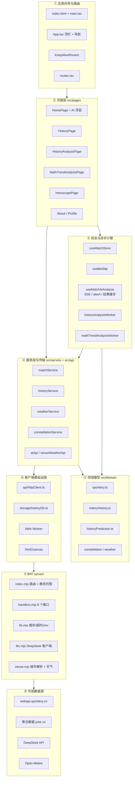
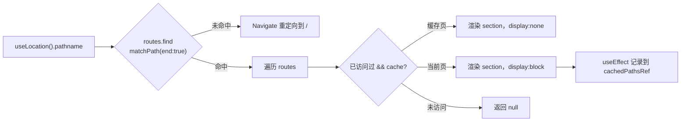
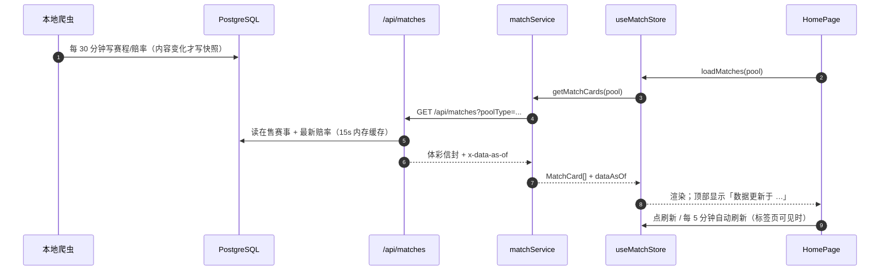
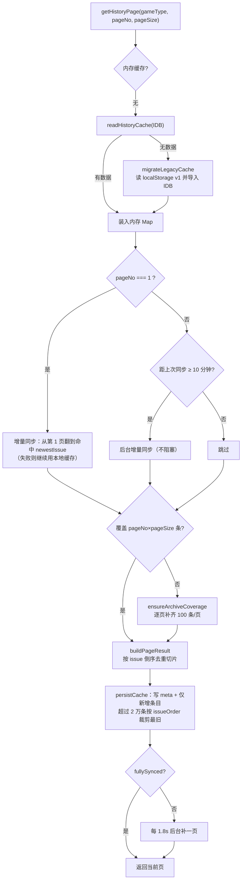
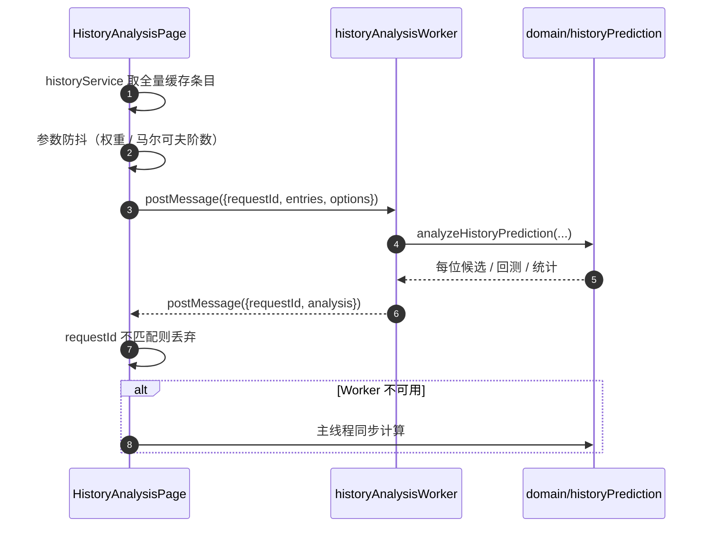
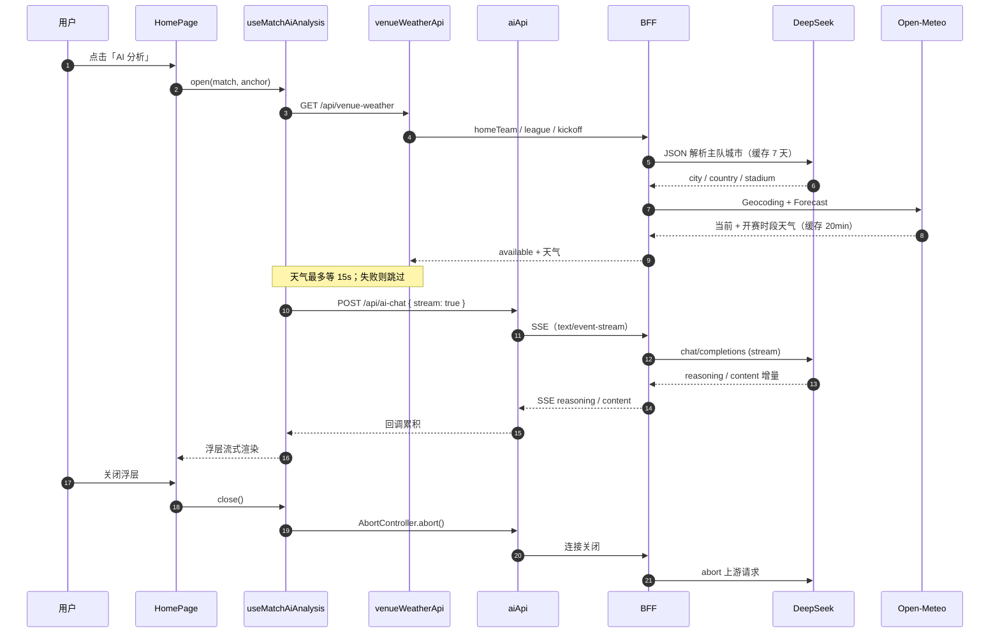
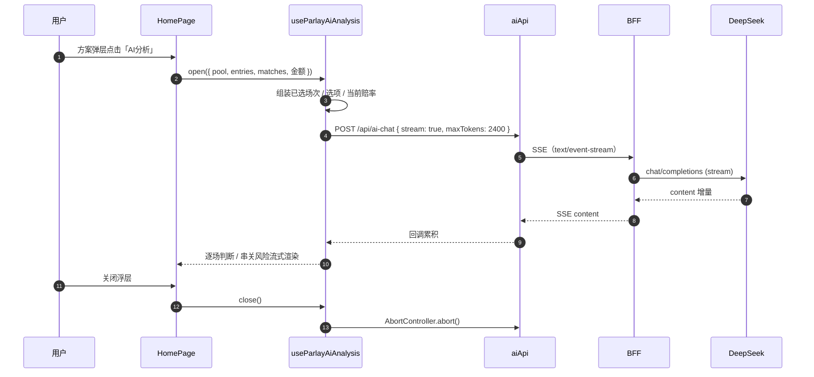
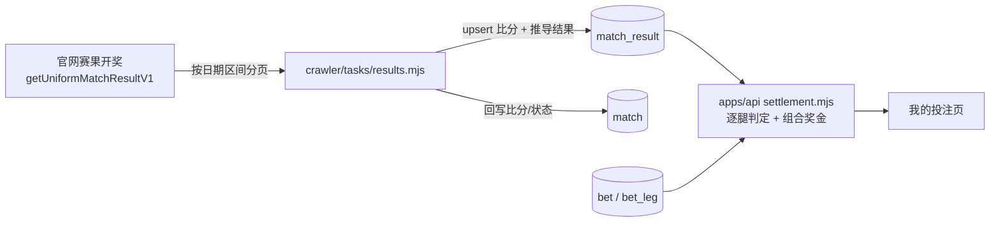
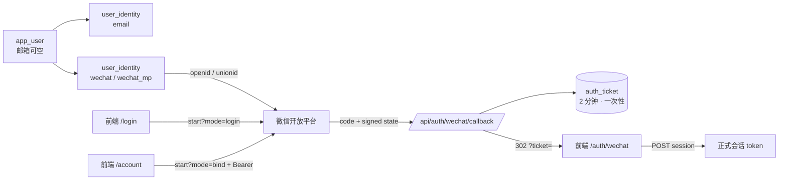

# ticai · 体彩助手 架构说明

> 中国体彩「排列五」开奖历史 + 竞彩足球赔率投注方案 + 两种号码预测分析，附带星座运势 / 天气。
>
> **架构形态**：React SPA（静态托管） + 独立 Node API（`apps/api`，只读库） + 本地爬虫（`apps/crawler`，写库）。
> 浏览器只与自有 API 通信；第三方密钥、提示词、上游访问全部留在服务端。
>
> 2026-10-23 起 `server/` 与 `api/` 两个旧 BFF 目录已删除。下文第 6、8 章中出现的「BFF」等价于今天的 `apps/api`，
> 接口契约以 [docs/api.md](api.md) 为准。


> 矢量源文件：[architecture.svg](./architecture.svg)（可直接在浏览器打开，或嵌入 PPT / 设计稿）
>
> 架构图由 [`scripts/update-architecture.mjs`](../scripts/update-architecture.mjs) 根据当前仓库文件清单自动生成；
> `pre-commit` hook 会在提交前同步 SVG / PNG，新增模块会自动出现在图中。

---

## 1. 项目速览

| 项目 | 内容 |
| --- | --- |
| 名称 / 版本 | `ticai` 0.0.0（私有） |
| 形态 | SPA 静态托管 + 独立 API 服务（两个 Vercel 项目，生产用同源 `/api` rewrite 代理） |
| 前端规模 | TS/TSX 60 个文件；SCSS 单文件 5 300+ 行 |
| 服务端规模 | `apps/api`：11 个接口、提示词与官方数据装配；`apps/crawler`：赛程/开奖/伤停/阵容四条链路 |
| 数据层 | PostgreSQL 16 张表 + 2 个视图：API 只读，爬虫只写（`db/README.md`） |
| 构建产物 | `dist/assets/index-*.js` ≈ 570 KB + 84 KB CSS + 2 个 Worker chunk |
| 运行时 | 浏览器（ES2022+）+ Node ≥ 20（内置 `fetch` / `AbortSignal.timeout`） |
| 依赖 | 前端：React 19、React Router 6、Zustand 5、html2canvas、Sass；服务端仅 `pg`；爬虫可选 `playwright`（阵容） |
| 工程设施 | Git hooks（架构图、密钥扫描、自动部署）+ `node:test` 单测 40+ 个 |
| tsconfig | `strict` **未开启**；开启 `noUnusedLocals`、`noUnusedParameters`、`erasableSyntaxOnly`、`verbatimModuleSyntax` |

### 功能地图

| 路由 | 页面 | 核心能力 | 数据来源 |
| --- | --- | --- | --- |
| `/` | 赛事投注 | 5 种玩法池、赔率勾选、串关注数/金额/最高奖金/税、首屏骨架屏、方案级 AI 串关分析、高清快照 | `GET /api/matches` |
| `/history` | 开奖历史 | 排列五 / 七星彩 / 大乐透走势；大乐透前后区号码矩阵 + 右侧前区逐期指标（和值 / 跨度 / 奇偶比 / 大小比 / 三区比），并按近期频次与遗漏给出下期 5+2 号码参考和理由、首屏骨架屏、预测摘要 | `GET /api/history` + IndexedDB |
| `/history-analysis` | 分析页面 | 频次/遗漏/马尔可夫/滚动回测/组合推荐/冷热统计，首屏骨架屏 | 本地 IndexedDB 数据 |
| `/math-trend-analysis` | 数学走势 | 线性回归趋势、预测中心、波动率、大样本回测，首屏骨架屏 | 本地 IndexedDB 数据 |
| `/horoscope` | 星座运势 | 12 星座 × 5 种时间维度 + 基于 IP 的天气 | `/api/horoscope`、`/api/weather`、`/api/ip` |
| `/results` | 赛果开奖 | 按比赛日翻看比分与五个玩法的开奖结果，未开奖场次明确标注 | `GET /api/results` |
| `/login` | 登录 / 注册 | 邮箱 + 密码，或邮箱验证码（Resend）；登录态存 localStorage，请求带 Bearer | `/api/auth/*` |
| `/account` | 账号 | 账号资料与登录方式；绑定 / 解绑微信，展示绑定状态 | `/api/auth/identities`、`/api/auth/wechat/*` |
| `/my-bets` | 我的投注 | 保存的投注方案，按玩法分类、按赛果自动判中奖与奖金；骨架屏、单注详情弹层（截图 / 回填到投注页） | `/api/bets` + `/api/results` |
| `/about` | 关于页 | Keep-Alive 演示（输入框保留） | 无 |
| `/profile` | 个人页 | 不缓存演示，**不在导航中** | 无 |

---

## 2. 技术栈与运行方式

| 关注点 | 选型 |
| --- | --- |
| 视图 | React 19.2 函数组件 + Hooks，无 UI 组件库，手写语义化 class |
| 类型 | TypeScript 6.0，`import type` 风格，无 `enum` |
| 构建 | Vite 8 + `@vitejs/plugin-react`，`tsc && vite build`，无自定义分包 |
| 路由 | react-router-dom 6，但**不用 `<Routes>`**，自研 `KeepAliveRoutes` |
| 状态 | Zustand 5（`matchStore`）+ 自定义 hook（`useBetSlip`） |
| 样式 | 单个 `src/styles/global.scss`（BEM，3 534 行） |
| 计算 | Web Worker（`type: 'module'`）承载预测算法，另有主线程降级路径 |
| 持久化 | IndexedDB（开奖历史）；localStorage 仅剩迁移入口与死代码 |
| 传输 | 浏览器 `fetch('/api/*')`（默认同源，Vercel rewrite 转发到 API 项目）；API 只读库，不直连上游 |
| 截图 | html2canvas → `canvas.toDataURL('image/png')` |

### 运行方式

```bash
npm install
cp .env.example .env        # DATABASE_URL + 聚合数据 / DeepSeek 密钥

npm run dev                 # API :3001 + Vite :5173（/api 走代理）
npm run dev:api             # 只起 API
npm run dev:web             # 只起前端
npm run crawl:daemon        # 本地爬虫（抓上游、写云端库）

npm run build               # 构建静态资源 → Vercel（前端项目）
```

| 环境变量 | 默认值 | 说明 |
| --- | --- | --- |
| `API_HOST` / `API_PORT` | `127.0.0.1` / `3001` | API 监听地址；默认只绑本机 |
| `DATABASE_URL` | — | PostgreSQL 连接串（API 与爬虫共用） |
| `DATABASE_SSL` | — | 云端库（Prisma Postgres 等）需设 `1` |
| `CORS_ORIGINS` | `http://localhost:5173` | 允许的前端来源，逗号分隔 |
| `VITE_API_BASE` | 空（同源） | 构建时写入前端 bundle 的 API 地址；留空时走同源 `/api` 代理 |
| `UPSTREAM_TIMEOUT_MS` | `8000` | 上游请求超时 |
| `JUHE_WEATHER_KEY` | — | 缺失时 `/api/weather` 返回 503 |
| `JUHE_HOROSCOPE_KEY` | — | 缺失时 `/api/horoscope` 返回 503 |
| `JUHE_IP_KEY` | — | 缺失时 `/api/ip` 返回空归属地（前端回退默认城市） |
| `DEEPSEEK_API_KEY` | — | `/api/ai-chat` 与比赛地城市解析；缺失时 503 / 天气降级 |
| `DEEPSEEK_MODEL` | `deepseek-flash` | 也可用 `deepseek-v4-pro` |
| `DEEPSEEK_BASE_URL` | `https://api.deepseek.com` | OpenAI 兼容接口地址 |
| `DEEPSEEK_TIMEOUT_MS` | `60000` | 大模型上游超时 |
| `AI_RATE_LIMIT_PER_MIN` | `10` | `/api/ai-chat` 单实例限流 |
| `VENUE_RATE_LIMIT_PER_MIN` | `20` | `/api/venue-weather` 单实例限流 |
| `SPORTTERY_BASE` / `JUHE_*_BASE` | 官方地址 | 指向 mock 服务即可离线联调 |

### 分层与依赖规则



**依赖规则（实际执行情况）**

- `pages → features/betting`：只有赛事投注页有 UI 拆分，其余页面仍自包含。
- `pages → service → api/httpClient → /api/*`：统一传输层，**前端不再出现任何上游域名或密钥**。
- `pages → domain`：分析页直接调用纯函数算法（`HistoryAnalysisPage` 通过 Worker）。
- `domain` 不依赖 React/DOM，可被 Worker 直接复用。
- `apps/api` 与 `apps/crawler` 不依赖前端代码，只通过 HTTP 契约与数据库耦合。

---

## 3. 目录结构

```text
D:\ticai
├─ index.html                  # 挂载点 <div id="app">
├─ vite.config.ts              # /api → 本地 API 代理（端口从 .env 读取）
├─ tsconfig.json               # bundler 模式、noEmit、未开 strict
├─ package.json                # dev / dev:api / build / crawl:* / db:*
├─ .env / .env.example         # 数据库与第三方密钥（.env 已被 .gitignore 忽略）
├─ public/                     # favicon.ico / favicon-32.png / apple-touch-icon.png / icon-192|512.png、icons.svg
├─ apps/
│  ├─ api/                     # ★ 独立服务端：只读库，对外 11 个接口
│  │  ├─ src/app.mjs           # 路由表、CORS、错误信封
│  │  ├─ src/handlers/         # matches|history|match-detail|ai|parlay|venue|ip|health
│  │  ├─ src/ai/prompt.mjs     # 单场提示词与官方数据装配
│  │  ├─ src/ai/parlay-prompt.mjs
│  │  └─ src/db.mjs            # pg 连接池（懒加载）
│  └─ crawler/                 # ★ 本地爬虫：只写库
│     ├─ src/tasks/matches.mjs # 赛程 + 赔率快照 + 自动下架
│     ├─ src/tasks/history.mjs # 四彩种开奖
│     ├─ src/tasks/details.mjs # 伤停 + 赛果
│     ├─ src/tasks/lineups*.mjs# 阵容（500.com + Playwright）
│     ├─ src/bet-window.mjs    # 竞彩销售时段闸门
│     └─ src/daemon.mjs        # 常驻调度器
├─ db/
│  ├─ migrations/              # 0001_init / 0002_match_feed
│  ├─ seed/                    # 四彩种
│  └─ maintenance.sql          # 阵容/赔率/抓取记录保留策略
├─ scripts/
│  ├─ dev.mjs                  # 并行拉起 API + Vite，任一退出则联动关闭
│  ├─ db-migrate.mjs           # 迁移执行器（up|seed|status|verify）
│  ├─ ai-smoke.mjs             # npm run ai:check 密钥连通性自检
│  ├─ update-architecture.mjs  # 按文件清单生成 architecture.svg/.png
│  ├─ install-git-hooks.mjs    # 安装 pre-commit / pre-push hooks
│  ├─ git-hooks/               # 进仓库的 hook 源文件
│  ├─ deploy-local.mjs         # 临时目录构建 + Vercel 预构建部署（前端）
│  └─ deploy-api.mjs           # 临时目录上传源码 + Vercel 构建（API）
└─ src
   ├─ main.tsx                 # createRoot + BrowserRouter + 全局样式
   ├─ App.tsx                  # 顶栏 + 导航 + <AppRouter/>
   ├─ router
   │  ├─ KeepAliveRoutes.tsx   # matchPath + display 切换的缓存路由
   │  ├─ routes.tsx            # appRoutes(7) / navLinks(5)
   │  └─ AppRouter.tsx / types.ts
   ├─ pages
   │  ├─ HomePage.tsx          # 511 行：状态编排 + 组合子组件 + 方案弹层
   │  ├─ HistoryPage.tsx       # 920 行：走势矩阵 + 大乐透号码推演 + 右栏指标
   │  ├─ HistoryAnalysisPage   # 720 行（仍未拆分）
   │  ├─ MathTrendAnalysisPage # 437 行（仍未拆分）
   │  └─ HoroscopePage / AboutPage / ProfilePage
   ├─ features/betting
   │  ├─ MatchListSkeleton.tsx # 首屏一屏骨架屏（按内容区高度补卡片）
   │  ├─ AiAnalysisPanel.tsx   # 单场 AI 分析浮层 / 移动端底部抽屉
   │  ├─ useMatchAiAnalysis.ts # 单场 SSE 状态机、天气、结果缓存
   │  ├─ ParlayAiAnalysisPanel.tsx # 方案级逐场判断 / 串关风险面板
   │  ├─ useParlayAiAnalysis.ts # 串关 SSE 状态机 + 方案缓存
   │  ├─ parlayAiAnalysis.ts   # 串关提示词、关键风险摘要解析
   │  ├─ aiAnalysisCache.ts    # AI 结果 localStorage 缓存（3 小时 TTL）
   │  ├─ aiAnalysis.ts         # 单场提示词构建、推荐摘要解析
   │  ├─ useBetSlip.ts         # 选择态、串关、注数/金额/最高奖金
   │  ├─ betSlipMath.ts        # 纯函数：组合乘积、税率、过关上限、标签格式化
   │  ├─ parlayModel.ts        # 一键串关模型：去水 → 拟合 λ → 泊松 → EV → 三选
   │  ├─ useAutoParlay.ts      # 分析流水线状态机（分批 + 进度）
   │  ├─ AutoParlayPanel.tsx   # 分析过程可视化（步骤、进度、串关明细）
   │  ├─ MatchPoolList.tsx     # 赛事卡片 + 赔率选项 + 混合过关展开 + AI 按钮
   │  ├─ BetSlipFooter.tsx     # 底部投注栏（过关/倍数/金额）
   │  ├─ PlanModal.tsx         # 方案弹层（截图专用元信息）
   │  └─ SnapshotOverlay.tsx   # 截图悬浮窗 + 大图预览
   ├─ storage
   │  └─ historyDb.ts          # ★ IndexedDB 仓储：读写、裁剪、清空
   ├─ service
   │  ├─ historyService.ts     # 缓存状态机（544 行）：内存 + IDB + 增量同步
   │  ├─ matchService.ts       # 赔率 → MatchCard 视图模型
   │  ├─ weatherService.ts     # /api/weather + /api/ip
   │  ├─ constellationService.ts
   │  └─ counterService.ts     # 死代码（无消费方）
   ├─ domain
   │  ├─ historyPrediction.ts  # 1064 行预测算法（纯函数）
   │  ├─ lotteryHistory.ts     # ★ 开奖记录 / 缓存元数据类型
   │  ├─ dltIndicators.ts      # 大乐透前区/后区逐期指标与解析（纯函数）
   │  ├─ dltRecommendation.ts  # 大乐透 5+2 号码推演：频次/遗漏评分 + 形态筛选 + 理由
   │  ├─ sporttery.ts / constellation.ts / weather.ts / counter.ts
   ├─ workers                  # 2 个 Worker 协议实现
   ├─ api
   │  ├─ httpClient.ts         # 超时 + AbortSignal + 统一 ApiError
   │  ├─ sportteryApi.ts       # /api/matches、/api/history
   │  ├─ aiApi.ts              # POST /api/ai-chat（askAi / askAiText / askAiStream）
   │  ├─ venueWeatherApi.ts    # GET /api/venue-weather
   │  └─ types.ts              # BffEnvelope<T>
   ├─ styles/global.scss
   ├─ components/AnalysisPageSkeleton.tsx # 分析页一屏骨架
   ├─ components/HistoryPageSkeleton.tsx  # 开奖历史页骨架
   ├─ components/DltIndicatorRail.tsx     # 大乐透右栏逐期指标（与号码矩阵逐行对齐）
   ├─ components/DltRecommendationPanel.tsx # 大乐透 5+2 号码参考 + 分析理由
   └─ assets/                  # 未被引用的图片（可删）
```

---

## 4. 路由与 Keep-Alive

`react-router-dom` 只提供 `BrowserRouter`、`NavLink`、`Navigate`、`matchPath`，**没有 `<Routes>`**：



要点：

1. 访问过的页面常驻 React 树，切换只改 `display`，`useState`/滚动位置保留。
2. **无缓存淘汰**：`cachedPathsRef` 只增不减。
3. `/profile`（`cache: false`）切走即卸载。
4. **移动端（≤640px）主导航折叠**：页头只留标题 + 登录/账号 + 汉堡按钮，导航收进两列菜单；
   路由切换时自动收起。桌面端保持平铺。
5. **吸顶不要叠两层**：站点头部吸顶，页面自己的工具条（如首页玩法切换）不再吸顶，
   否则整页可滚动时会互相遮挡；`.app-shell` 用 `100dvh` 跟随移动端可视高度。
6. **路由级 SEO**：`App` 在 pathname 变化时调用 `src/features/seo/seo.ts` 的 `applyPageMeta`，
   设置 title / description / canonical / robots；登录后才可见的页面标记 `noindex`，
   比赛详情页等拿到队名后再覆盖一次标题。静态入口在 `index.html`（OG / JSON-LD / noscript），
   `public/robots.txt` 与 `public/sitemap.xml` 由 Vercel 直接作为静态文件返回。
7. **构建时预渲染**：`npm run build` 末尾跑 `scripts/prerender.mjs`，用 Playwright 打开 `vite preview`，
   把 `/` 直接写回 `dist/index.html`（Vercel 静态文件优先于 rewrite），其余公开路由
   `/results`、`/history`、`/history-analysis`、`/math-trend-analysis`、`/horoscope`、`/about`
   落成 `dist/prerender/*.html` 并由显式 rewrite 提供；构建出的干净壳另存为 `dist/spa.html`，
   供 `/match/:id`、登录后页面等动态路由回落，避免深链先闪首页内容。
   本地 API 不在线或没装浏览器时用 SPA 壳兜底，不影响构建。
4. 精确匹配为主；`/match/:matchId` 是唯一的动态路由（`cache: false`），切换不同 `matchId` 时组件不卸载，但 `useMatchDetail` 会按 id 重新拉取。
5. 副作用常驻：页面的定时器与后台请求在切走后仍运行（`historyService` 的后台补页就是全局单例，不受影响）。

对战详情有两条入口，同一份正文组件（`MatchDetailContent`）：

| 端 | 形态 | 实现 |
| --- | --- | --- |
| PC（≥768px） | 弹框 | `MatchDetailDialog`，portal 到 body，Esc / 遮罩 / × 关闭 |
| H5（<768px） | 独立页面 `/match/:matchId` | `MatchDetailPage`，带返回按钮 |

---

## 5. 核心数据流

### 5.1 赛事投注（`/`）



数据新鲜度直接来自响应头 `x-data-as-of`（库里 `max(last_seen_at)`），页头把它显示成「刚刚 / N 分钟前」，
超过 45 分钟标黄——这样「是页面没刷新」还是「爬虫真的没跑」一眼能分清，不用再去翻日志。

**首屏与方案快照细节**

1. 首屏加载时 `MatchListSkeleton` 读取 `.home-page__content` 的可视高度、单卡高度和 gap，按 `ceil((可视高度 + gap) / (卡片高度 + gap))` 动态补足骨架卡，覆盖一整屏。
2. 方案快照只截 `.plan-modal__card`，不带遮罩和背后的赛事列表；截图倍率按 DPR 取 3～4 倍。
3. 截图副本中隐藏「AI分析 / 截图 / 关闭」操作，并显示仅截图可见的当前玩法、倍数、投注金额与最高奖金；正常弹层不展示这些附加信息。
4. 截图副本会临时解除弹层最大高度和列表滚动限制，保证所有场次与底部摘要都被完整截入，不会挡住最后一行。

**投注计算规则（`features/betting/betSlipMath.ts`，纯函数）**

| 概念 | 规则 |
| --- | --- |
| 过关上限 | 胜平负 8 串 1、进球数 6 串 1、比分/半全场 4 串 1、混合 5 串 1 |
| 注数 | 每种串法求「所选选项数的组合乘积」，再跨串法求和（`sumCombinationProducts`） |
| 投注金额 | `注数 × 2 元 × 倍数`，倍数上限 50 |
| 最高奖金 | `Σ 各串法 max(赔率) 乘积 × 2 × 倍数` |
| 彩票税 | 奖金 > 10 000 元按 20% 计税 |
| 截图 | `PlanModal` 根节点 → html2canvas → `toDataURL` → 预览/下载 |

### 5.2 开奖历史：IndexedDB 缓存 + 增量同步



开奖历史页的首屏与预测：

- 首次加载时 `HistoryPageSkeleton` 覆盖预测摘要 / 号码推演卡和走势表的占位，不再先渲染空表格；
- 7755 期全量预测从主线程 `useMemo` 迁移到 `historyAnalysisWorker`，避免首屏计算卡死；
- 预测按「样本数 + 首期 + 末期」签名去重，翻页时复用同一份分析结果，不重复跑全量回测；
- 走势表格的 `TrendGrid` 用 `memo` 隔离，Worker 返回预测时只更新表头预测/回测摘要，不重建 5×30×10 个单元格。
- 大乐透前区逐期指标由 `domain/dltIndicators.ts` 纯函数计算（和值、跨度、奇偶比、大小比、三区比），`DltIndicatorRail` 渲染为桌面右栏，移动端卡片复用同一套口径；
- 桌面四列（期号轴 / 前区 / 后区 / 指标栏）共用行高（表头 2.125rem、统计区 2.7rem、每期 1.875rem）逐行对齐，期号轴左侧标注「出现次数 / 当前遗漏」；64–75rem 收窄号码字号，避免 35 列两位数挤压。
- 大乐透 5+2 号码推演由 `domain/dltRecommendation.ts` 同步计算（最多取最近 300 期），`DltRecommendationPanel` 展示主推号码、备选与逐条理由；移动端与桌面共用同一份 DOM，窄屏上下堆叠；
- 推演口径：近 10 / 30 / 300 期频次按期望次数归一，遗漏按平均间隔归一（封顶 3 倍）；前区每区取评分前 4 共 12 码，枚举 5 码组合，再用近 30 期和值 / 跨度 / 奇偶 / 大小 / 三区均值打分；后区取 5 码候选池枚举 2 码；理由引用实际频次、遗漏与结构数据。

存储设计（`src/storage/historyDb.ts`）：

| 项 | 值 |
| --- | --- |
| 数据库 | `ticai`，version 1 |
| `history_meta` | keyPath `gameType`；同步元数据（页数、已加载页、newestIssue、时间戳） |
| `history_draws` | keyPath `key = ${gameType}:${issue}`；索引 `byGame`、`byGameOrder = [gameType, issueOrder]` |
| 写入策略 | 只写新增条目（按 issue 差集），元数据同事务更新 |
| 容量治理 | 上限 20 000 条，`byGameOrder` 游标删除最旧记录，内存同步裁剪 |
| 旧数据迁移 | 首次读不到 IDB 时导入 `ticai:history-cache:v1`，成功后删除该 key |
| 降级 | 隐私模式等 IDB 不可用 → 纯内存运行（不持久化），页面仍可用 |

### 5.3 分析计算（Worker）



算法要点：近期/长期频次 + 遗漏补偿 + 一阶/二阶转移加权打分；滚动回测 top1/top3；马尔可夫模式后继分布；组合推荐与冷热/和值/跨度统计；数学趋势页额外做线性回归斜率、预测中心、标准差波动率（240 期窗口、120 期起验证）。

两个分析页在首次拉取历史数据（`state.loading`）时渲染 `AnalysisPageSkeleton`：预测 hero、权重/模型面板、概览和走势卡都有占位块，顶部统计 chips 也换为骨架，避免先闪出一屏 `0 / --` 再跳变。首屏 state 直接初始化为 loading，加载完成后才挂载真实内容。

> ✅ `HistoryPage` 已将全量预测迁移到 `historyAnalysisWorker`，并用签名去重避免翻页时重复计算；主线程只负责渲染当前页走势。

### 5.4 比赛 AI 分析（SSE）



要点：

1. 城市解析依赖 DeepSeek，天气来自 Open-Meteo；两者都有缓存，失败时不阻塞分析，只在提示词里标注「天气缺失」。
2. `aiApi` 解析 SSE 的 `reasoning` / `content` / `done` / `error`，前端只拼接文本；流式请求有 120s 总超时。
3. 关闭浮层会 abort 客户端请求，BFF 监听 `res` 的 `close` 事件后同步 abort DeepSeek，避免继续生成。

### 5.5 方案级 AI 串关分析（SSE）



要点：

1. 只分析当前方案已选场次，不额外拉取未选比赛；提示词要求逐场覆盖、不新增比赛。
2. 输出固定包含「总评 / 逐场分析 / 串关建议 / 结论」，解析「整体风险、综合信心、一句话总结」做摘要。
3. 缓存键为「玩法 + 过关方式 + 场次 + 选项」，同一方案重复打开不重复扣费；关闭浮层会 abort SSE。
4. 单场与方案结果写入 `localStorage`，TTL 3 小时；方案未命中时仍只发一次请求，但会把已缓存单场分析带入提示词复用。
5. 与单场分析不同，方案级分析不逐场请求比赛地天气，避免 N 场串关产生 N 次城市解析与天气请求。

### 5.6 星座与天气

1. `weatherService.getWeatherByLocation()`：`GET /api/ip` 拿城市 → `GET /api/weather?cityname=`；定位失败回退默认城市 `宝山`。
2. `constellationService.getHoroscope()`：`GET /api/horoscope?consName=&type=`。
3. 两个请求各自 `AbortController`，同一 `reloadSeed` 触发刷新。

---

### 5.7 赛果开奖 → 投注结算

过去「赛果」是逐场从 `getMatchResultV1`（球队视角的近期赛果）里捞，一场一个请求。
2026-10 起改用官网赛果开奖接口，一次一批：



- **推导集中在爬虫**（`normalize.mjs`）：上游只给比分和胜平负，`hhad/ttg/crs/hafu`
  由 `crsKey` / `hafuKey` 等纯函数算出，key 与前端玩法选项一致；
  单测覆盖「胜其它 / 平其它 / 负其它」等边界。
- **关联**：`match_result.match_id` 回填到当时在售的 `match` 行（按 `sporttery_match_id`），
  老的赛程/详情接口不需要改就能看到比分。
- **少爬**：`details` 默认不再抓赛果 feed，每场请求数 2 → 1；没有待开奖比赛时
  `results` 连请求都不发（`hasPendingResults` 先查库）。
- **结算实时算**：`bet` 只存下注时的赔率/让球/过关方式快照，中奖与奖金每次读取时
  用 `match_result` 重算，所以开奖数据更新后「我的投注」刷新即变，不需要后台结算任务。
- **单注奖金限额**：按体彩规则对每一注封顶——单场 10 万、2/3 串 20 万、4/5 串 50 万、
  6 串及以上 100 万；倍数按多注处理，每注各自封顶后相加。前端「理论最高奖金」与
  服务端结算奖金都走同一条规则，超过时在投注栏打「封顶」角标。
  （`getPayoutLimit()` / `computePlanMetrics()` / `settleBet()`）

---

### 5.8 账号与第三方身份（微信）

账号（`app_user`）与登录方式（`user_identity`）是两层：



设计要点：

- **一个账号多条身份**：邮箱注册的用户再绑微信，是给已有账号加一条 `wechat` 身份，投注记录不动；
  反过来微信首次登录没有邮箱，就直接建一个 `email = null` 的账号。
- **state 自签名**：HMAC 里带 mode、渠道、绑定用户 id 与 10 分钟过期，不依赖服务端 session 存储，多实例也成立。
- **回调不直发 token**：URL 会进历史记录/日志，所以只放 2 分钟、一次性的 `auth_ticket`，前端换取正式会话后立即作废。
- **渠道可扩展**：`wechat_web`（开放平台扫码）与 `wechat_mp`（公众号网页授权）共用同一条回调与建号逻辑；
  以后接小程序/Apple 只是新增 `channel` 与一个 adapter（`apps/api/src/wechat.mjs`）。
- **未接入时给指引**：没配 `WECHAT_*` 时 `config` 返回 `enabled: false` 与 `missing`，登录页/账号页把按钮变成「接入步骤」弹层，不影响邮箱登录与投注。

---

## 6. 接口契约（已迁移到 apps/api）

> 2026-10-23 起接口实现位于 `apps/api`，`server/` 与 `api/` 已删除。
> **完整契约以 [docs/api.md](api.md) 为准**（11 个接口、SSE 协议、错误码、字段双写）。
> 本章保留早期的设计说明，其中「BFF」一律等价于今天的 `apps/api`。
> 新增：`POST /api/ai-parlay`（串关分析，只收选中的场次与选项）。

| 路径 | 上游 | 入参（均白名单校验） | 缓存 |
| --- | --- | --- | --- |
| `GET /api/matches` | 体彩 `getMatchCalculatorV1` | `poolType` ∈ had/crs/ttg/hafu/mixed | 20 s |
| `GET /api/history` | 体彩 `getHistoryPageListV1` | `gameNo`(4-8 位数字)、`pageNo`≥1、`pageSize`≤100、`provinceId`、`isVerify`、`termLimits` | 60 s |
| `GET /api/horoscope` | 聚合 `constellation/getAll` | `consName` ∈ 12 星座、`type` ∈ 5 种 | 10 min |
| `GET /api/weather` | 聚合 `weather/index` | `cityname`(≤64 字符，去控制字符)、`dtype`、`format` | 10 min |
| `GET /api/ip` | 聚合 `ip/ipNewV3`（可选） | 无（取连接 IP / `x-forwarded-for`） | 30 min |
| `POST /api/ai-chat` | DeepSeek `chat/completions` | JSON body：`messages`（≤40 条、单条 ≤15000 字符、合计 ≤30000 字符）、`temperature`、`maxTokens`、`json`、`thinking`、`reasoningEffort`、`stream` | 无 |
| `GET /api/venue-weather` | DeepSeek 城市解析 + Open-Meteo | `homeTeam`、`league`、`kickoff`、`teamId` | 城市 7 天；天气 20 min |
| `GET /api/health` | — | 无 | 无 |

> `/api/history` 的库在远端 Prisma Postgres。`apps/api` 已把开奖与奖级合并为一次查询、彩种元数据做进程内缓存，连接池空闲保留 30 分钟（`DATABASE_IDLE_TIMEOUT_MS` 可调），本地/VPS 入口启动时预热并每 4 分钟 `select 1` 保活（`DATABASE_KEEPALIVE_MS` 可调，0 = 关闭）。响应头 `Server-Timing` 会给出 `db / resolve / reshape / app` 分段耗时。实测 SQL 执行仅 8–11ms，请求慢主要在跨境建连（5–7s）与每次 DB 往返（0.4–1s）；本地/自建服务可靠连接复用规避，Vercel 冷启动仍建议换池化或就近的数据库入口。

响应形态三类：

- **体彩信封原样透传**：`{ success, errorCode, errorMessage, value }`（前端 `sportteryApi` 逻辑不变）。
- **BFF 统一信封**：`{ success, data }` 或 `{ success:false, errorMessage }`（天气/星座/IP/AI）。
- **SSE**：`/api/ai-chat` 传 `stream: true` 时返回 `text/event-stream`，事件为 `reasoning`/`content`/`done`/`error`。

比赛 AI 分析链路：`MatchPoolList` → `useMatchAiAnalysis` → `GET /api/venue-weather`（DeepSeek 解析主队城市 + Open-Meteo 天气）
→ `askAiStream` → `POST /api/ai-chat`（SSE）→ DeepSeek。城市解析失败时返回 `available:false`，分析继续但注明天气缺失。
方案 AI 链路：`PlanModal` → `useParlayAiAnalysis` → `buildParlayAnalysisMessages`（只包含已选场次）→ `POST /api/ai-chat`（SSE）→ DeepSeek；
按「玩法 + 过关方式 + 场次 + 选项」缓存，关闭时 abort。
服务端在首个增量前不写响应头，因此参数/鉴权/限流错误仍按普通 JSON 错误返回；结果按 `pool:matchId` 缓存在页面内存。
关闭浮层时前端 `AbortController` 取消请求，BFF 在 `res` 的 `close` 事件里同步中止 DeepSeek 上游；天气查询最多等 15s，超时按缺失处理。

错误约定：参数非法 `400`、请求体过大 `413`、方法不允许 `405`、未知接口 `404`、上游失败 `502`、上游超时 `504`、缺密钥 `503`、AI 限流 `429`。

安全姿态：

- 密钥仅存在于服务端 `.env`；构建产物中**已确认不含任何密钥或上游域名**。
- 默认只监听 `127.0.0.1`，且无 CORS 头（仅同源可用）。
- 入参全部白名单/类型校验，不透传任意 query。
- `/api/ai-chat` 有单实例内存限流（默认 10 次/分钟/IP），但**没有鉴权**：公网部署前仍需登录或网关限流，否则密钥额度会被他人消耗。
- `/api/venue-weather` 另有限流（默认 20 次/分钟/IP），且城市解析结果与天气均缓存，避免重复调用模型与上游。
- ⚠️ 其余接口**没有鉴权与限流**：一旦对外暴露，配额仍可能被刷；对外部署需前置网关鉴权或在 BFF 增加限流。

---

## 7. 持久化与缓存

| 存储 | key / store | 写入方 | 内容 | 生命周期 |
| --- | --- | --- | --- | --- |
| IndexedDB | `ticai` → `history_meta` / `history_draws` | `historyService` | 全量开奖条目 + 同步元数据（上限 2 万条） | 持久，按 issueOrder 裁剪 |
| localStorage | `ticai:history-cache:v1` | 旧版本 | 仅剩迁移来源，迁移成功后删除 | 一次性 |
| localStorage | `ticai_counter_value` | `counterService` | 单个数字（死代码） | 永久 |
| 内存 | `cacheByGame`（Map） | `historyService` | 会话内权威缓存 | 页面刷新即丢 |
| 内存 | `matchStore.poolCache` | `matchStore` | 5 个玩法池 `{loading,error,cards,fetched}` | 刷新即丢 |
| 内存 | 组件 state | `HomePage` | 选择态、弹层、截图 dataURL | 卸载即丢 |

### 7.1 服务端数据库（PostgreSQL）

体彩数据不再实时透传，改为"爬虫写库 → API 读库"。数据库是三件事的唯一交汇点：


| 域 | 表 | 写入方 | 保留策略 |
| --- | --- | --- | --- |
| 彩票 | `lottery_game` / `lottery_draw` / `lottery_prize_level` | 开奖爬虫（4 个彩种） | 永久 |
| 足球 | `league` / `team` / `team_alias` / `match` / `match_odds_snapshot` | 赛程爬虫 + 赛果爬虫 | 赔率快照 120 天 |
| 赛果 | `match_result` | 赛果开奖爬虫 | 永久（按 sporttery_match_id 幂等覆盖） |
| 补充 | `player` / `injury` / `match_lineup` / `match_lineup_player` | 自建爬虫 | 阵容每队只留最近 1 场 |
| 映射 | `external_ref` | 人工确认后写入 | 永久 |
| 账户 | `app_user` / `email_code` / `user_session` | API（登录链路） | 会话 30 天，验证码 10 分钟 |
| 身份 | `user_identity` / `auth_ticket` | API（登录/绑定链路） | 身份永久；票据 2 分钟一次性 |
| 投注 | `bet` / `bet_leg` | API（登录用户） | 永久（用户删除即级联删除） |
| 可观测 | `crawl_run` | 每条爬虫链路 | 30 天 |

关键设计：

1. **只入库竞彩赛事**：`match.sporttery_match_id` 必填且唯一，第三方数据只 UPDATE 字段、不 INSERT 行，避开跨源实体消解。
2. **比分与半场比分单列**，`htft` 是存储生成列（`h/d/a × h/d/a`），半全场分布可直接分组统计；`match_side` 视图把主客方向拉平，并用 `translate(htft,'ha','ah')` 翻转客队视角。
3. **赔率快照按 `content_hash` 去重**，内容不变不写行，是唯一需要保留策略的表。
4. **`crawl_run` 是数据新鲜度的唯一来源**，API 用它回答"当前数据是多少分钟前的"，而不是猜上游。

实现与运维细节见 [db/README.md](../db/README.md)。

### 7.2 独立 API 服务（`apps/api`）

8 个接口从 `server/` + `api/*.js` 抽成独立服务：零框架、零构建，只依赖 `pg`。同一份 `createApp()` 同时给本地/VPS 的 `node:http` 和 Vercel 函数使用，不存在两套实现。

| 接口 | 数据来源 | 说明 |
| --- | --- | --- |
| `/api/matches` | 数据库 | 库 → 体彩 `matchInfoList` 信封；忽略 `poolType`，一次返回全部玩法 |
| `/api/results` | 数据库 | 赛果开奖：比分 + 五个玩法结果（`had/hhad/ttg/crs/hafu`），按**真实开赛时间**筛选与升序 |
| `/api/auth/code` `/register` `/login` `/logout` `/me` | 数据库 + Resend | 邮箱验证码 / 密码登录，Bearer 不透明 token，服务端只存 sha256 |
| `/api/bets` `/api/bets/:id` | 数据库 | 保存投注快照、按玩法筛选、实时结算（读 `match_result`） |
| `/api/auth/wechat/*`、`/api/auth/identities` | 数据库 + 微信开放平台 | 微信扫码/网页授权；回调只发一次性 ticket，前端换会话；未配置时前端展示接入步骤 |
| `/api/history` | 数据库 | 库 → `{list,pageNo,pageSize,pages,total}`；金额字段同时输出上游真名与历史误用名 |
| `/api/match-detail` | 数据库 | 对战详情 7 个板块（交锋/伤停/近况/未来/特征/积分/射手），**缺失返回 null、空分组保留空数组，并列出 `missing`** |
| `/api/ai-analysis` | 数据库 + DeepSeek | **只收 `matchId` + `pool`**：服务端装配提示词（`apps/api/src/ai/prompt.mjs`）、官方数据、天气，SSE 先发 `meta` 再流式输出 |
| `/api/horoscope` `/api/weather` `/api/ip` | 聚合数据 | 代理 + TTL 缓存 |
| `/api/venue-weather` | DeepSeek + Open-Meteo | 城市解析 + 天气 |
| `/api/ai-chat` | DeepSeek | `stream:true` → SSE |
| `/api/health` `/healthz` | 数据库 / — | readiness（库不通 503）与 liveness 分离 |

关键约定：**响应形状不变**，所以前端 `matchService` / `historyService` 一行不改就能切到新服务；切流只需给前端加 `VITE_API_BASE`。

前端 AI 分析会在打开面板时并行拉取 `/api/match-detail`，把伤停、历史交锋、近期战绩、联赛排名、射手写进提示词（[src/features/betting/aiAnalysis.ts](../src/features/betting/aiAnalysis.ts) 的 `formatMatchDetail`）。接口不可用时静默降级为 null，**不改变原有行为**；数据缺失时提示词明确写「缺失，不要编造」，而不是交给模型猜。

### 7.3 独立爬虫（`apps/crawler`）

与主应用、API 都隔离：自己的 `package.json`、自己的进程，不 import 任何应用代码，只写数据库。

```
体彩 webapi ──▶ apps/crawler ──写──▶ PostgreSQL ──读──▶ apps/api ──▶ 前端
```

| 任务 | 数据源 | 写入 | 频率 |
| --- | --- | --- | --- |
| `matches` | 体彩 | `league` / `team` / `match` / `match_odds_snapshot` | 每 30 分钟（销售时段内） |
| `results` | 体彩赛果开奖 | `match_result` + 回写 `match` 比分 | 每 30 分钟；没有待开奖比赛时自动跳过 |
| `history` | 体彩 | `lottery_draw` / `lottery_prize_level` | 每 3 小时 |
| `details` | 体彩 | `injury` / `player` / `match_feed` | 每 3 小时（默认只抓伤停） |
| `lineups` | 500.com | `match_lineup` / `match_lineup_player` / `player` | 每 60 分钟，仅赛前 6 小时窗口 |
| `expire` | —（纯本地） | `match.sell_status` | 每 30 分钟 |
| `official` | 体彩 | 上面几类官方数据 | **每天 09:00**（开盘前预热） |

调度规则（`daemon.mjs`）：

- **销售时段闸门**：平日 11:00–22:00、周末 11:00–23:00（北京时间）。非销售时段盘口不变，`matches` / `details` / `lineups` 直接跳过；`history` 与 `expire` 不受限。
- **开盘补跑**：被闸门跳过时按开盘时刻排一次性定时器，11:00 立刻抓一轮，不用等下一个 30 分钟周期。
- **串行队列**：跨境写库延迟高，几条链路排队执行；上一轮没跑完时同一任务不会重复入队。
- **已开赛兜底**：体彩在结算前仍会返回已开赛的比赛，`matches` 写库时按 `kickoff_at <= now()` 一律记 `closed`，否则会把 `expire` 的结果改回在售。
- **跨零点日期**：`businessDate` 是销售日，凌晨场次的真实比赛日在元素 `matchDate` 上；`kickoff_at` 用 `resolveMatchDate` 拼日期。只按销售日拼会把凌晨场次提前 24 小时，上面那条兜底会连带把在售状态和阵容一起藏掉。

单测覆盖：`normalize`（赛程/开奖/伤停）、`results`（赛果推导：比分 key、半全场、让球、总进球封顶、日期切块）、`daily-schedule`（09:00 倒计时）、`bet-window`（开盘边界与补跑倒计时）；API 侧另有 `settlement`（逐腿判定、复式注数、奖金连乘）。

三个关键事实（实测）：

1. **体彩不需要浏览器**。不带 `Referer` 时体彩 WAF 返回 `HTTP 567`，补齐 `referer`/`origin`/浏览器 UA/`accept-language` 后即 200。爬虫把这套头写死在 `http.mjs`。
2. **对战数据有 7 个接口**（`getInjurySuspensionV1` / `getMatchResultV1` / `getResultHistoryV1` / `getFutureMatchesV1` / `getMatchFeatureV1` / `getMatchTablesV1` / `getMatchPlayerV1`），都挂在 `webapi.sporttery.cn/gateway/uniform/football`，参数是 **`sportteryMatchId`**（不是 `matchId`，用错会静默返回空 `value`）。
3. **比分与半场比分来自 `getMatchResultV1`** 的 `fullCourtGoal` / `halfTimeGoal`；`match.htft` 生成列据此自动产出，半全场分布可直接统计。
4. **阵容必须用浏览器**：体彩没有阵容接口（7 个候选路径全 `E0001`），改用 500.com；它的阵容是 JS 渲染且拦截 headless，所以 `lineups` 用 Playwright + 有头 Chrome，按「场次号」匹配（体彩与 500.com 共用同一套编号）。

每轮写一条 `crawl_run`，`/api/health` 的 `dataSources[].ageSeconds` 直接由它计算。

---

## 8. 关键设计取舍

1. **独立 API 而非浏览器直连**：密钥、提示词与上游访问都留在服务端；代价是多一个需要部署的项目（`ticai-service`）。
2. **零框架 Node API**：不引入 Express/Fastify，用 `node:http`（本地）与单函数（Vercel）共用一套 `createApp()`，避免供应链与安装成本；服务端唯一依赖是 `pg`。
3. **IndexedDB 而非 localStorage**：开奖数据是只追加序列，5 MB 配额与"整份重写"都不合适；改为 meta + 单条记录两 store，只写增量、按序裁剪。
4. **内存 Map 为权威、IDB 为持久化**：读路径零 await 抖动，写入异步且失败静默降级，保证弱网/隐私模式仍可用。
5. **自研 Keep-Alive**：React Router 6 无内置方案，`display:none` + 常驻挂载成本最低；代价是无淘汰、无懒加载。
6. **视图模型下沉到 service**：`MatchCard` 让页面不感知 `ttg/crs/had/hafu` 原始字段。
7. **投注逻辑抽成纯函数 + hook**：`betSlipMath.ts` 可独立测试，`useBetSlip` 让页面只做编排。

---

## 9. 风险与技术债

### 高

| # | 问题 | 位置 | 影响 |
| --- | --- | --- | --- |
| 1 | 只读接口无鉴权 | `apps/api/src/app.mjs` | 赛事/开奖可被任意调用；AI 接口有 IP 限流，其余没有 |
| 2 | 跨境数据库往返 | `apps/api/src/db.mjs` | 单次写 100–300ms，批量抓取变慢；连接数受 Prisma Postgres 限制（`max_connections=50`） |
| 3 | 爬虫依赖本机长驻 | `apps/crawler/src/daemon.mjs` | 机器关机/休眠就没有新数据；可用系统计划任务兜底跑 `official` |

### 中

| # | 问题 | 位置 | 影响 |
| --- | --- | --- | --- |
| 4 | 分析页仍巨型 | `HistoryAnalysisPage` 720 行、`MathTrendAnalysisPage` 437 行 | 与已拆分的 `HomePage` 风格不一致，复用困难 |
| 6 | 单文件全局样式 5 335 行 | `global.scss` | 无作用域隔离，删除困难 |
| 7 | 单 chunk 560 KB，无懒加载 | 构建产物 | 首屏体积偏大，超 Vite 500 KB 告警线 |
| 8 | 类型宽松 | 领域类型含 `[key: string]: unknown`；`strict` 未开 | 接口字段漂移无法在编译期发现 |
| 9 | 截图以 base64 常驻 state | `HomePage.tsx` | 多次截图累积数 MB 内存 |
| 10 | 缓存无 TTL 过期 | `historyService.ts` | 老数据长期保留（裁剪只按数量） |
| 11 | 无 ESLint / Prettier / CI | 全仓 | 已有 `node:test` 单测 54 个，但没有 lint 与流水线 |

### 低

| # | 问题 | 说明 |
| --- | --- | --- |
| 12 | 死代码 | `useCounterStore` / `counterService` / `domain/counter.ts` / `matchStore.addMockCard` / `src/assets/*` |
| 13 | 移动端横向溢出 | 430 px 视口下玩法标签与底部栏仍有被裁切的风险；列表切换的横向滚动条已通过 `overflow-x: hidden` 消除 |
| 14 | 错误边界缺失 | 任一页面抛错仍会整页白屏；加载态已补一屏骨架屏 |
| 15 | 无 404 路由 | 未知路径统一重定向首页 |

---

## 10. 演进建议

1. **BFF 加固**：加 IP 维度限流、简单 token 鉴权、`/api/health` 探活接入编排；必要时换 Fastify 以获得成熟中间件。
2. **测试基线**：给 `betSlipMath.ts`、`historyPrediction.ts`、`historyDb.ts` 加 Vitest（纯函数/仓储，收益最高）；把本次的 CDP 冒烟固化成 `scripts/smoke.mjs`。
3. **继续拆页面**：`HistoryAnalysisPage` 按「参数面板 / 每位明细 / 统计卡」拆分，复用 `useAnalysisWorker`。
4. **分包与懒加载**：路由级 `React.lazy` + 手动 chunk（worker 已独立，主 chunk 约 560 KB）。
5. **样式模块化**：按页拆 `*.module.scss`，`global.scss` 只留 reset 与设计 token。
6. **缓存治理**：加 TTL 与"最近访问"策略；超范围分页明确返回空态提示。

---

## 11. 本次改造记录

| 项 | 改造前 | 改造后 |
| --- | --- | --- |
| 第三方密钥 | 硬编码在 `weatherService` / `constellationService` | 仅在本地 `.env` 与 Vercel 环境变量，由 BFF 读取；bundle 已扫描确认无泄漏 |
| 生产请求地址 | `http://` 直连（HTTPS 站点必被拦截） | 同源 `/api/*`，由 BFF 转发 |
| IP 定位 | 依赖仓库外的 `localhost:3000/api/ip`（无实现） | BFF 实现 `/api/ip`，未配置密钥时优雅降级 |
| 上游治理 | 无缓存、无超时、错误靠文案 | 白名单校验 + TTL 缓存 + 8 s 超时 + 统一错误码 |
| 开奖缓存 | localStorage 单 key 全量，超 5 MB 静默失败 | IndexedDB 两 store，增量写入，2 万条上限裁剪，旧数据自动迁移 |
| 首页 | `HomePage.tsx` 916 行、12 个 `useState` | 511 行 + `features/betting`（hook + 组件 + AI + 快照） |
| 构建 | `npm run build` 失败（`main.tsx` 未使用 React 导入） | 通过，退出码 0 |

### 2026-10-21 增量

| 项 | 内容 |
| --- | --- |
| 首屏骨架屏 | 按内容区高度动态计算卡片数量，覆盖一整屏；切换玩法也复用同一套骨架 |
| 方案级 AI | 弹层内「AI分析」逐场判断已选比赛 + 串关风险；SSE 流式、方案维度缓存、关闭 abort |
| 方案快照 | 只截白色弹框、3～4 倍 DPR 输出、隐藏操作控件；截图副本显示玩法/倍数/金额/最高奖金 |
| 自动交付 | `pre-commit` 同步架构图 + 密钥扫描；`pre-push` 自动 Vercel 预构建部署；hook 源文件已进仓库 |
| 部署隔离 | 使用系统临时目录 + 项目 ID 构建，不依赖仓库根 `.vercel`，避免权限/密钥目录问题 |
| 线上体彩 | 发布构建强制 `VITE_SPORTTERY_DIRECT=1` 并校验 bundle 含体彩域名；Vercel 出口 IP 会被体彩 WAF 拦截 |
| 交互修复 | 玩法切换动画导致的短暂横向滚动条通过内容区 `overflow-x: hidden` 消除 |
| 开奖历史性能 | 7755 期预测在主线程 `useMemo` 中同步计算 | 迁移 `historyAnalysisWorker`，按样本签名去重；走势表格 memo，首屏增加骨架 |
| 分析页骨架 | 分析页 / 数学走势页加载态为文字 | 预测 hero、参数面板、概览和走势区均有一屏骨架 |

**验证证据（本次实跑）**

| 验证项 | 结果 |
| --- | --- |
| `tsc --noEmit` / `npm run build` | 通过，退出码 0 |
| 8 个接口实测（真实上游） | `matches/history/horoscope/weather/ip/ai-chat/venue-weather/health` 均正常；`400/404/405/429` 分支正确 |
| AI 分析链路（真实 DeepSeek） | SSE 增量、关闭 abort、比赛地天气、120s 流式超时均实测 |
| 本地预构建部署 | `vercel build --prebuilt` 上传，云端仅托管；函数产物已剔除 `.env` |
| 生产构建 5 个路由（CDP 驱动 Chrome） | 全部渲染出真实数据，**0 exception、0 console error** |
| 存储层集成测试 | localStorage 3 条 → IDB 迁移成功且旧 key 删除；裁剪 3→2 保留最新；新页面从 IDB 读回 2 条 |
| 真实应用写入 IDB | 访问 `/history` 后落库 100 条（期号 26177–26276），新页面读回一致 |
| 投注计算 | 2 场各选 1 项 → 2串1 = 1 注 = 2 元；2 倍 → 4 元；最高奖金 280 元；方案弹层 2 条 |
| 截图链路 | 弹层截图生成 `data:image/png` 并出现缩略图 |
| 布局回归 | 拆分前后 430×932 截图一致（含既有的横向溢出问题） |

### 2026-10-23 重构：数据层与 AI 全链路

| 项 | 改造前 | 改造后 |
| --- | --- | --- |
| 接口来源 | BFF 实时透传体彩 | 爬虫写库，API 只读库（`apps/api`） |
| 数据存储 | 无 | PostgreSQL 16 张表 + 2 个视图：彩票域、足球域、对战源、可观测性 |
| 爬虫 | 无 | `apps/crawler`：赛程/赔率、四彩种开奖、伤停、赛果、阵容 |
| 阵容 | 无来源 | 500.com + Playwright（有头），按场次号匹配，11 首发 + 替补 |
| AI 分析 | 前端拼 messages 发 `/api/ai-chat` | `POST /api/ai-analysis` 只收 `matchId + pool`，提示词与官方数据下沉服务端 |
| 前端请求 | 天气 + 详情 + 对话 = 3 次 | 1 次；`meta` 事件先返回天气 |
| 部署 | Vercel 单项目 | 前端 `ticai` + 后端 `ticai-service` 两个项目，`VITE_API_BASE` 连接 |
| 投注时段 | 无限制 | matches/details/lineups 过销售时段闸门（平日 11–22、周末 11–23），开盘瞬间补跑一次 |
| 每日预热 | 无 | 每天 09:00 跑一轮「仅体彩官网数据」：停售收敛 + 赛程赔率 + 开奖 + 伤停赛果 |

接口清单与契约见 [docs/api.md](api.md)；数据库与上游字段实况见 [db/README.md](../db/README.md)；爬虫调度与阵容抓取见 [apps/crawler/README.md](../apps/crawler/README.md)。

---

## 12. 关键文件索引

| 关注点 | 文件 |
| --- | --- |
| BFF 入口 / 路由 | [server/index.mjs](../server/index.mjs) |
| BFF 接口实现 | [server/handlers.mjs](../server/handlers.mjs) |
| BFF 基础设施 | [server/lib.mjs](../server/lib.mjs) |
| 开发双进程脚本 | [scripts/dev.mjs](../scripts/dev.mjs) |
| 环境变量样例 | [.env.example](../.env.example) |
| 构建与代理 | [vite.config.ts](../vite.config.ts) |
| 应用入口 / 外壳 | [src/main.tsx](../src/main.tsx)、[src/App.tsx](../src/App.tsx) |
| 缓存路由 | [src/router/KeepAliveRoutes.tsx](../src/router/KeepAliveRoutes.tsx) |
| 投注页 | [src/pages/HomePage.tsx](../src/pages/HomePage.tsx) |
| 投注逻辑 | [src/features/betting/useBetSlip.ts](../src/features/betting/useBetSlip.ts)、[betSlipMath.ts](../src/features/betting/betSlipMath.ts)、[parlayModel.ts](../src/features/betting/parlayModel.ts) |
| 投注组件 | [MatchPoolList.tsx](../src/features/betting/MatchPoolList.tsx)、[MatchListSkeleton.tsx](../src/features/betting/MatchListSkeleton.tsx)、[BetSlipFooter.tsx](../src/features/betting/BetSlipFooter.tsx)、[PlanModal.tsx](../src/features/betting/PlanModal.tsx)、[SnapshotOverlay.tsx](../src/features/betting/SnapshotOverlay.tsx) |
| 单场 AI | [AiAnalysisPanel.tsx](../src/features/betting/AiAnalysisPanel.tsx)、[useMatchAiAnalysis.ts](../src/features/betting/useMatchAiAnalysis.ts)、[aiAnalysis.ts](../src/features/betting/aiAnalysis.ts) |
| 方案 AI | [ParlayAiAnalysisPanel.tsx](../src/features/betting/ParlayAiAnalysisPanel.tsx)、[useParlayAiAnalysis.ts](../src/features/betting/useParlayAiAnalysis.ts)、[parlayAiAnalysis.ts](../src/features/betting/parlayAiAnalysis.ts) |
| AI 本地缓存 | [aiAnalysisCache.ts](../src/features/betting/aiAnalysisCache.ts)（`localStorage`，3 小时 TTL） |
| 自动交付 | [scripts/update-architecture.mjs](../scripts/update-architecture.mjs)、[scripts/deploy-local.mjs](../scripts/deploy-local.mjs)、[scripts/deploy-api.mjs](../scripts/deploy-api.mjs)、[scripts/git-hooks](../scripts/git-hooks)、[AGENTS.md](../AGENTS.md) |
| 开奖缓存 | [src/service/historyService.ts](../src/service/historyService.ts) |
| IndexedDB 仓储 | [src/storage/historyDb.ts](../src/storage/historyDb.ts) |
| 预测算法 | [src/domain/historyPrediction.ts](../src/domain/historyPrediction.ts) |
| 开奖逐期指标 | [src/domain/dltIndicators.ts](../src/domain/dltIndicators.ts)、[src/components/DltIndicatorRail.tsx](../src/components/DltIndicatorRail.tsx) |
| 大乐透号码推演 | [src/domain/dltRecommendation.ts](../src/domain/dltRecommendation.ts)、[src/components/DltRecommendationPanel.tsx](../src/components/DltRecommendationPanel.tsx) |
| 传输层 | [src/api/httpClient.ts](../src/api/httpClient.ts)、[src/api/sportteryApi.ts](../src/api/sportteryApi.ts) |
| 数据库 schema | [db/migrations/0001_init.sql](../db/migrations/0001_init.sql) |
| 彩种种子 | [db/seed/001_lottery_games.sql](../db/seed/001_lottery_games.sql) |
| 保留策略 / 巡检 | [db/maintenance.sql](../db/maintenance.sql) |
| 迁移执行器 | [scripts/db-migrate.mjs](../scripts/db-migrate.mjs) |
| 数据库说明 | [db/README.md](../db/README.md) |
| 接口文档 | [docs/api.md](api.md) |
| 独立 API 入口 | [apps/api/src/index.mjs](../apps/api/src/index.mjs)、[apps/api/src/app.mjs](../apps/api/src/app.mjs) |
| 独立 API 读库 | [apps/api/src/repos/matches.mjs](../apps/api/src/repos/matches.mjs)、[apps/api/src/repos/lottery.mjs](../apps/api/src/repos/lottery.mjs) |
| 响应整形 | [apps/api/src/reshape.mjs](../apps/api/src/reshape.mjs) |
| Vercel 函数入口 | [apps/api/api/index.js](../apps/api/api/index.js) |
| 爬虫入口 / 调度 | [apps/crawler/src/index.mjs](../apps/crawler/src/index.mjs) |
| 爬虫任务 | [apps/crawler/src/tasks/matches.mjs](../apps/crawler/src/tasks/matches.mjs)、[apps/crawler/src/tasks/history.mjs](../apps/crawler/src/tasks/history.mjs) |
| 上游归一化 | [apps/crawler/src/normalize.mjs](../apps/crawler/src/normalize.mjs) |
| 对战数据任务 | [apps/crawler/src/tasks/details.mjs](../apps/crawler/src/tasks/details.mjs) |
| 对战详情接口 | [apps/api/src/match-detail.mjs](../apps/api/src/match-detail.mjs)、[apps/api/src/handlers/match-detail.mjs](../apps/api/src/handlers/match-detail.mjs) |
| 对战详情页 | [src/features/matchDetail/MatchDetailContent.tsx](../src/features/matchDetail/MatchDetailContent.tsx)、[MatchDetailDialog.tsx](../src/features/matchDetail/MatchDetailDialog.tsx)、[src/pages/MatchDetailPage.tsx](../src/pages/MatchDetailPage.tsx) |
| 详情视图映射 | [src/features/matchDetail/matchDetailView.ts](../src/features/matchDetail/matchDetailView.ts) |
| 体彩 HTTP 客户端 | [apps/crawler/src/http.mjs](../apps/crawler/src/http.mjs) |
| 样式 | [src/styles/global.scss](../src/styles/global.scss) |
