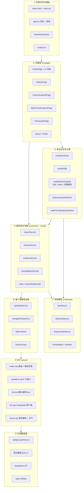
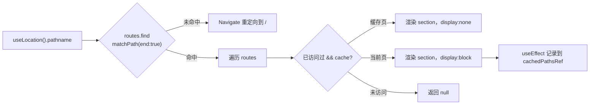
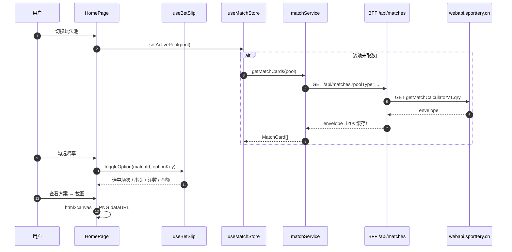
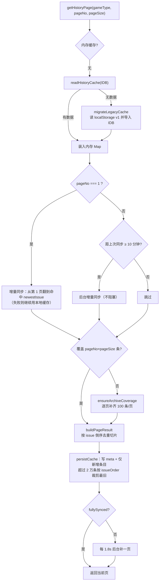
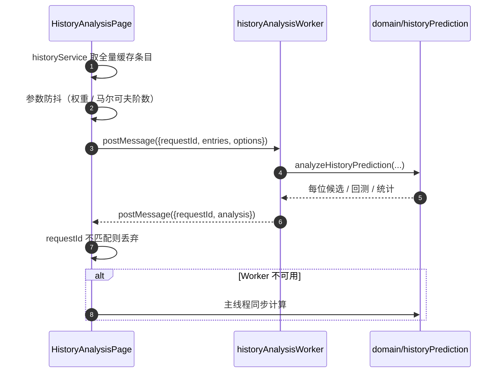
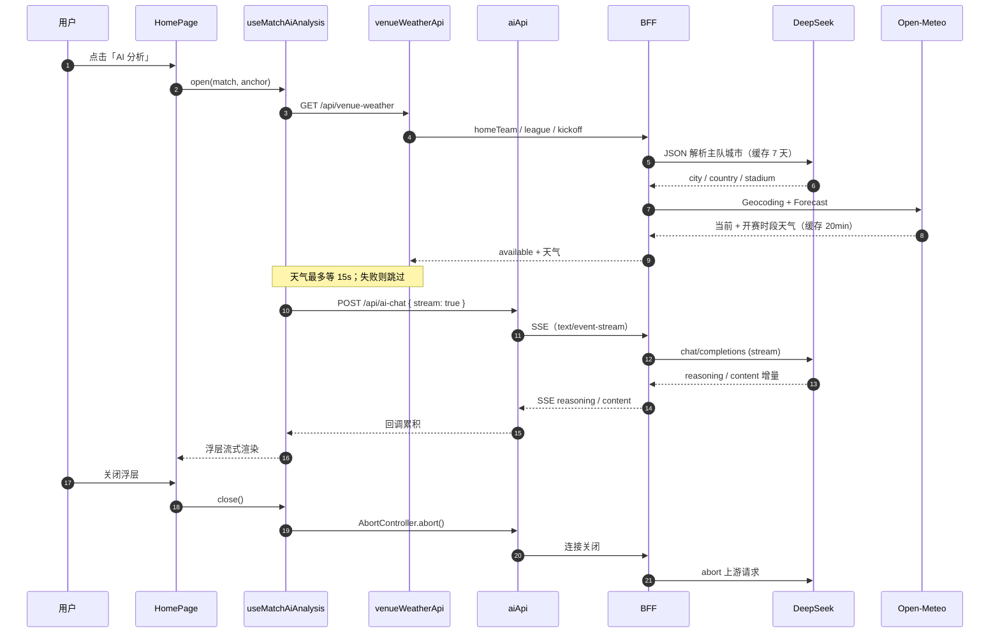
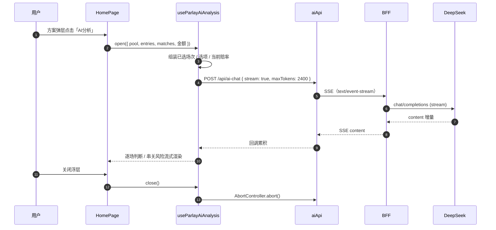

# ticai · 体彩助手 架构说明

> 中国体彩「排列五」开奖历史 + 竞彩足球赔率投注方案 + 两种号码预测分析，附带星座运势 / 天气。
>
> **架构形态**：React SPA 　+　 零依赖 Node BFF（`server/`）。浏览器只与同源 `/api/*` 通信，第三方密钥只存在于服务端。


> 矢量源文件：[architecture.svg](./architecture.svg)（可直接在浏览器打开，或嵌入 PPT / 设计稿）
>
> 架构图由 [`scripts/update-architecture.mjs`](../scripts/update-architecture.mjs) 根据当前仓库文件清单自动生成；
> `pre-commit` hook 会在提交前同步 SVG / PNG，新增模块会自动出现在图中。

---

## 1. 项目速览

| 项目 | 内容 |
| --- | --- |
| 名称 / 版本 | `ticai` 0.0.0（私有） |
| 形态 | SPA + 同源 BFF，单端口可部署（BFF 顺带托管 `dist`） |
| 前端规模 | TS/TSX 53 个文件 ≈ 9 298 行；SCSS 1 个文件 5 104 行 |
| BFF 规模 | `server/` 5 个文件 + `api/` 9 个文件，共 1 908 行；`scripts/` 负责构建、部署与架构图生成 |
| 构建产物 | `dist/assets/index-*.js` ≈ 547 KB（单 chunk）+ 73.7 KB CSS + 2 个 Worker chunk |
| 运行时 | 浏览器（ES2022+）+ Node ≥ 20（内置 `fetch` / `AbortSignal.timeout`） |
| 依赖 | 前端：React 19、React Router 6、Zustand 5、html2canvas、Sass；服务端：**无第三方依赖** |
| 工程设施 | ❌ 无 ESLint / Prettier / 单元测试 / CI；已有本地 Git hooks（密钥扫描、架构图同步、自动部署） |
| tsconfig | `strict` **未开启**；开启 `noUnusedLocals`、`noUnusedParameters`、`erasableSyntaxOnly`、`verbatimModuleSyntax` |

### 功能地图

| 路由 | 页面 | 核心能力 | 数据来源 |
| --- | --- | --- | --- |
| `/` | 赛事投注 | 5 种玩法池、赔率勾选、串关注数/金额/最高奖金/税、首屏骨架屏、方案级 AI 串关分析、高清快照 | `GET /api/matches` |
| `/history` | 开奖历史 | 排列五开奖列表、走势图、预测摘要 | `GET /api/history` + IndexedDB |
| `/history-analysis` | 分析页面 | 频次/遗漏/马尔可夫/滚动回测/组合推荐/冷热统计 | 本地 IndexedDB 数据 |
| `/math-trend-analysis` | 数学走势 | 线性回归趋势、预测中心、波动率、大样本回测 | 本地 IndexedDB 数据 |
| `/horoscope` | 星座运势 | 12 星座 × 5 种时间维度 + 基于 IP 的天气 | `/api/horoscope`、`/api/weather`、`/api/ip` |
| `/about` | 关于页 | Keep-Alive 演示（输入框保留） | 无 |
| `/profile` | 个人页 | 不缓存演示，**不在导航中** | 无 |

---

## 2. 技术栈与运行方式

| 关注点 | 选型 |
| --- | --- |
| 视图 | React 19.2 函数组件 + Hooks，无 UI 组件库，手写语义化 class |
| 类型 | TypeScript 6.0，`import type` 风格，无 `enum` |
| 构建 | Vite 8 + `@vitejs/plugin-react`，`tsc && vite build`，无自定义分包 |
| 路由 | react-router-dom 6，但**不用 `<Routes>`**，自研 `KeepAliveRoutes` |
| 状态 | Zustand 5（`matchStore`）+ 自定义 hook（`useBetSlip`） |
| 样式 | 单个 `src/styles/global.scss`（BEM，3 534 行） |
| 计算 | Web Worker（`type: 'module'`）承载预测算法，另有主线程降级路径 |
| 持久化 | IndexedDB（开奖历史）；localStorage 仅剩迁移入口与死代码 |
| 传输 | 浏览器 `fetch('/api/*')` → BFF；BFF 用 Node `fetch` 访问上游 |
| 截图 | html2canvas → `canvas.toDataURL('image/png')` |

### 运行方式

```bash
npm install
cp .env.example .env        # 填入聚合数据密钥（BFF 专用）

npm run dev                 # BFF :3000 + Vite :5173（/api 走代理）
npm run dev:api             # 只起 BFF
npm run dev:web             # 只起前端

npm run build && npm start   # 生产：单进程，:3000 同时提供 dist 与 /api
```

| 环境变量 | 默认值 | 说明 |
| --- | --- | --- |
| `HOST` / `PORT` | `127.0.0.1` / `3000` | BFF 监听地址；默认只绑本机 |
| `SERVE_STATIC` | `1` | 是否由 BFF 托管 `dist`（反代部署可设 `0`） |
| `UPSTREAM_TIMEOUT_MS` | `8000` | 上游请求超时 |
| `JUHE_WEATHER_KEY` | — | 缺失时 `/api/weather` 返回 503 |
| `JUHE_HOROSCOPE_KEY` | — | 缺失时 `/api/horoscope` 返回 503 |
| `JUHE_IP_KEY` | — | 缺失时 `/api/ip` 返回空归属地（前端回退默认城市） |
| `DEEPSEEK_API_KEY` | — | `/api/ai-chat` 与比赛地城市解析；缺失时 503 / 天气降级 |
| `DEEPSEEK_MODEL` | `deepseek-flash` | 也可用 `deepseek-v4-pro` |
| `DEEPSEEK_BASE_URL` | `https://api.deepseek.com` | OpenAI 兼容接口地址 |
| `DEEPSEEK_TIMEOUT_MS` | `60000` | 大模型上游超时 |
| `AI_RATE_LIMIT_PER_MIN` | `10` | `/api/ai-chat` 单实例限流 |
| `VENUE_RATE_LIMIT_PER_MIN` | `20` | `/api/venue-weather` 单实例限流 |
| `SPORTTERY_BASE` / `JUHE_*_BASE` | 官方地址 | 指向 mock 服务即可离线联调 |

### 分层与依赖规则



**依赖规则（实际执行情况）**

- `pages → features/betting`：只有赛事投注页有 UI 拆分，其余页面仍自包含。
- `pages → service → api/httpClient → /api/*`：统一传输层，**前端不再出现任何上游域名或密钥**。
- `pages → domain`：分析页直接调用纯函数算法（`HistoryAnalysisPage` 通过 Worker）。
- `domain` 不依赖 React/DOM，可被 Worker 直接复用。
- `server/*` 不依赖前端代码，只通过 HTTP 契约耦合。

---

## 3. 目录结构

```text
D:\ticai
├─ index.html                  # 挂载点 <div id="app">
├─ vite.config.ts              # /api → BFF 代理（端口从 .env 读取）
├─ tsconfig.json               # bundler 模式、noEmit、未开 strict
├─ package.json                # dev / dev:api / dev:web / build / start / preview
├─ .env / .env.example         # BFF 密钥与端口（.env 已被 .gitignore 忽略）
├─ public/                     # favicon.svg、icons.svg
├─ server/                     # ★ 零依赖 Node BFF
│  ├─ index.mjs                # HTTP 服务、路由分发、静态托管、SPA fallback、优雅退出
│  ├─ handlers.mjs             # /api/matches|history|horoscope|weather|ip|ai-chat|venue-weather|health
│  ├─ llm.mjs                  # DeepSeek 客户端（OpenAI 兼容 /chat/completions）
│  ├─ venue.mjs                # 主队城市解析（DeepSeek）+ Open-Meteo 比赛地天气
│  └─ lib.mjs                  # .env 解析、TTL/LRU 缓存、超时 fetch、JSON body、静态文件
├─ scripts/
│  ├─ dev.mjs                  # 并行拉起 BFF + Vite，任一退出则联动关闭
│  ├─ ai-smoke.mjs             # npm run ai:check 密钥连通性自检
│  ├─ update-architecture.mjs  # 按文件清单生成 architecture.svg/.png
│  ├─ install-git-hooks.mjs    # 安装 pre-commit / pre-push hooks
│  ├─ git-hooks/               # 进仓库的 hook 源文件
│  └─ deploy-local.mjs         # 临时目录构建 + Vercel 预构建部署
└─ src
   ├─ main.tsx                 # createRoot + BrowserRouter + 全局样式
   ├─ App.tsx                  # 顶栏 + 导航 + <AppRouter/>
   ├─ router
   │  ├─ KeepAliveRoutes.tsx   # matchPath + display 切换的缓存路由
   │  ├─ routes.tsx            # appRoutes(7) / navLinks(5)
   │  └─ AppRouter.tsx / types.ts
   ├─ pages
   │  ├─ HomePage.tsx          # 499 行：状态编排 + 组合子组件 + 方案弹层
   │  ├─ HistoryPage.tsx       # 385 行
   │  ├─ HistoryAnalysisPage   # 720 行（仍未拆分）
   │  ├─ MathTrendAnalysisPage # 437 行（仍未拆分）
   │  └─ HoroscopePage / AboutPage / ProfilePage
   ├─ features/betting
   │  ├─ MatchListSkeleton.tsx # 首屏一屏骨架屏（按内容区高度补卡片）
   │  ├─ AiAnalysisPanel.tsx   # 单场 AI 分析浮层 / 移动端底部抽屉
   │  ├─ useMatchAiAnalysis.ts # 单场 SSE 状态机、天气、结果缓存
   │  ├─ ParlayAiAnalysisPanel.tsx # 方案级逐场判断 / 串关风险面板
   │  ├─ useParlayAiAnalysis.ts # 串关 SSE 状态机 + 方案缓存
   │  ├─ parlayAiAnalysis.ts   # 串关提示词、关键风险摘要解析
   │  ├─ aiAnalysis.ts         # 单场提示词构建、推荐摘要解析
   │  ├─ useBetSlip.ts         # 选择态、串关、注数/金额/最高奖金
   │  ├─ betSlipMath.ts        # 纯函数：组合乘积、税率、过关上限、标签格式化
   │  ├─ MatchPoolList.tsx     # 赛事卡片 + 赔率选项 + 混合过关展开 + AI 按钮
   │  ├─ BetSlipFooter.tsx     # 底部投注栏（过关/倍数/金额）
   │  ├─ PlanModal.tsx         # 方案弹层（截图专用元信息）
   │  └─ SnapshotOverlay.tsx   # 截图悬浮窗 + 大图预览
   ├─ storage
   │  └─ historyDb.ts          # ★ IndexedDB 仓储：读写、裁剪、清空
   ├─ service
   │  ├─ historyService.ts     # 缓存状态机（544 行）：内存 + IDB + 增量同步
   │  ├─ matchService.ts       # 赔率 → MatchCard 视图模型
   │  ├─ weatherService.ts     # /api/weather + /api/ip
   │  ├─ constellationService.ts
   │  └─ counterService.ts     # 死代码（无消费方）
   ├─ domain
   │  ├─ historyPrediction.ts  # 1064 行预测算法（纯函数）
   │  ├─ lotteryHistory.ts     # ★ 开奖记录 / 缓存元数据类型
   │  ├─ sporttery.ts / constellation.ts / weather.ts / counter.ts
   ├─ workers                  # 2 个 Worker 协议实现
   ├─ api
   │  ├─ httpClient.ts         # 超时 + AbortSignal + 统一 ApiError
   │  ├─ sportteryApi.ts       # /api/matches、/api/history
   │  ├─ aiApi.ts              # POST /api/ai-chat（askAi / askAiText / askAiStream）
   │  ├─ venueWeatherApi.ts    # GET /api/venue-weather
   │  └─ types.ts              # BffEnvelope<T>
   ├─ styles/global.scss
   └─ assets/                  # 未被引用的图片（可删）
```

---

## 4. 路由与 Keep-Alive

`react-router-dom` 只提供 `BrowserRouter`、`NavLink`、`Navigate`、`matchPath`，**没有 `<Routes>`**：



要点：

1. 访问过的页面常驻 React 树，切换只改 `display`，`useState`/滚动位置保留。
2. **无缓存淘汰**：`cachedPathsRef` 只增不减。
3. `/profile`（`cache: false`）切走即卸载。
4. 只支持精确匹配：无路径参数、无嵌套路由、无 404 页。
5. 副作用常驻：页面的定时器与后台请求在切走后仍运行（`historyService` 的后台补页就是全局单例，不受影响）。

---

## 5. 核心数据流

### 5.1 赛事投注（`/`）



**首屏与方案快照细节**

1. 首屏加载时 `MatchListSkeleton` 读取 `.home-page__content` 的可视高度、单卡高度和 gap，按 `ceil((可视高度 + gap) / (卡片高度 + gap))` 动态补足骨架卡，覆盖一整屏。
2. 方案快照只截 `.plan-modal__card`，不带遮罩和背后的赛事列表；截图倍率按 DPR 取 3～4 倍。
3. 截图副本中隐藏「AI分析 / 截图 / 关闭」操作，并显示仅截图可见的当前玩法、倍数、投注金额与最高奖金；正常弹层不展示这些附加信息。

**投注计算规则（`features/betting/betSlipMath.ts`，纯函数）**

| 概念 | 规则 |
| --- | --- |
| 过关上限 | 胜平负 8 串 1、进球数 6 串 1、比分/半全场 4 串 1、混合 5 串 1 |
| 注数 | 每种串法求「所选选项数的组合乘积」，再跨串法求和（`sumCombinationProducts`） |
| 投注金额 | `注数 × 2 元 × 倍数`，倍数上限 50 |
| 最高奖金 | `Σ 各串法 max(赔率) 乘积 × 2 × 倍数` |
| 彩票税 | 奖金 > 10 000 元按 20% 计税 |
| 截图 | `PlanModal` 根节点 → html2canvas → `toDataURL` → 预览/下载 |

### 5.2 开奖历史：IndexedDB 缓存 + 增量同步



存储设计（`src/storage/historyDb.ts`）：

| 项 | 值 |
| --- | --- |
| 数据库 | `ticai`，version 1 |
| `history_meta` | keyPath `gameType`；同步元数据（页数、已加载页、newestIssue、时间戳） |
| `history_draws` | keyPath `key = ${gameType}:${issue}`；索引 `byGame`、`byGameOrder = [gameType, issueOrder]` |
| 写入策略 | 只写新增条目（按 issue 差集），元数据同事务更新 |
| 容量治理 | 上限 20 000 条，`byGameOrder` 游标删除最旧记录，内存同步裁剪 |
| 旧数据迁移 | 首次读不到 IDB 时导入 `ticai:history-cache:v1`，成功后删除该 key |
| 降级 | 隐私模式等 IDB 不可用 → 纯内存运行（不持久化），页面仍可用 |

### 5.3 分析计算（Worker）



算法要点：近期/长期频次 + 遗漏补偿 + 一阶/二阶转移加权打分；滚动回测 top1/top3；马尔可夫模式后继分布；组合推荐与冷热/和值/跨度统计；数学趋势页额外做线性回归斜率、预测中心、标准差波动率（240 期窗口、120 期起验证）。

> ⚠️ `HistoryPage` 仍在 `useMemo` 里**同步**调用 `analyzeHistoryPrediction`（数据量大时阻塞主线程），与另两页的 Worker 方案不一致，属于遗留项。

### 5.4 比赛 AI 分析（SSE）



要点：

1. 城市解析依赖 DeepSeek，天气来自 Open-Meteo；两者都有缓存，失败时不阻塞分析，只在提示词里标注「天气缺失」。
2. `aiApi` 解析 SSE 的 `reasoning` / `content` / `done` / `error`，前端只拼接文本；流式请求有 120s 总超时。
3. 关闭浮层会 abort 客户端请求，BFF 监听 `res` 的 `close` 事件后同步 abort DeepSeek，避免继续生成。

### 5.5 方案级 AI 串关分析（SSE）



要点：

1. 只分析当前方案已选场次，不额外拉取未选比赛；提示词要求逐场覆盖、不新增比赛。
2. 输出固定包含「总评 / 逐场分析 / 串关建议 / 结论」，解析「整体风险、综合信心、一句话总结」做摘要。
3. 缓存键为「玩法 + 过关方式 + 场次 + 选项」，同一方案重复打开不重复扣费；关闭浮层会 abort SSE。
4. 与单场分析不同，方案级分析不逐场请求比赛地天气，避免 N 场串关产生 N 次城市解析与天气请求。

### 5.6 星座与天气

1. `weatherService.getWeatherByLocation()`：`GET /api/ip` 拿城市 → `GET /api/weather?cityname=`；定位失败回退默认城市 `宝山`。
2. `constellationService.getHoroscope()`：`GET /api/horoscope?consName=&type=`。
3. 两个请求各自 `AbortController`，同一 `reloadSeed` 触发刷新。

---

## 6. BFF 接口契约

| 路径 | 上游 | 入参（均白名单校验） | 缓存 |
| --- | --- | --- | --- |
| `GET /api/matches` | 体彩 `getMatchCalculatorV1` | `poolType` ∈ had/crs/ttg/hafu/mixed | 20 s |
| `GET /api/history` | 体彩 `getHistoryPageListV1` | `gameNo`(4-8 位数字)、`pageNo`≥1、`pageSize`≤100、`provinceId`、`isVerify`、`termLimits` | 60 s |
| `GET /api/horoscope` | 聚合 `constellation/getAll` | `consName` ∈ 12 星座、`type` ∈ 5 种 | 10 min |
| `GET /api/weather` | 聚合 `weather/index` | `cityname`(≤64 字符，去控制字符)、`dtype`、`format` | 10 min |
| `GET /api/ip` | 聚合 `ip/ipNewV3`（可选） | 无（取连接 IP / `x-forwarded-for`） | 30 min |
| `POST /api/ai-chat` | DeepSeek `chat/completions` | JSON body：`messages`（≤40 条、单条 ≤15000 字符、合计 ≤30000 字符）、`temperature`、`maxTokens`、`json`、`thinking`、`reasoningEffort`、`stream` | 无 |
| `GET /api/venue-weather` | DeepSeek 城市解析 + Open-Meteo | `homeTeam`、`league`、`kickoff`、`teamId` | 城市 7 天；天气 20 min |
| `GET /api/health` | — | 无 | 无 |

响应形态三类：

- **体彩信封原样透传**：`{ success, errorCode, errorMessage, value }`（前端 `sportteryApi` 逻辑不变）。
- **BFF 统一信封**：`{ success, data }` 或 `{ success:false, errorMessage }`（天气/星座/IP/AI）。
- **SSE**：`/api/ai-chat` 传 `stream: true` 时返回 `text/event-stream`，事件为 `reasoning`/`content`/`done`/`error`。

比赛 AI 分析链路：`MatchPoolList` → `useMatchAiAnalysis` → `GET /api/venue-weather`（DeepSeek 解析主队城市 + Open-Meteo 天气）
→ `askAiStream` → `POST /api/ai-chat`（SSE）→ DeepSeek。城市解析失败时返回 `available:false`，分析继续但注明天气缺失。
方案 AI 链路：`PlanModal` → `useParlayAiAnalysis` → `buildParlayAnalysisMessages`（只包含已选场次）→ `POST /api/ai-chat`（SSE）→ DeepSeek；
按「玩法 + 过关方式 + 场次 + 选项」缓存，关闭时 abort。
服务端在首个增量前不写响应头，因此参数/鉴权/限流错误仍按普通 JSON 错误返回；结果按 `pool:matchId` 缓存在页面内存。
关闭浮层时前端 `AbortController` 取消请求，BFF 在 `res` 的 `close` 事件里同步中止 DeepSeek 上游；天气查询最多等 15s，超时按缺失处理。

错误约定：参数非法 `400`、请求体过大 `413`、方法不允许 `405`、未知接口 `404`、上游失败 `502`、上游超时 `504`、缺密钥 `503`、AI 限流 `429`。

安全姿态：

- 密钥仅存在于服务端 `.env`；构建产物中**已确认不含任何密钥或上游域名**。
- 默认只监听 `127.0.0.1`，且无 CORS 头（仅同源可用）。
- 入参全部白名单/类型校验，不透传任意 query。
- `/api/ai-chat` 有单实例内存限流（默认 10 次/分钟/IP），但**没有鉴权**：公网部署前仍需登录或网关限流，否则密钥额度会被他人消耗。
- `/api/venue-weather` 另有限流（默认 20 次/分钟/IP），且城市解析结果与天气均缓存，避免重复调用模型与上游。
- ⚠️ 其余接口**没有鉴权与限流**：一旦对外暴露，配额仍可能被刷；对外部署需前置网关鉴权或在 BFF 增加限流。

---

## 7. 持久化与缓存

| 存储 | key / store | 写入方 | 内容 | 生命周期 |
| --- | --- | --- | --- | --- |
| IndexedDB | `ticai` → `history_meta` / `history_draws` | `historyService` | 全量开奖条目 + 同步元数据（上限 2 万条） | 持久，按 issueOrder 裁剪 |
| localStorage | `ticai:history-cache:v1` | 旧版本 | 仅剩迁移来源，迁移成功后删除 | 一次性 |
| localStorage | `ticai_counter_value` | `counterService` | 单个数字（死代码） | 永久 |
| 内存 | `cacheByGame`（Map） | `historyService` | 会话内权威缓存 | 页面刷新即丢 |
| 内存 | `matchStore.poolCache` | `matchStore` | 5 个玩法池 `{loading,error,cards,fetched}` | 刷新即丢 |
| 内存 | 组件 state | `HomePage` | 选择态、弹层、截图 dataURL | 卸载即丢 |

---

## 8. 关键设计取舍

1. **BFF 而非直连**：密钥不出服务端、同源消除 HTTPS 混合内容、上游超时与错误映射集中一处；代价是多一个需要部署的进程。
2. **零依赖 Node BFF**：不引入 Express/Fastify，用 `node:http` + 内置 `fetch`，避免供应链与安装成本；代价是路由/静态服务手写（已限制在 147 行内）。
3. **IndexedDB 而非 localStorage**：开奖数据是只追加序列，5 MB 配额与"整份重写"都不合适；改为 meta + 单条记录两 store，只写增量、按序裁剪。
4. **内存 Map 为权威、IDB 为持久化**：读路径零 await 抖动，写入异步且失败静默降级，保证弱网/隐私模式仍可用。
5. **自研 Keep-Alive**：React Router 6 无内置方案，`display:none` + 常驻挂载成本最低；代价是无淘汰、无懒加载。
6. **视图模型下沉到 service**：`MatchCard` 让页面不感知 `ttg/crs/had/hafu` 原始字段。
7. **投注逻辑抽成纯函数 + hook**：`betSlipMath.ts` 可独立测试，`useBetSlip` 让页面只做编排。

---

## 9. 风险与技术债

### 高

| # | 问题 | 位置 | 影响 |
| --- | --- | --- | --- |
| 1 | BFF 无鉴权/限流 | `server/index.mjs` | 对外暴露时配额可被刷；建议前置网关或加 IP 限流 |
| 2 | 单进程、无重试、无熔断 | `server/lib.mjs` | 上游抖动时直接 502/504；进程重启后缓存全冷 |
| 3 | 部署必须提供 `.env` | `.env.example` | 缺密钥时天气/星座 503（页面显示错误态），但赛事与开奖仍可用 |

### 中

| # | 问题 | 位置 | 影响 |
| --- | --- | --- | --- |
| 4 | 分析页仍巨型 | `HistoryAnalysisPage` 720 行、`MathTrendAnalysisPage` 437 行 | 与已拆分的 `HomePage` 风格不一致，复用困难 |
| 5 | `HistoryPage` 主线程同步跑算法 | `HistoryPage.tsx:81` | 数据量大时切页卡顿 |
| 6 | 单文件全局样式 5 104 行 | `global.scss` | 无作用域隔离，删除困难 |
| 7 | 单 chunk 547 KB，无懒加载 | 构建产物 | 首屏体积偏大，超 Vite 500 KB 告警线 |
| 8 | 类型宽松 | 领域类型含 `[key: string]: unknown`；`strict` 未开 | 接口字段漂移无法在编译期发现 |
| 9 | 截图以 base64 常驻 state | `HomePage.tsx` | 多次截图累积数 MB 内存 |
| 10 | 缓存无 TTL 过期 | `historyService.ts` | 老数据长期保留（裁剪只按数量） |
| 11 | 无 ESLint / Prettier / 测试 / CI | 全仓 | 重构缺乏自动化保护（本次改造依赖手工 CDP 冒烟） |

### 低

| # | 问题 | 说明 |
| --- | --- | --- |
| 12 | 死代码 | `useCounterStore` / `counterService` / `domain/counter.ts` / `matchStore.addMockCard` / `src/assets/*` |
| 13 | 移动端横向溢出 | 430 px 视口下玩法标签与底部栏仍有被裁切的风险；列表切换的横向滚动条已通过 `overflow-x: hidden` 消除 |
| 14 | 错误边界缺失 | 任一页面抛错仍会整页白屏；加载态已补一屏骨架屏 |
| 15 | 无 404 路由 | 未知路径统一重定向首页 |

---

## 10. 演进建议

1. **BFF 加固**：加 IP 维度限流、简单 token 鉴权、`/api/health` 探活接入编排；必要时换 Fastify 以获得成熟中间件。
2. **测试基线**：给 `betSlipMath.ts`、`historyPrediction.ts`、`historyDb.ts` 加 Vitest（纯函数/仓储，收益最高）；把本次的 CDP 冒烟固化成 `scripts/smoke.mjs`。
3. **继续拆页面**：`HistoryAnalysisPage` 按「参数面板 / 每位明细 / 统计卡」拆分，复用 `useAnalysisWorker`。
4. **分包与懒加载**：路由级 `React.lazy` + 手动 chunk（worker 已独立，主 chunk 约 547 KB）。
5. **样式模块化**：按页拆 `*.module.scss`，`global.scss` 只留 reset 与设计 token。
6. **缓存治理**：加 TTL 与"最近访问"策略；超范围分页明确返回空态提示。

---

## 11. 本次改造记录

| 项 | 改造前 | 改造后 |
| --- | --- | --- |
| 第三方密钥 | 硬编码在 `weatherService` / `constellationService` | 仅在本地 `.env` 与 Vercel 环境变量，由 BFF 读取；bundle 已扫描确认无泄漏 |
| 生产请求地址 | `http://` 直连（HTTPS 站点必被拦截） | 同源 `/api/*`，由 BFF 转发 |
| IP 定位 | 依赖仓库外的 `localhost:3000/api/ip`（无实现） | BFF 实现 `/api/ip`，未配置密钥时优雅降级 |
| 上游治理 | 无缓存、无超时、错误靠文案 | 白名单校验 + TTL 缓存 + 8 s 超时 + 统一错误码 |
| 开奖缓存 | localStorage 单 key 全量，超 5 MB 静默失败 | IndexedDB 两 store，增量写入，2 万条上限裁剪，旧数据自动迁移 |
| 首页 | `HomePage.tsx` 916 行、12 个 `useState` | 499 行 + `features/betting`（hook + 组件 + AI + 快照） |
| 构建 | `npm run build` 失败（`main.tsx` 未使用 React 导入） | 通过，退出码 0 |

### 2026-10-21 增量

| 项 | 内容 |
| --- | --- |
| 首屏骨架屏 | 按内容区高度动态计算卡片数量，覆盖一整屏；切换玩法也复用同一套骨架 |
| 方案级 AI | 弹层内「AI分析」逐场判断已选比赛 + 串关风险；SSE 流式、方案维度缓存、关闭 abort |
| 方案快照 | 只截白色弹框、3～4 倍 DPR 输出、隐藏操作控件；截图副本显示玩法/倍数/金额/最高奖金 |
| 自动交付 | `pre-commit` 同步架构图 + 密钥扫描；`pre-push` 自动 Vercel 预构建部署；hook 源文件已进仓库 |
| 部署隔离 | 使用系统临时目录 + 项目 ID 构建，不依赖仓库根 `.vercel`，避免权限/密钥目录问题 |
| 交互修复 | 玩法切换动画导致的短暂横向滚动条通过内容区 `overflow-x: hidden` 消除 |

**验证证据（本次实跑）**

| 验证项 | 结果 |
| --- | --- |
| `tsc --noEmit` / `npm run build` | 通过，退出码 0 |
| 8 个接口实测（真实上游） | `matches/history/horoscope/weather/ip/ai-chat/venue-weather/health` 均正常；`400/404/405/429` 分支正确 |
| AI 分析链路（真实 DeepSeek） | SSE 增量、关闭 abort、比赛地天气、120s 流式超时均实测 |
| 本地预构建部署 | `vercel build --prebuilt` 上传，云端仅托管；函数产物已剔除 `.env` |
| 生产构建 5 个路由（CDP 驱动 Chrome） | 全部渲染出真实数据，**0 exception、0 console error** |
| 存储层集成测试 | localStorage 3 条 → IDB 迁移成功且旧 key 删除；裁剪 3→2 保留最新；新页面从 IDB 读回 2 条 |
| 真实应用写入 IDB | 访问 `/history` 后落库 100 条（期号 26177–26276），新页面读回一致 |
| 投注计算 | 2 场各选 1 项 → 2串1 = 1 注 = 2 元；2 倍 → 4 元；最高奖金 280 元；方案弹层 2 条 |
| 截图链路 | 弹层截图生成 `data:image/png` 并出现缩略图 |
| 布局回归 | 拆分前后 430×932 截图一致（含既有的横向溢出问题） |

---

## 12. 关键文件索引

| 关注点 | 文件 |
| --- | --- |
| BFF 入口 / 路由 | [server/index.mjs](../server/index.mjs) |
| BFF 接口实现 | [server/handlers.mjs](../server/handlers.mjs) |
| BFF 基础设施 | [server/lib.mjs](../server/lib.mjs) |
| 开发双进程脚本 | [scripts/dev.mjs](../scripts/dev.mjs) |
| 环境变量样例 | [.env.example](../.env.example) |
| 构建与代理 | [vite.config.ts](../vite.config.ts) |
| 应用入口 / 外壳 | [src/main.tsx](../src/main.tsx)、[src/App.tsx](../src/App.tsx) |
| 缓存路由 | [src/router/KeepAliveRoutes.tsx](../src/router/KeepAliveRoutes.tsx) |
| 投注页 | [src/pages/HomePage.tsx](../src/pages/HomePage.tsx) |
| 投注逻辑 | [src/features/betting/useBetSlip.ts](../src/features/betting/useBetSlip.ts)、[betSlipMath.ts](../src/features/betting/betSlipMath.ts) |
| 投注组件 | [MatchPoolList.tsx](../src/features/betting/MatchPoolList.tsx)、[MatchListSkeleton.tsx](../src/features/betting/MatchListSkeleton.tsx)、[BetSlipFooter.tsx](../src/features/betting/BetSlipFooter.tsx)、[PlanModal.tsx](../src/features/betting/PlanModal.tsx)、[SnapshotOverlay.tsx](../src/features/betting/SnapshotOverlay.tsx) |
| 单场 AI | [AiAnalysisPanel.tsx](../src/features/betting/AiAnalysisPanel.tsx)、[useMatchAiAnalysis.ts](../src/features/betting/useMatchAiAnalysis.ts)、[aiAnalysis.ts](../src/features/betting/aiAnalysis.ts) |
| 方案 AI | [ParlayAiAnalysisPanel.tsx](../src/features/betting/ParlayAiAnalysisPanel.tsx)、[useParlayAiAnalysis.ts](../src/features/betting/useParlayAiAnalysis.ts)、[parlayAiAnalysis.ts](../src/features/betting/parlayAiAnalysis.ts) |
| 自动交付 | [scripts/update-architecture.mjs](../scripts/update-architecture.mjs)、[scripts/deploy-local.mjs](../scripts/deploy-local.mjs)、[scripts/git-hooks](../scripts/git-hooks)、[AGENTS.md](../AGENTS.md) |
| 开奖缓存 | [src/service/historyService.ts](../src/service/historyService.ts) |
| IndexedDB 仓储 | [src/storage/historyDb.ts](../src/storage/historyDb.ts) |
| 预测算法 | [src/domain/historyPrediction.ts](../src/domain/historyPrediction.ts) |
| 传输层 | [src/api/httpClient.ts](../src/api/httpClient.ts)、[src/api/sportteryApi.ts](../src/api/sportteryApi.ts) |
| 样式 | [src/styles/global.scss](../src/styles/global.scss) |
